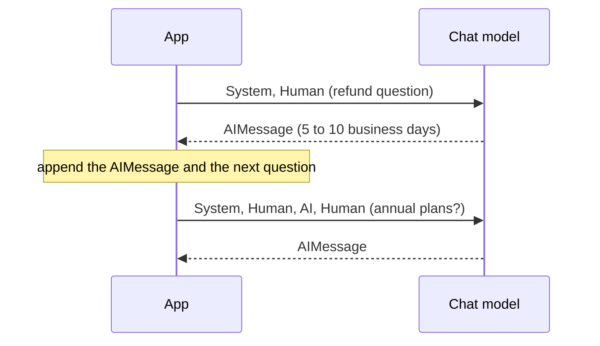

# M07.4 Theory: Inputs and outputs: messages, LLM vs chat model

*[M07 theory](../README.md) · Lesson 7.4 · Notebooks: [`04a_LangChain_Inputs_and_Outputs.ipynb`](../../../../course/p03_langchain_and_langgraph/m07_langchain_core/notebooks/04a_LangChain_Inputs_and_Outputs.ipynb), [`04b_LLM_vs_ChatModel.ipynb`](../../../../course/p03_langchain_and_langgraph/m07_langchain_core/notebooks/04b_LLM_vs_ChatModel.ipynb) · [All theory pages](../../../README.md)*

## Messages

A chat model reads a list of messages, each with a role:

| Class | Role | Holds |
|---|---|---|
| `SystemMessage` | `system` | the instructions for the whole conversation |
| `HumanMessage` | `user` | what the user said |
| `AIMessage` | `assistant` | a reply from the model, including earlier replies you send back |

The OpenAI-style spelling, `{"role": "user", "content": "..."}`, works too: LangChain converts each dict to the matching class before the call (`convert_to_messages` shows the result). Tool results add a fourth class, `ToolMessage`, in M23.

A chat model keeps no state between calls. To continue a conversation, the app appends the model's `AIMessage` and the next question to the list and sends the whole list again:



In notebook 04a, "What did we discuss so far?" gets an answer only because the earlier turns are in the list. Two consequences follow for Larkspur's assistant. Every earlier turn is paid for again as input tokens on every call, so history needs a bound (M33). And the history is just data your app holds, so it can be trimmed, summarised or filtered before it is sent. In a template, history goes in a `MessagesPlaceholder` ([lesson 7.5](../05_prompt_templates_and_few_shot_composition/README.md#prompt-templates)).

For several conversations at once, `.batch()` takes a list of inputs and returns a list of `AIMessage`. The older `.generate()` takes a list of message lists and returns an `LLMResult`, whose `generations` is a nested list (one entry per conversation) and whose `llm_output["token_usage"]` sums the batch.

## LLM vs chat model

LangChain has two model interfaces:

| Interface | In and out | Classes in notebook 04b |
|---|---|---|
| `BaseLLM` | a string in, a string out | `OpenAI` (`gpt-3.5-turbo-instruct`), `HuggingFaceEndpoint`, `HuggingFacePipeline` |
| `BaseChatModel` | messages in, an `AIMessage` out | `ChatOpenAI`, `ChatGoogleGenerativeAI`, `ChatHuggingFace` |

Both accept both shapes, because LangChain first turns the input into a `PromptValue` and then asks it for the shape the model needs. With `langchain-core` 1.7.0 (empty fields left out of the printout):

```python
from langchain_core.messages import HumanMessage, SystemMessage
from langchain_core.prompt_values import ChatPromptValue, StringPromptValue

StringPromptValue(text="How long does a refund take?").to_messages()
# [HumanMessage(content='How long does a refund take?')]

ChatPromptValue(messages=[
    SystemMessage("Answer only from the passages."),
    HumanMessage("How long does a refund take?"),
]).to_string()
# 'System: Answer only from the passages.\nHuman: How long does a refund take?'
```

A string sent to a chat model becomes one `HumanMessage`, so nothing is lost. A message list sent to a completion model is flattened into `System:` and `Human:` lines of plain text, which the model continues like any other text; the system instruction becomes a hint instead of a role it was trained to follow. That is why every chain in this course uses a chat model, and why a completion model appears only in notebook 04b, for contrast.

---
*Previous: [7.2 Commercial LLMs natively and with LangChain](../02_commercial_llms_natively_and_with_langchain/README.md). Next: [7.5 Prompt templates and few-shot composition](../05_prompt_templates_and_few_shot_composition/README.md).*
