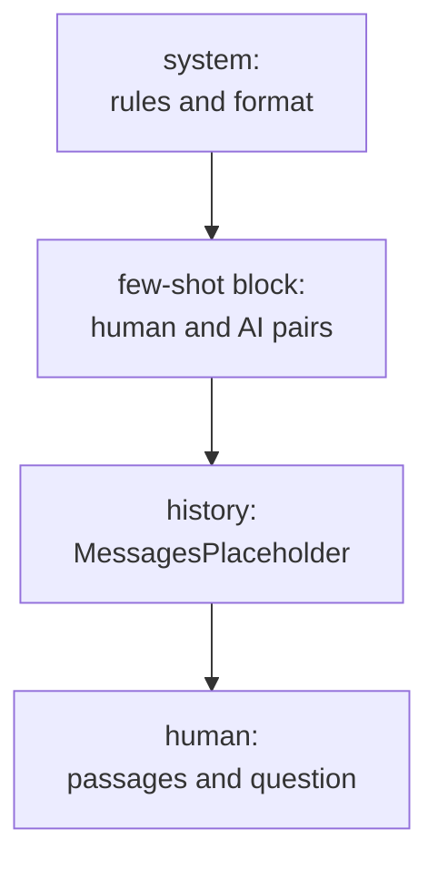

# M07.5 Theory: Prompt templates and few-shot composition

*[M07 theory](../README.md) · Lesson 7.5 · Notebooks: [`05a_Prompt_Templates.ipynb`](../../../../course/p03_langchain_and_langgraph/m07_langchain_core/notebooks/05a_Prompt_Templates.ipynb), [`05b_Few_Shot_Composition_and_Serialization.ipynb`](../../../../course/p03_langchain_and_langgraph/m07_langchain_core/optional/05b_Few_Shot_Composition_and_Serialization.ipynb) (optional) · [All theory pages](../../../README.md)*

## Prompt templates

A prompt template is a function from variables to a prompt. It has `{slots}` filled with Python's `str.format` syntax, and it comes in two kinds:

| Class | Produces | Use with |
|---|---|---|
| `PromptTemplate` | a `StringPromptValue`: one string | completion models, or one human message |
| `ChatPromptTemplate` | a `ChatPromptValue`: a list of role-tagged messages | chat models, and anything with a system prompt or history |

Both work with a chat model, because a string becomes one `HumanMessage` ([lesson 7.4](../04_inputs_and_outputs_messages_llm_vs_chat_model/README.md#llm-vs-chat-model)). `ChatPromptTemplate.from_template("Explain {topic}")` is exactly `from_messages([("human", "Explain {topic}")])`; the notebook compares the two and gets the same messages. Use `from_messages` whenever there is a system prompt.

Three calls fill a template. `.format()` returns a plain string; `.format_prompt()` and `.invoke()` return the `PromptValue`. `.invoke()` takes a dict, and it is the call an LCEL chain makes for you.

The Larkspur answer prompt, with a slot for the parser's format instructions and one for the conversation so far:

```python
from langchain_core.prompts import ChatPromptTemplate, MessagesPlaceholder

prompt = ChatPromptTemplate.from_messages([
    ("system", "Answer from the Larkspur Cloud handbook passages only.\n{format_instructions}"),
    MessagesPlaceholder("history"),
    ("human", "Passages:\n{passages}\n\nQuestion: {question}"),
])
prompt.input_variables
# ['format_instructions', 'history', 'passages', 'question']
prompt.partial(format_instructions=parser.get_format_instructions()).input_variables
# ['history', 'passages', 'question']
```

`.partial()` fills a slot once, at build time, so callers never pass it. `MessagesPlaceholder` takes a whole list of messages at call time, which is where the history from lesson 7.4 goes.

Two of these template mistakes raise and two pass without a word. Each was checked against `langchain-core` 1.7.0:

| Mistake | What happens |
|---|---|
| A typo in the `input_variables` you pass | The list is recomputed from the template text and the typo disappears. Only `validate_template=True` raises. |
| A variable left out at format time | `KeyError` names it. This one is loud. |
| Literal JSON braces in a template, `{"answer": ...}` | `"answer"` becomes a variable, and formatting raises `KeyError`. Double the braces: `{{"answer": ...}}`. |
| `.partial()` for a slot the template does not have | Ignored without an error; the value never reaches the model (lesson 7.6 shows this in a course notebook). |

Printing `input_variables` and the formatted messages once, before the first model call, catches the silent pair.

## Few-shot and composition

Examples in the prompt steer both the answer and its format. Notebook 05b puts nine labelled reviews into one template string; the classes keep examples as data instead:

- `FewShotPromptTemplate` formats a list of example dicts with an `example_prompt` and adds a `suffix` holding the real input. Adding an example is appending a dict.
- `FewShotChatMessagePromptTemplate` (optional notebook [`07e_prompt_templates_all.ipynb`](../../../../course/p03_langchain_and_langgraph/m07_langchain_core/optional/07e_prompt_templates_all.ipynb)) turns each example into a human message and an AI reply, and slots the block into a `ChatPromptTemplate` between the system prompt and the question.

For Larkspur, one or two examples of a question, its passages and the exact JSON answer show the model the citation format better than a description of it. Examples written inside a template string need their braces doubled, as in notebook 05b.



Templates compose with `+`. Adding two `PromptTemplate` objects concatenates the text and merges the variables: a passages part plus a question part gives one template with `['passages', 'question']`. `ChatPromptTemplate` objects add the same way, message list to message list. `PipelinePromptTemplate`, the 0.x class for this, is in neither `langchain-core` 1.7.0 nor `langchain-classic`.

A template is data, so it can be versioned like code. In 1.x, `dumps` and `loads` from `langchain_core.load` save and restore it as JSON. `loads` takes `allowed_objects=[PromptTemplate]`: deserialising rebuilds objects from the file's contents, so you name the classes you trust. The older `.save()` still runs and warns that it was deprecated in `langchain-core` 1.2.21 and will be removed in 2.0.0.

## Key Takeaways

- Use `ChatPromptTemplate.from_messages` whenever there is a system prompt or history. Fill fixed slots once with `.partial()` and pass history through a `MessagesPlaceholder`.
- Double literal JSON braces in templates, and print `input_variables` and the formatted messages once before the first call, since a typo or an unused partial fails silently.
- Keep few-shot examples as data in a few-shot template, compose templates with `+`, and save them with `dumps` and `loads`, naming the classes you trust.

## Check yourself

<details>
<summary>1. In the Larkspur answer prompt, why do the input variables drop from four names to three after calling partial for the format instructions?</summary>

`.partial()` fills the `format_instructions` slot once, at build time, so callers never pass it. What remains is `history`, `passages` and `question`; `history` is a `MessagesPlaceholder` that takes a whole message list at call time.

</details>

<details>
<summary>2. You want the model to return Larkspur answers in an exact JSON citation format. Should you describe the format or show it, and what must you watch for?</summary>

Show it. One or two examples of a question, its passages and the exact JSON answer show the citation format better than a description; `FewShotChatMessagePromptTemplate` adds each as a human message and an AI reply. Examples written inside a template string need their braces doubled, or `"answer"` becomes a variable and formatting raises `KeyError`.

</details>

<details>
<summary>3. Two of the four template mistakes pass without an error. Which two, and how do you catch them?</summary>

A typo in the `input_variables` you pass, which is recomputed from the template text unless `validate_template=True`, and `.partial()` for a slot the template does not have, which is ignored. Printing `input_variables` and the formatted messages once, before the first model call, catches both.

</details>

---
*Previous: [7.4 Inputs and outputs: messages, LLM vs chat model](../04_inputs_and_outputs_messages_llm_vs_chat_model/README.md). Next: [7.6 Output parsers](../06_output_parsers/README.md).*
