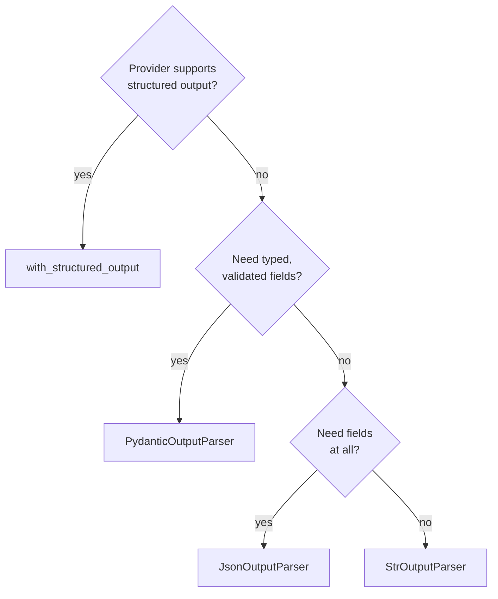

# M07.7 Theory: LangChain 1.x recap course, ending in a structured-output Q&A bot

*[M07 theory](../README.md) · Lesson 7.7 · Notebooks: [`07a_smart_bot_section1.ipynb`](../../../../course/p03_langchain_and_langgraph/m07_langchain_core/notebooks/07a_smart_bot_section1.ipynb), [`07f_output_parsers_demo.ipynb`](../../../../course/p03_langchain_and_langgraph/m07_langchain_core/optional/07f_output_parsers_demo.ipynb) (optional), [`07g_output_parsers_final.ipynb`](../../../../course/p03_langchain_and_langgraph/m07_langchain_core/optional/07g_output_parsers_final.ipynb) (optional) · [All theory pages](../../../README.md)*

## Structured output

`llm.with_structured_output(Schema)` returns a new runnable that outputs an instance of the schema. Unlike a parser, it sends the schema to the provider with the request instead of writing it into the prompt, and providers that support structured output constrain the reply to it. Notebook 07g's advice is to prefer it over `PydanticOutputParser` for any model that supports it.

| | `PydanticOutputParser` | `with_structured_output` |
|---|---|---|
| Where the schema goes | into the prompt, as format instructions (748 characters for the lesson 7.6 schema) | to the provider's API |
| Which models | any model that follows instructions | models with structured-output or tool-calling support |
| Prose around the JSON, fences, trailing notes | repaired or raised by the parser | not produced when the provider constrains the reply |
| Values the schema allows but your app does not | pass | pass |

The last row is the same for both. A schema bound to the model still lets through a made-up passage id if `citations` is `list[str]`, so the lesson 7.6 rule holds: put every rule you can into the schema, with `Literal` for ids and fixed labels.

Notebook 07a builds `SmartQABot` on this: a `ChatPromptTemplate` with a system prompt and a `{question}` slot, piped into `ChatOpenAI(...).with_structured_output(QAResponse)`. `QAResponse` has five fields: `answer`, `confidence`, `reasoning`, `follow_up_questions` and `sources_needed`. Two of its choices are worth copying, and two are worth fixing before Larkspur uses the pattern:

- **Copy: a fallback object.** `ask()` catches any exception and returns a valid `QAResponse` with `confidence="low"` and the error in `reasoning`, so the caller always gets the same type back.
- **Copy: tracing.** `@traceable` sends every call to LangSmith when `LANGSMITH_API_KEY` is set, so a bad answer can be traced to its exact prompt and reply.
- **Fix: `confidence` is a `str`.** Its description asks for high, medium or low, but nothing enforces it; `Literal["high", "medium", "low"]` would.
- **Fix: `ask_batch()` has no fallback.** It calls `chain.batch(inputs)`, and by default `batch` raises the first exception and loses every result. Checked with a three-input batch whose middle input fails: plain `batch` raises, `batch(..., return_exceptions=True)` returns the two results with the exception in place of the middle one.

For the lab brief, the same shape answers Larkspur's refund question: `CitedAnswer` from lesson 7.6 as the schema, the three passages and the question in the human message, and a fallback that says the handbook could not be checked instead of guessing.

---
*Previous: [7.6 Output parsers](../06_output_parsers/README.md). Next: [M07 interview questions](../README.md#interview-spotlight-5-questions-you-might-get-asked).*
