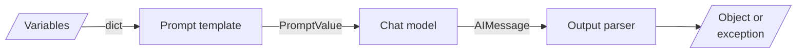

# M07 Theory: LangChain Core: Models, Prompts & Parsers

*Part III · LangChain & LangGraph Fundamentals · [Module README](../../../course/p03_langchain_and_langgraph/m07_langchain_core/README.md) · [All theory pages](../../README.md)*

Every LangChain program in this course has the same three parts: a prompt template that turns variables into messages, a chat model that turns messages into an `AIMessage`, and an output parser that turns the `AIMessage` into something your code can use. The M07 notebooks build on four ideas: chat models, messages, prompt templates and output parsers. Each idea has a page in the folder of the lesson that teaches it, listed under [Lessons](#lessons). This page has the overview, the interview questions and the takeaways.

The running example is the Larkspur Cloud support assistant that M11 to M13 build, at the step after retrieval. It holds three handbook passages (`refund-window`, `refund-timing` and `billing`) for the question *How long does a refund take?* and must return a JSON answer with a list of the passages it cites. That is the module's lab brief, and the lab runs it.

## TL;DR

- LangChain 1.x splits the old `langchain` package by how fast each part changes: base types in `langchain-core`, one partner package per provider, retired APIs in `langchain-classic`. A 0.x path such as `langchain.chains` raises `ModuleNotFoundError` with no deprecation warning first.
- Every chat model takes a string, a message list or a `PromptValue` and returns an `AIMessage` with `.content`, `.usage_metadata` and `.response_metadata`. Changing provider changes one class or one `"provider:model"` string.
- A chat model keeps no state. The conversation is the message list you send, so every earlier turn is paid for again on every call.
- A prompt template turns variables into a `PromptValue`, which becomes a string or a message list for whichever model receives it. Its `input_variables` are recomputed from the template text, so a typo in the list you pass is replaced without an error.
- A parser cannot make a reply good. It decides whether a bad reply raises. On the lab's eight replies, `JsonOutputParser` raises on 1 and returns 4 unusable results; `PydanticOutputParser` with the passage ids as a `Literal` raises on 5 and returns none. Both give the same 3 usable answers.

## Mental model

<!-- animated: diagrams/chain.anim.html -->

The prompt template and the parser are where your code meets the model's text. The template decides what the model reads; the parser decides what reaches the rest of your program, and whether a malformed reply arrives as an exception or as a value that looks fine.

## Lessons

| Lesson | Topic | Theory |
|---|---|---|
| 7.1 | LangChain introduction and the 1.x package split | [The 1.x package split](01_langchain_introduction_and_the_1_x_package_split/README.md#the-1x-package-split) [Reading an import error](01_langchain_introduction_and_the_1_x_package_split/README.md#reading-an-import-error) |
| 7.2 | Commercial LLMs natively and with LangChain | [Chat models](02_commercial_llms_natively_and_with_langchain/README.md#chat-models) |
| 7.3 | Open-source LLMs: Transformers, Inference Client, Groq, LangChain | *planned* |
| 7.4 | Inputs and outputs: messages, LLM vs chat model | [Messages](04_inputs_and_outputs_messages_llm_vs_chat_model/README.md#messages) [LLM vs chat model](04_inputs_and_outputs_messages_llm_vs_chat_model/README.md#llm-vs-chat-model) |
| 7.5 | Prompt templates and few-shot composition | [Prompt templates](05_prompt_templates_and_few_shot_composition/README.md#prompt-templates) [Few-shot and composition](05_prompt_templates_and_few_shot_composition/README.md#few-shot-and-composition) |
| 7.6 | Output parsers | [Output parsers](06_output_parsers/README.md#output-parsers) [Check that the instructions arrive](06_output_parsers/README.md#check-that-the-instructions-arrive) |
| 7.7 | LangChain 1.x recap course, ending in a structured-output Q&A bot | [Structured output](07_langchain_1_x_recap_course_ending_in_a_structured_output_q_a_bot/README.md#structured-output) |

## Interactive lab

[**The parser bench**](06_output_parsers/interactive/parser-bench-lab.html): open the file in a browser. Start on `JsonOutputParser` and read the four rows marked unusable: each one parsed without an error. Switch to `PydanticOutputParser` with `Literal` ids and watch them move to the raised column while the usable count stays at 3. Then pick *Clean JSON* in the inspector and drag the cut slider down, as a `max_tokens` limit would, to see `JsonOutputParser` repair almost every truncated reply into a dict.

## How it connects

- **Before:** [M02](../../p01_ai_engineering_foundations/m02_llm_apis_and_model_selection/README.md) calls the provider SDKs that M07 wraps. [M05](../../p02_prompt_engineering/m05_prompt_engineering_patterns/README.md) writes the prompt patterns that M07 turns into templates, and [M06](../../p02_prompt_engineering/m06_multimodal_prompting/README.md) sends images through the same message lists.
- **Next:** [M08](../m08_lcel_runnables_and_chains/README.md) pipes templates, models and parsers into LCEL chains. [M11](../../p04_rag_foundations/m11_rag_lifecycle/README.md) builds the first RAG pipeline from them, and [M24](../../p08_agent_foundations/m24_react_agents/README.md) returns to structured output for agents. [M28](../../p09_agentic_rag/m28_retrieval_grading_rewriting/README.md) grades retrieved passages with schema-bound model calls.

## Interview Spotlight: 5 Questions You Might Get Asked

*Production questions in the style of OpenAI, Anthropic and Google interviews for applied AI roles.*

### 1. Larkspur's refund answers start failing: about one request in fifty raises `OutputParserException` after a model upgrade. The previous model never did. Where do you look first?

**What a strong answer covers:**
- Pulls the raw `AIMessage.content` for failed requests before changing any code; the exception's `llm_output` holds what the parser saw
- Sorts the failures by shape: prose before the JSON, a truncated reply (`finish_reason` of `length` in `response_metadata`), a missing field, a wrong type
- Fixes each shape at its cause: a token limit for truncation, the schema description for a wrong type, `with_structured_output` where the provider supports it
- Adds the failing replies to a parser test set, so the next upgrade is checked against them before it ships

### 2. The answer must cite the passages it used. A teammate proposes `JsonOutputParser` because it "never breaks". Do you agree?

**What a strong answer covers:**
- `JsonOutputParser` rarely raises because it repairs text: it strips fences, drops trailing prose and closes truncated JSON, so a cut-off reply arrives as a dict with a half-written citation
- An exception is the cheaper failure: it can be retried or logged, while a wrong dict reaches the customer
- Puts the rules in a schema: `citations` as a list of the retrieved passage ids (a `Literal` or a post-parse check), `answer` as a required string
- Keeps a fallback for the raise, as the lesson 7.7 bot does, and counts how often it fires

### 3. How do you monitor the structured-answer step in production?

**What a strong answer covers:**
- Rate of `OutputParserException` per model and per prompt version, with the raw reply logged for each one
- Rate of answers whose citations are not among the retrieved passage ids, checked in code after parsing
- Token counts from `usage_metadata`, split into input and output, because format instructions and history grow the input side
- Share of replies with `finish_reason` of `length`, which predicts truncated JSON before the parser sees it

### 4. A customer asks "How long does a refund take?" and then "And for annual plans?". The second answer ignores the first turn. What happened, and how do you fix it without the prompt growing forever?

**What a strong answer covers:**
- Chat models keep no state; the second call saw only the second question unless the app resent the first turn and the reply
- Puts history in a `MessagesPlaceholder` and appends the `AIMessage` after each turn
- Bounds the history: keep the last few turns, or summarise older ones (M33), and measures the input-token cost per turn
- Rewrites the follow-up into a standalone question before retrieval, because the retriever needs "annual plans" and "refund" in one query (M33)

### 5. You move the refund assistant from `gpt-4o-mini` to a Groq-hosted open model to cut cost. The chain code does not change. What can still break?

**What a strong answer covers:**
- The call shape survives a swap (`init_chat_model("groq:…")` or `ChatGroq`), the replies do not: format compliance, refusal style and verbosity can all change
- `with_structured_output` depends on the provider's structured-output or tool-calling support; check it before relying on it, or fall back to a parser
- Re-runs the golden questions from M11 and the parser test set, and compares usable-answer rate, citation validity, tokens and latency
- Keeps the provider in configuration (a `"provider:model"` string) so a rollback is a config change

## Key Takeaways

- Import from `langchain_core` for prompts, messages and parsers, and from a partner package for the model. A `ModuleNotFoundError` on an old path means the module moved; an `ImportError` means the name did.
- Send the conversation every time. The model remembers nothing between calls, and every resent turn costs input tokens.
- Build prompts from templates with explicit slots, and check `input_variables` and the formatted messages before the first model call.
- Pick the parser for which failures you want to see. Put every rule you can into the schema, so a bad reply raises instead of passing.

---
*Previous: [M06 Multimodal prompting](../../p02_prompt_engineering/m06_multimodal_prompting/README.md). Next: [M08 LCEL, runnables and chains](../m08_lcel_runnables_and_chains/README.md).*
