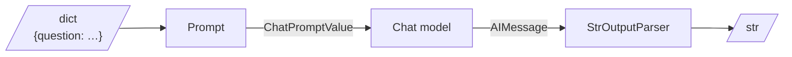

# M08.1 Theory: LCEL and the Runnable interface

*[M08 theory](../README.md) · Lesson 8.1 · Notebooks: [`01a_LCEL_Introduction.ipynb`](../../../../course/p03_langchain_and_langgraph/m08_lcel_runnables_and_chains/notebooks/01a_LCEL_Introduction.ipynb), [`01b_Runnables.ipynb`](../../../../course/p03_langchain_and_langgraph/m08_lcel_runnables_and_chains/notebooks/01b_Runnables.ipynb) · [All theory pages](../../../README.md)*

## Runnable interface

A Runnable is any LangChain component that takes one input and returns one output through a fixed set of methods. A prompt template, a chat model, an output parser, a retriever and a chain built from them all have the same methods, so code that runs one runs any of them.

| Method | Takes | Returns | Use it for |
|---|---|---|---|
| `invoke(x)` | one input | one output | a single request |
| `batch([x1, x2, …])` | a list of inputs | a list of outputs, in order | many independent requests, run on a thread pool |
| `stream(x)` | one input | an iterator of chunks | showing tokens as the model writes them |
| `ainvoke`, `abatch`, `astream` | the same | awaitables and async iterators | async servers such as FastAPI |

Each method also takes a `config` argument. It carries tags, metadata and callbacks for tracing, and `max_concurrency`, which caps how many `batch` calls run at once.

**One input, always.** `invoke` passes exactly one argument. Notebook 01b shows the three ways to get more than one value in: a tuple, a dict, or a lambda that unpacks a dict for an existing function (`RunnableLambda(lambda d: sum_values(d["a"], d["b"]))`). A function with two parameters fails: `RunnableLambda(lambda a, b: a).invoke(1)` raises `TypeError: missing 1 required positional argument: 'b'`. Dicts are the common choice, because prompt templates read their variables from a dict and `RunnableParallel` returns one.

**Three helpers cover most glue code.**

- `RunnablePassthrough()` returns its input unchanged. It keeps the original question available next to a transformed copy.
- `RunnableLambda(f)` wraps any Python function so it can sit in a pipe: cleaning input, formatting retrieved documents, extracting a key.
- `RunnableParallel(a=..., b=...)` runs several Runnables on the same input and returns a dict of their outputs. Lesson 8.3 covers it in depth.

**Each step changes the type.** Notebook 02a invokes the pieces of `prompt | model | parser` one at a time. On a Larkspur question the data changes shape at every step:

Most pipe errors are a type mismatch at one of these arrows: a function that expects a string receives a dict, or a prompt receives an `AIMessage`. Invoke each step alone and print what it returns, as notebook 02a does before it builds anything else.

**`batch` and `stream` come for free, with two details.** The default `batch` runs `invoke` on a thread pool, and with a single input it skips the pool and runs inline, so a one-item batch shows no speed-up. A `RunnableLambda` that wraps a generator streams each `yield`: notebook 01b's `streaming_processor` yields four strings for `"building scalable data solutions"`, one per word. Called with `invoke` instead, the same Runnable returns all four strings added together into one, which is rarely what you want.

For the Larkspur assistant this means one test harness covers every part. The same three lines that check the refund prompt (`invoke`, print, assert) check the retriever, the parser and the finished chain.

## Check yourself

1. Why can the same few test lines check the Larkspur refund prompt, the retriever, the parser and the finished chain?

Each of them is a Runnable with the same fixed methods: `invoke`, `batch`, `stream` and their async forms. Code that runs one runs any of them, so the same three lines (`invoke`, print, assert) work on every part.

2. An existing function takes two parameters, a and b. How do you put it in a pipe?

Wrap it in a lambda that unpacks a dict: `RunnableLambda(lambda d: sum_values(d["a"], d["b"]))`. `invoke` passes exactly one argument, so a two-parameter lambda raises `TypeError` for the missing `b`. Dicts are the usual choice because prompt templates read their variables from one and `RunnableParallel` returns one.

3. A pipe of prompt, model and your own formatting function fails with a type error. How do you find the broken step?

Invoke each step alone and print what it returns, as notebook 02a does. The data changes shape at every arrow (dict, then `ChatPromptValue`, then `AIMessage`, then `str`), and most pipe errors are a mismatch at one of them, such as a function that expects a string receiving an `AIMessage`.

---
*Previous: [M08 overview](../README.md). Next: [8.2 LCEL deep dive](../02_lcel_deep_dive/README.md).*
