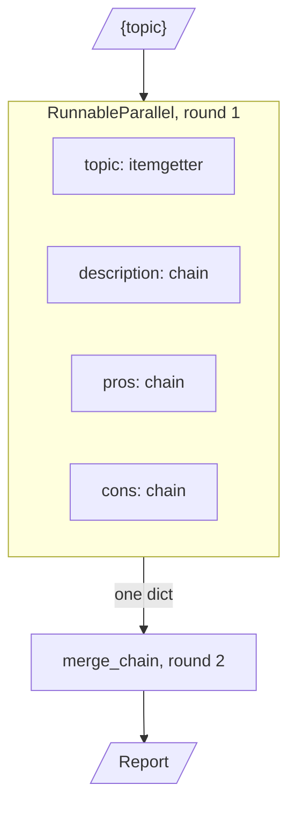
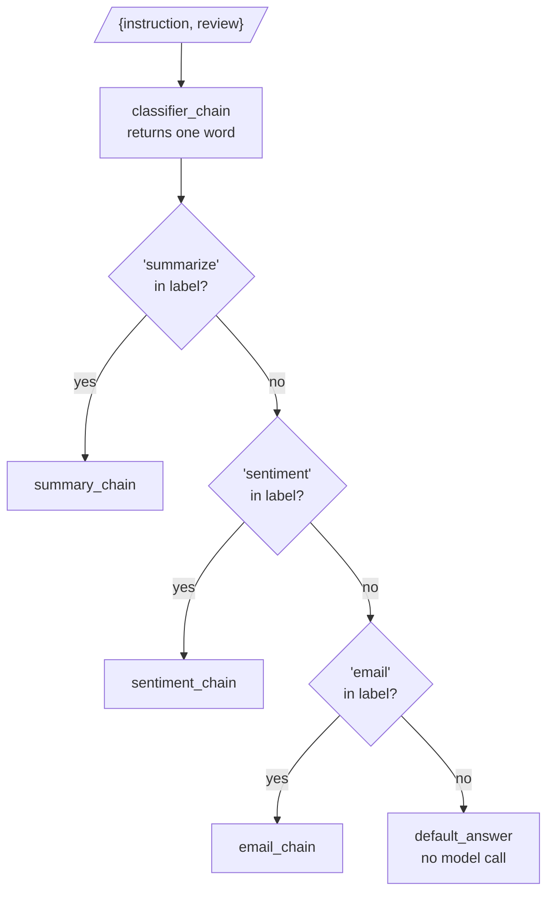

# M08.3 Theory: Branching, routing and merging chains

*[M08 theory](../README.md) · Lesson 8.3 · Notebooks: [`03a_Branching_Routing_Merging_Chains.ipynb`](../../../../course/p03_langchain_and_langgraph/m08_lcel_runnables_and_chains/notebooks/03a_Branching_Routing_Merging_Chains.ipynb) · [All theory pages](../../../README.md)*

## RunnableParallel / Branch

A straight pipe runs one step after another. Notebook 03a builds the three other shapes a chain needs, each from the pieces of lessons 8.1 and 8.2: a pipeline that keeps every intermediate result, a fan-out that merges, and a router.

**Linking: `RunnablePassthrough.assign` keeps the trail.** The notebook's IT-support pipeline runs four LLM chains in order: detect the message's language, translate it to English, write a resolution, translate the resolution back. Each step is an `.assign()`, so the output dict holds `orig_msg`, `orig_lang`, `trans_msg`, `trans_response` and `orig_response`, and the last step can still read `orig_lang` from the first. `final_chain.map()` runs the pipeline over all four queued messages at once: 16 model calls, in 4 rounds rather than 16, because the four messages run side by side while each message's four steps stay in order. (Counted by running the notebook's chain shapes with a stub model in place of `ChatOpenAI`.)

**Branching and merging: `RunnableParallel`, then one more chain.**

The three LLM branches share one input and run at the same time; `itemgetter('topic')` copies the topic through without a model call. The merge prompt reads all four keys and writes the report. That is 4 model calls in 2 rounds, so the wall time is the slowest branch plus the merge. A Larkspur version compares plans: description, pros and cons of the annual plan in parallel, then one call that writes the comparison table.

**Routing: `RunnableBranch` runs the first true condition.**

`RunnableBranch((cond1, chain1), (cond2, chain2), …, default)` takes `(condition, Runnable)` pairs and a default. It tests the conditions in order, runs the first whose condition returns true, and runs the default when none does. It needs at least one pair and a default: `RunnableBranch(f)` raises `ValueError: RunnableBranch requires at least two branches`. In the notebook a dict runs the classifier and copies `instruction`, `review` and `sentiment` beside its label, then the branch picks a chain: 2 model calls per request in 2 rounds, or 1 call when the default answers.

For the Larkspur support desk the same shape triages tickets: a classifier labels each ticket `refund`, `outage` or `export`, and the branch sends it to the chain whose prompt holds that policy. Two properties of this design matter in production:

- **Order decides ties.** The conditions in 03a are substring tests on free text. A label such as "summarize and email" matches the first condition and never reaches the email chain.
- **Plan the default.** In 03a it returns a fixed apology string. For a support desk it should usually hand the ticket to a person and be counted, because a rising default rate is an early sign that the classifier has drifted.

The notebook ends with moderation: piping a chain into the legacy `OpenAIModerationChain` from `langchain_classic` screens its output before it reaches the caller. Any Runnable can take that last position, which is how output checks and guardrails attach to a pipe.

---
*Previous: [8.2 LCEL deep dive](../02_lcel_deep_dive/README.md). Next: [8.4 Legacy chains and migration to LCEL](../04_legacy_chains_and_migration_to_lcel/README.md).*
