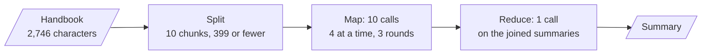
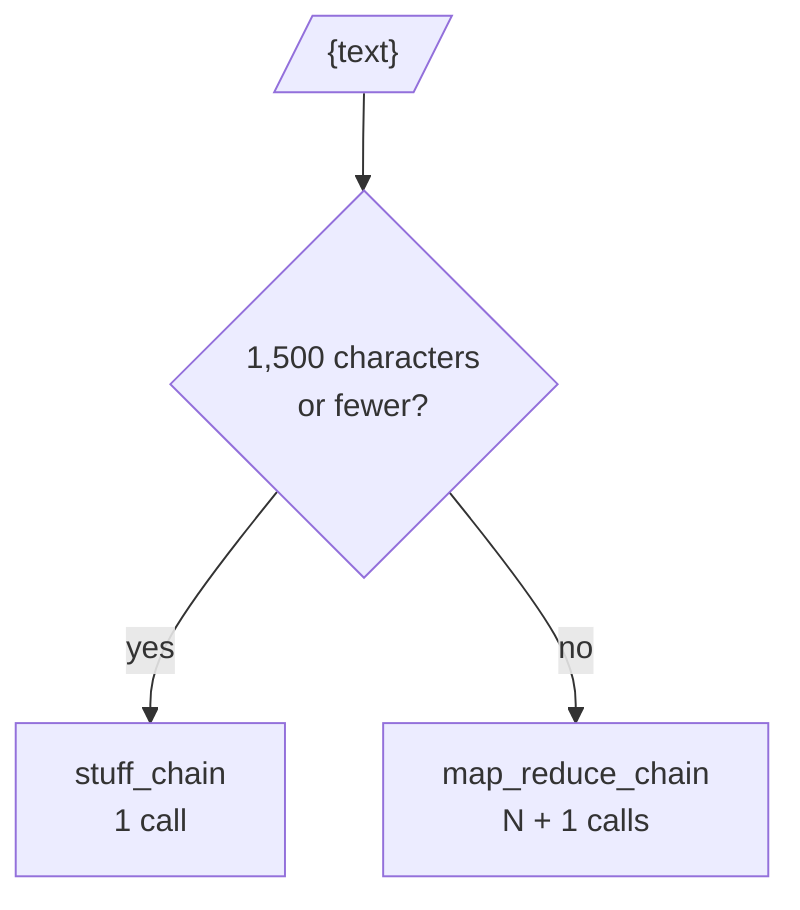

# M08.5 Theory: Summarization: stuff, map-reduce, refine

*[M08 theory](../README.md) · Lesson 8.5 · Notebooks: [`05a_Summarization_Essentials.ipynb`](../../../../course/p03_langchain_and_langgraph/m08_lcel_runnables_and_chains/notebooks/05a_Summarization_Essentials.ipynb), [`05b_Doc_Chains_to_LCEL_LangChain_v1.ipynb`](../../../../course/p03_langchain_and_langgraph/m08_lcel_runnables_and_chains/notebooks/05b_Doc_Chains_to_LCEL_LangChain_v1.ipynb) · [All theory pages](../../../README.md)*

## Map-reduce summarisation

A model reads a finite context window, and a handbook, a contract or a quarter of support tickets can be longer. There are three ways to get many documents through one model, and notebook 05b writes each out in a few lines of LCEL in place of the old `load_summarize_chain(llm, chain_type=...)`:

- **Stuff:** join the documents, fill one prompt, call once. It is the cheapest strategy and the least lossy, because nothing is summarised twice, and it works only while the text fits.
- **Map-reduce:** summarise each chunk on its own (the map), then summarise the summaries (the reduce). The map calls are independent, so `map_chain.batch(...)` runs them on a thread pool.
- **Refine:** summarise the first chunk, then revise that summary once per remaining chunk. Each call needs the previous answer, so the calls run one after another, and later chunks get more say than earlier ones.

The map-reduce from notebook 05b, in full:

```python
partials = map_chain.batch([{"text": c} for c in chunks], config={"max_concurrency": 4})
summary = reduce_chain.invoke({"text": "\n\n".join(partials)})
```

On the whole Larkspur handbook (2,746 characters) split at `chunk_size=400` with an overlap of 20, that is 10 chunks:


<!-- animated: diagrams/map-reduce.anim.html -->

A round here is one wait on the model: calls in the same round run at the same time, so wall time grows with rounds, and cost grows with calls.

| Strategy | Model calls | Rounds (`max_concurrency=4`) | Most source text in one call | Parallel |
|---|---|---|---|---|
| Stuff | 1 | 1 | 2,746 characters | nothing to parallelise |
| Map-reduce | 11 | 4 | 399 characters | the map step |
| Refine | 10 | 10 | 399 characters, plus the running summary | no, by design |

Notebook 05b gives the general form: stuff is 1 call, map-reduce N + 1 calls, refine N calls. The [interactive lab](interactive/summarise-strategy-lab.html) computes all three on three handbook documents, splitting them with a port of LangChain's `RecursiveCharacterTextSplitter` that matches the library on every chunk size from 200 to 1200. Its numbers show where each strategy wins:

- **Chunk size sets the call count.** On the whole handbook, chunk size 1200 gives 3 chunks and chunk size 200 gives 21. Refine's rounds climb from 3 to 21; map-reduce at `max_concurrency=4` goes from 2 rounds to 7, and at 16 it needs only 3 rounds for all 22 calls.
- **Concurrency is what makes map-reduce fast.** At `max_concurrency=1` the map step is a loop, and map-reduce takes N + 1 rounds, one more than refine. Rate limits often force a low cap, so measure at the cap you can run in production.
- **Small chunks cost calls without adding much.** Notebook 05a splits its 630-character sample at `chunk_size=100`: 11 chunks, two of them only 13 and 18 characters long. Map-reduce then makes 12 calls on a text that one stuff call reads whole.

<!-- lab: interactive/summarise-strategy-lab.html -->

The reduce step has a limit of its own. It reads every map summary at once, so a long enough document produces joined summaries that no longer fit. The fix is to reduce in groups and reduce the results again, the recursive summarisation that M42's RAPTOR builds into a tree.

## Routing by length

Stuff is the best strategy whenever it fits, so the summariser should decide per input. This is the module's lab brief in miniature: rebuild `load_summarize_chain` as LCEL, then add a branch that routes short and long inputs differently.

```python
summarise = RunnableBranch(
    (lambda x: len(x["text"]) <= 1500, stuff_chain),
    map_reduce_chain,
)
```



In the lab, the refunds section (1,111 characters) goes to stuff, and the refunds and outages sections together (1,833) and the whole handbook (2,746) go to map-reduce. The check runs a real `RunnableBranch` in Python and the lab's routing matches it on all three. The 1,500-character limit stands in for a context budget. In production, count tokens with the model's tokenizer and set the limit to the context window minus the prompt template and the room the answer needs.

The two branches return the same type, a summary string, so callers never see which strategy ran. Log it anyway: when the share of map-reduce runs rises, documents have grown, and cost and latency will follow.

## Check yourself

<details>
<summary>1. Why is stuff the best summarisation strategy whenever the text fits in one call?</summary>

It is the cheapest and the least lossy. It joins the documents into one prompt and calls the model once, so nothing is summarised twice. Map-reduce and refine exist only because a long text does not fit, which is why the router sends short inputs to stuff.

</details>

<details>
<summary>2. The Larkspur handbook splits into 10 chunks at chunk size 400. How many model calls and rounds does map-reduce need at a max concurrency of 4, and how does refine compare?</summary>

Map-reduce makes 11 calls in 4 rounds: 10 map calls, 4 at a time over 3 rounds, then 1 reduce. Refine makes 10 calls in 10 rounds, because each call needs the previous summary. At `max_concurrency=1` map-reduce would take N + 1 rounds, one more than refine.

</details>

<details>
<summary>3. Your length router sends anything over 1,500 characters to map-reduce. In production, what should replace that limit, and what should you log?</summary>

A token budget: count tokens with the model's tokenizer and set the limit to the context window minus the prompt template and the room the answer needs. Log which strategy ran, because a rising share of map-reduce runs means documents have grown, and cost and latency will follow.

</details>

---
*Previous: [8.4 Legacy chains and migration to LCEL](../04_legacy_chains_and_migration_to_lcel/README.md). Next: [M08 interview questions](../README.md#interview-spotlight-5-questions-you-might-get-asked).*
