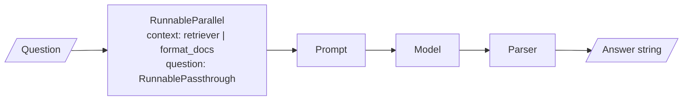

# M08 Theory: LCEL, Runnables & Chains

*Part III · LangChain & LangGraph Fundamentals · [Module README](../../../course/p03_langchain_and_langgraph/m08_lcel_runnables_and_chains/README.md) · [All theory pages](../../README.md)*

LCEL is how LangChain 1.x composes work: prompts, models, parsers and retrievers snap together with `|`, and the result runs with the same methods as each piece. Every RAG chain from M11 onwards is one of these pipes. The M08 notebooks build on four ideas: the one interface every component shares, the pipe that joins components into a sequence, the parallel and branching shapes a pipe can take, and map-reduce for documents longer than one prompt. Each idea has a page in the folder of the lesson that teaches it, listed under [Lessons](#lessons). This page has the overview, the interview questions and the takeaways.

The running example is the Larkspur Cloud handbook used from M11 onwards: a support assistant that answers refund and outage questions, triages tickets, and summarises handbook sections. The lab summarises three handbook documents of 1,111, 1,833 and 2,746 characters.

## TL;DR

- A Runnable has one interface: `invoke` for one input, `batch` for a list, `stream` for chunks, and an async twin of each. Prompts, models, parsers, retrievers and whole chains all have it.
- `a | b` is Python's `__or__` returning a `RunnableSequence`. A dict inside a pipe becomes a `RunnableParallel`, so `{"context": retriever | format_docs, "question": RunnablePassthrough()} | prompt | llm | parser` is a complete RAG chain.
- `RunnableParallel` runs its branches on the same input at once: notebook 03a's description, pros and cons chains plus a merge chain make 4 model calls in 2 rounds. `RunnableBranch` runs the first branch whose condition is true.
- `LLMChain`, `RetrievalQA` and `load_summarize_chain` now live in `langchain-classic`, deprecated with removal set for 2.0.0. Each rewrites as a short pipe.
- Map-reduce trades calls for a small prompt. In the lab the whole handbook at `chunk_size=400` is 10 chunks: map-reduce makes 11 calls in 4 rounds at `max_concurrency=4`, refine makes 10 calls in 10 rounds, and stuff makes 1 call that reads all 2,746 characters.

## Mental model

<!-- animated: diagrams/rag-chain.anim.html -->

This is the RAG chain from notebook 04a, and every box in it is a Runnable. The dict fans the question out to two branches and hands one dict to the prompt; each later step takes the previous step's output as its only input. Because the whole pipe is also a Runnable, the chain you build here can sit inside a bigger pipe, a `RunnableBranch` or a LangGraph node without changes.

## Lessons

| Lesson | Topic | Theory |
|---|---|---|
| 8.1 | LCEL and the Runnable interface | [Runnable interface](01_lcel_and_the_runnable_interface/README.md#runnable-interface) |
| 8.2 | LCEL deep dive | [Pipe composition](02_lcel_deep_dive/README.md#pipe-composition) |
| 8.3 | Branching, routing and merging chains | [RunnableParallel / Branch](03_branching_routing_and_merging_chains/README.md#runnableparallel--branch) |
| 8.4 | Legacy chains and migration to LCEL | [Legacy chains to LCEL](04_legacy_chains_and_migration_to_lcel/README.md#legacy-chains-to-lcel) |
| 8.5 | Summarization: stuff, map-reduce, refine | [Map-reduce summarisation](05_summarization_stuff_map_reduce_refine/README.md#map-reduce-summarisation) [Routing by length](05_summarization_stuff_map_reduce_refine/README.md#routing-by-length) |

## Interactive lab

[**Stuff, map-reduce or refine**](05_summarization_stuff_map_reduce_refine/interactive/summarise-strategy-lab.html): open the file in a browser. Pick *Whole handbook* and slide the chunk size from 1200 down to 200: refine's rounds climb from 3 to 21 while map-reduce stays at 2 to 7. Then set `max_concurrency` to 1 and watch map-reduce take one round more than refine. Finally pick *Refunds section* to see the router send a short document to stuff.

## How it connects

- **Before:** [M07](../m07_langchain_core/README.md) covers the pieces this module pipes together: chat models, prompt templates and output parsers.
- **Next:** [M09](../m09_langgraph_core/README.md) and [M10](../m10_langgraph_runtime/README.md) move control flow into LangGraph, where a Runnable can be a node. [M11](../../p04_rag_foundations/m11_rag_lifecycle/README.md) composes its baseline RAG chain as exactly this pipe (notebook 05a), and [M13](../../p05_ingestion_and_indexing/m13_chunking/README.md) explains the splitter the map step depends on. [M25](../../p08_agent_foundations/m25_agentic_workflow_patterns/README.md) turns `RunnableParallel` into the parallelisation workflow pattern, and [M42](../../p12_hierarchical_and_graph_rag/m42_hierarchical_memory_rag/README.md) applies recursive summarisation to a whole corpus.

## Interview Spotlight: 5 Questions You Might Get Asked

*Production questions in the style of OpenAI, Anthropic and Google interviews for applied AI roles.*

### 1. Larkspur's nightly job runs `triage_chain.batch()` over 2,000 support tickets. Last night it died at ticket 1,412 with a rate-limit error and wrote nothing. What do you change?

**What a strong answer covers:**
- Caps parallel calls with `config={"max_concurrency": n}` sized to the provider's rate limit, since the default is Python's thread-pool size
- Wraps the model step in `.with_retry()` so a transient 429 retries that call instead of failing the batch
- Passes `return_exceptions=True` so one bad ticket returns an exception in its slot and the other 1,999 results survive
- Writes results in pages (or checkpoints them) and adds `.with_fallbacks([...])` to a second model if outages are common

### 2. Product wants a weekly digest of every handbook change. Some weeks one paragraph changes; in release weeks, 40 pages do. Which summarisation strategy do you build?

**What a strong answer covers:**
- A `RunnableBranch` on input length: stuff below a token budget (one call, nothing summarised twice), map-reduce above it
- Map-reduce for the long case: the map step parallelises, so latency is about one map round plus the reduce, and every chunk is treated the same
- Refine only if later changes should override earlier ones, accepting one sequential call per chunk and order sensitivity
- A guard for the reduce step itself: if the joined summaries exceed the budget, reduce in groups and reduce again

### 3. The support chain routes tickets with a classifier and a `RunnableBranch`. How do you find out, in production, which branch each ticket took and which branch is slow?

**What a strong answer covers:**
- Traces every run (LangSmith or any callback handler); a pipe records each step as a child run with its own latency
- Names the steps with `.with_config(run_name=...)` and tags runs with metadata such as ticket id and plan, so traces can be filtered
- Logs the classifier's raw output next to the chosen branch, since a wrong route usually starts as an unexpected label
- Dashboards the share of tickets per branch and the default-branch rate, which rises when the classifier drifts

### 4. The ticket classifier returns "Refund." for most refund tickets, but for one ticket it returns "Refund or outage". The branch conditions are `"refund" in label` and `"outage" in label`. What happens, and how do you make routing safe?

**What a strong answer covers:**
- `RunnableBranch` tests conditions in order and runs the first true one, so the ticket silently goes to the refund chain
- Substring checks on free text are fragile: punctuation, case and multi-label answers all route somewhere
- Constrains the classifier with structured output (an enum of labels) and validates it before the branch
- Keeps a default branch that escalates to a human, and counts how often it fires

### 5. You inherit a Larkspur service built on `RetrievalQA`, `LLMChain` and `hub.pull("rlm/rag-prompt")` on LangChain 0.x. How do you migrate it to 1.x without breaking the API that callers use?

**What a strong answer covers:**
- Repoints imports to `langchain_classic` first so the service runs on 1.x, then rewrites chain by chain behind the same interface
- Replaces `RetrievalQA` with `{"context": retriever | format_docs, "question": RunnablePassthrough()} | prompt | llm | StrOutputParser()`, and maps the output shape: the legacy chain returns a dict with `query` and `result`, the pipe returns a string
- Inlines the prompt, because `hub.pull` is deprecated and raises for public prompts on the repo's pinned `langsmith`
- Replaces every `chain(...)` and `.run()` call with `.invoke()`, and compares old and new answers on a fixed question set before switching

## Key Takeaways

- Every component and every chain shares one interface, so test each step alone with `.invoke()` before you pipe it.
- Build data flow with dicts: a dict fans one input out, and `RunnablePassthrough.assign()` adds a key while keeping the rest.
- Write new chains as pipes. Treat `langchain_classic` imports as a staging post for old code, never as a destination.
- Choose a summarisation strategy by length and latency: stuff when it fits, map-reduce when it does not, refine only when order should matter.

---
*Previous: [M07 LangChain core](../m07_langchain_core/README.md). Next: [M09 LangGraph core](../m09_langgraph_core/README.md).*
