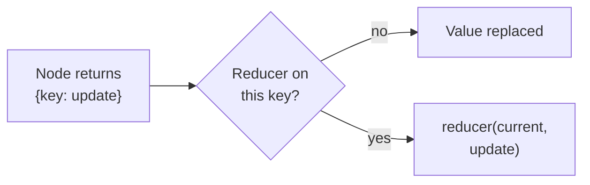

# M09.1 Theory: State, graphs and reducers

*[M09 theory](../README.md) · Lesson 9.1 · Notebooks: [`01a_State_and_Graph_Basics.ipynb`](../../../../course/p03_langchain_and_langgraph/m09_langgraph_core/notebooks/01a_State_and_Graph_Basics.ipynb), [`01b_MessagesState.ipynb`](../../../../course/p03_langchain_and_langgraph/m09_langgraph_core/notebooks/01b_MessagesState.ipynb) · [All theory pages](../../../README.md)*

## StateGraph

A `StateGraph` has three parts. The **state** is a schema, usually a `TypedDict`, that every node receives. A **node** is a plain function that takes the state and returns a dict with only the keys it changes. An **edge** says which node runs next; `START` and `END` are the entry and exit. `compile()` turns the builder into a runnable, and `invoke` runs it and returns the final state.

The Larkspur support graph from the lab, written the way notebook 01a builds its graphs:

```python
class SupportState(MessagesState):        # messages, with the add_messages reducer
    route: str
    answer: dict

builder = StateGraph(SupportState)
builder.add_node("classify", classify)
builder.add_node("billing", billing)
builder.add_node("technical", technical)
builder.add_node("human", human)
builder.add_edge(START, "classify")
builder.add_conditional_edges("classify", lambda s: s["route"], ["billing", "technical", "human"])
for name in ("billing", "technical", "human"):
    builder.add_edge(name, END)
graph = builder.compile()

graph.invoke({"messages": [HumanMessage("When will my refund appear on my statement?")]})
```

`MessagesState` is a ready-made schema with one key, `messages`, already paired with the `add_messages` reducer. Notebook 01b subclasses it to add `turn_count`; that key has no reducer, so the counter node's write replaces it. Run once, the notebook's three-node graph ends with 2 messages and `turn_count` 1: two keys in one schema, merged by two different rules.

Two habits from the notebooks keep graphs readable. Nodes return partial updates, never the whole state, so each node's return shows exactly what it changed. And the state holds data the graph works on; per-call settings and dependencies such as a database client go elsewhere (lesson [9.4](../04_nodes_runtime_context_and_command/README.md) and [9.5](../05_input_output_schemas_and_configuration/README.md)).

## Reducers

A reducer decides what a node's write does to a key. Without one, the write replaces the value. Notebook 01a shows the cost: three nodes each return `{"messages": "..."}` into a `str` key, and the final state holds only `'Hello this is the final node'`; the customer's input is gone after the first node.



A reducer is attached with `Annotated[type, function]` and is called as `function(current, update)`. Notebook 01a starts from `{"count": 5, "animals": ["lion", "tiger"]}` and runs one node that returns `{"count": 1, "animals": ["cat"]}`:

- **No reducer:** the state becomes `{"count": 1, "animals": ["cat"]}`.
- **`Annotated[int, custom_increment]` and `Annotated[list, operator.add]`:** the state becomes `{"count": 6, "animals": ["lion", "tiger", "cat"]}`.
- **`Annotated[list, add_messages]`:** appends messages, gives each one an id, and replaces a message whose id is already in the list. It also turns a bare string into a message: in notebook 01a the input and the three nodes' strings end as four `HumanMessage` objects, so a node that should speak as the assistant must return an `AIMessage`.

The reducer and what the nodes return have to agree. The [interactive lab](interactive/reducer-lab.html) runs the Larkspur graph with each reducer, once with nodes that return only their new message and once with nodes that return `state["messages"] + [msg]`. Messages in the final state for the refund question:

| Reducer on `messages` | Node returns its message | Node returns the whole list |
|---|---|---|
| None (overwrite) | **1**, and the question is lost | 3 |
| `operator.add` | 3 | **7**, the question four times |
| `add_messages` | 3 | 3 |

- **Overwrite with new-message returns** loses the question after `classify`, so the billing node has nothing to answer and the structured answer has no source.
- **Overwrite with whole-list returns** works, but only while every node copies the list forward. One node written the other way erases the history.
- **`operator.add` with whole-list returns** concatenates the copy onto the original: 1, then 3, then 7 messages. A chat-model node would read and pay for every copy.
- **`add_messages`** gives 3 either way, because the copied messages carry ids and replace themselves.

<!-- lab: interactive/reducer-lab.html -->

Reducers matter again when nodes run in parallel. If two nodes in the same step write a key that has no reducer, LangGraph 1.2.18 raises `InvalidUpdateError: At key 'out': Can receive only one value per step`. The fan-out patterns in [M25](../../../p08_agent_foundations/m25_agentic_workflow_patterns/README.md) give such keys a reducer, usually `operator.add`.

## Key Takeaways

- A graph is state, nodes and edges. Have each node return only the keys it changes, and keep settings and dependencies out of the state.
- A key with no reducer is replaced on every write. Attach one with `Annotated[type, function]` when a key should accumulate, as `messages` does with `add_messages`.
- Match the reducer to what nodes return. `operator.add` with whole-list returns grows 1, 3, 7 messages, while `add_messages` stays at 3 because ids replace duplicates.

## Check yourself

<details>
<summary>1. What does a reducer decide, and what happens to a key that has none?</summary>

A reducer decides what a node's write does to a key; LangGraph calls it as `function(current, update)`. Without one, the write replaces the value. In notebook 01a, three nodes write into a `str` key and the final state holds only `'Hello this is the final node'`; the customer's input is gone after the first node.

</details>

<details>
<summary>2. The state starts as count 5 and animals lion and tiger. A node returns count 1 and animals cat. What is the state with custom_increment on count and operator.add on animals?</summary>

`{"count": 6, "animals": ["lion", "tiger", "cat"]}`. Each reducer combines the current value with the update. Without reducers the same write gives `{"count": 1, "animals": ["cat"]}`.

</details>

<details>
<summary>3. The Larkspur graph with operator.add on messages ends with 7 messages, the question four times. What went wrong, and what fixes it?</summary>

The nodes return the whole list, `state["messages"] + [msg]`, and `operator.add` concatenates that copy onto the original: 1, then 3, then 7 messages. Either have each node return only its new message, or use `add_messages`, which gives 3 either way because the copied messages carry ids and replace themselves.

</details>

---
*Previous: [M09 overview](../README.md). Next: [9.2 Conditional edges and LLM nodes](../02_conditional_edges_and_llm_nodes/README.md).*
