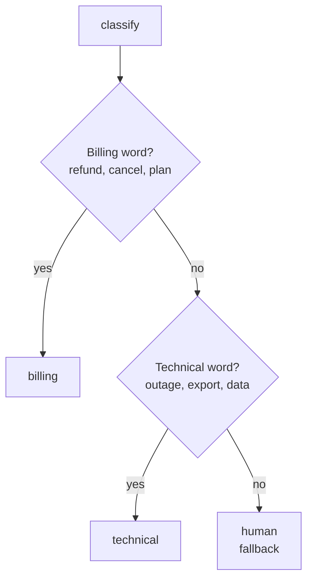
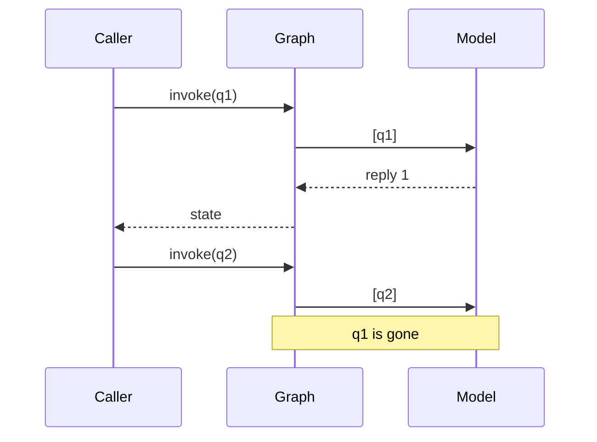

# M09.2 Theory: Conditional edges and LLM nodes

*[M09 theory](../README.md) · Lesson 9.2 · Notebooks: [`02a_Conditional_Routing.ipynb`](../../../../course/p03_langchain_and_langgraph/m09_langgraph_core/notebooks/02a_Conditional_Routing.ipynb), [`02b_LLM_Powered_Chatbot.ipynb`](../../../../course/p03_langchain_and_langgraph/m09_langgraph_core/notebooks/02b_LLM_Powered_Chatbot.ipynb) · [All theory pages](../../../README.md)*

## Conditional edges

A normal edge always goes from A to B. A conditional edge calls a routing function after its source node finishes; the function reads the state and returns the name of the node to run next.

```python
builder.add_conditional_edges("classify", route_question, ["billing", "technical", "human"])
```

The Larkspur router reads the words of the question and checks two rule sets in order, billing words first:



Three things follow from how LangGraph runs the router.

- **The destination list is a check.** With `["rainy", "sunny"]` passed, notebook 02a's weather router fails on `humid` with `KeyError: 'humid'`. Without the list, LangGraph 1.2.18 logs "wrote to unknown channel branch:to:humid, ignoring it" and ends the run with no error, and the drawn graph shows no branches at all.
- **The router only reads.** It runs between nodes, and in LangGraph 1.2.18 any change it makes to `state` is thrown away. A retry counter or a "reason for the route" must be written by a node, such as `classify`, before the router runs.
- **Rule order decides the close calls.** *Can I export my data after I cancel my plan?* is a data question, but `cancel` and `plan` match the billing rule first, so the billing node answers from the `cancel` page instead of `export`. The [M09 lab](../01_state_graphs_and_reducers/interactive/reducer-lab.html) shows the route for each question. A fallback route, as in notebook 02a's comic-book router (`node_others` for anything unknown), turns a router gap into a handoff instead of an error: *Can I pay by bank transfer?* matches no rule and goes to `human`.

A model can make the decision instead of keywords: the `classify` node asks a chat model for a label, writes it to `route`, and the router stays a one-line read. That keeps the model call in a node, where it can be retried and traced, and keeps the edge testable without a model. [M25](../../../p08_agent_foundations/m25_agentic_workflow_patterns/README.md) and [M30](../../../p09_agentic_rag/m30_adaptive_rag_routing/README.md) build routers this way.

## A chat model inside a node

A node that calls a model is an ordinary node: read the messages, call the model, return the reply under `messages`, and let `add_messages` append it. Notebook 02b's chatbot is one such node between `START` and `END`, on `gpt-4o-mini`:

```python
def chatbot(state: State):
    return {"messages": [llm.invoke(state["messages"])]}
```

The graph keeps no memory between calls. Each `invoke` starts from the input you pass, so notebook 02b's follow-up *What did we discuss so far?* reaches the model on its own (`q1` and `q2` are the two questions):



Notebook 01a works around this by passing `turn1_state["messages"] + [message2]` into the second call. [M10](../../m10_langgraph_runtime/README.md) replaces that with a checkpointer that saves the state per thread.

`invoke` waits for the whole run. `stream` yields as nodes finish, in two modes notebook 02b compares:

- **`stream_mode="values"`:** the full state after each step, useful for watching a list grow, as in the M09 lab.
- **`stream_mode="updates"`:** only what each node returned, keyed by node name, such as `{"chatbot": {"messages": [...]}}`. It is smaller, and it names the node that made each change.

## Key Takeaways

- Always pass the destination list to `add_conditional_edges`. With it an unknown route fails loudly; without it the run ends silently and the drawing shows no branches.
- A router only reads state, and checks its rules in order. Write anything the route needs from a node, and add a fallback route such as `human` for questions no rule matches.
- A graph keeps no memory between `invoke` calls. Use `stream_mode="updates"` to see which node changed what, and a checkpointer for conversation history.

## Check yourself

<details>
<summary>1. Notebook 02b's chatbot answers a first question, then gets "What did we discuss so far?" in a second invoke and cannot say. Why?</summary>

The graph keeps no memory between calls. Each `invoke` starts from the input you pass, so the second question reaches the model on its own and the first is gone. Notebook 01a works around it by passing the first run's messages plus the new one; M10 replaces that with a checkpointer that saves state per thread.

</details>

<details>
<summary>2. The Larkspur router gets "Can I export my data after I cancel my plan?" Which node answers it, and why?</summary>

The billing node, from the `cancel` page. The router checks the billing words first, and `cancel` and `plan` match before the technical rule sees `export` and `data`. Rule order decides the close calls, even when the question is really about data.

</details>

<details>
<summary>3. You leave the destination list out of the conditional edge, and a run whose router returns an unknown name ends with no error and no answer. What happened?</summary>

LangGraph 1.2.18 logged "wrote to unknown channel branch:to:humid, ignoring it" and ended the run, and the drawn graph shows no branches. With the destination list passed, the same route fails loudly with `KeyError: 'humid'`. Pass the list, and add a fallback route such as `human` so a router gap becomes a handoff.

</details>

---
*Previous: [9.1 State, graphs and reducers](../01_state_graphs_and_reducers/README.md). Next: [9.3 State schemas and validation](../03_state_schemas_and_validation/README.md).*
