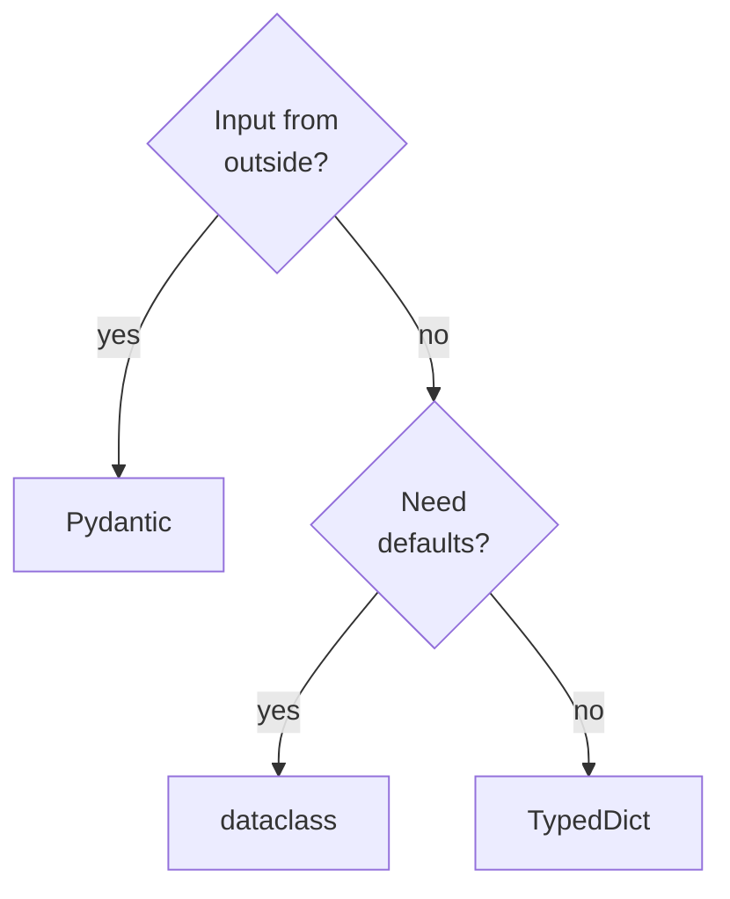

# M09.3 Theory: State schemas and validation

*[M09 theory](../README.md) · Lesson 9.3 · Notebooks: [`03a_Different_Graph_States.ipynb`](../../../../course/p03_langchain_and_langgraph/m09_langgraph_core/notebooks/03a_Different_Graph_States.ipynb), [`03b_Pydantic_State_Validation.ipynb`](../../../../course/p03_langchain_and_langgraph/m09_langgraph_core/notebooks/03b_Pydantic_State_Validation.ipynb) · [All theory pages](../../../README.md)*

## Choosing a state schema

`StateGraph` accepts four kinds of schema, and notebook 03a runs the same two-node graph on each. The wiring, the nodes and the reducers (`Annotated[int, custom_add]`, `Annotated[list, add_messages]`) stay the same; the choice changes how nodes read the state and where a bad input is caught. Measured on LangGraph 1.2.18:

| Schema | Nodes read | Defaults | Wrong type in the input |
|---|---|---|---|
| `dict` | `state["key"]` | none | accepted |
| `TypedDict` | `state["key"]` | none | accepted |
| `@dataclass` | `state.key` | yes | accepted |
| Pydantic `BaseModel` | `state.key` | yes | `ValidationError` at `invoke` |

- **`dict`** has no schema, so it cannot attach reducers: notebook 03a's dict run ends with `messages` holding only `"Step B Completed"` and `step_count` 1, where the other three end with two messages and a count of 2.
- **`TypedDict`** annotations are hints for you and your editor. Notebook 03b passes `{"name": 123}` into a graph whose node appends a string; the run starts, and the node fails with `TypeError: unsupported operand type(s) for +: 'int' and 'str'`. A missing key fails the same way, as a `KeyError` inside the node.
- **`@dataclass`** adds defaults (`private_data: str = ""`) and passes nodes an instance, but checks no types: `{"name": 123}` goes through.
- **Pydantic** checks the input against the model before the first node. The same `{"name": 123}` raises `ValidationError` at `graph.invoke`, and no node runs. It also converts where it can: `"5"` for an `int` field arrives as `5`.

Two limits apply to every schema. `invoke` returns a plain dict even when the schema is a dataclass or a Pydantic model. And Pydantic validates what comes in, not what nodes write: a node that returns `{"name": 5}` for a `str` field finishes without an error, and the final state holds `5`. A node whose output matters, such as Larkspur's structured answer, validates it itself, for example by building the answer as a Pydantic model before returning it.

For the Larkspur support graph the question arrives from a web widget, so the state schema itself is a Pydantic model: `question: str`, with `route` and `answer` given defaults. The check comes from the state schema. In LangGraph 1.2.18 a Pydantic `input_schema` on a `TypedDict` state lets `{"question": 123}` through to the first node, which fails with `TypeError`; with a Pydantic state the same input stops at `invoke` before any node runs. Lesson [9.5](../05_input_output_schemas_and_configuration/README.md) then narrows what the caller sends and receives. Validation costs a parse on every `invoke`, which is small next to one model call.

## Key Takeaways

- `TypedDict` and dataclass annotations check no types, so a bad input fails inside a node. A plain `dict` cannot attach reducers at all.
- Use a Pydantic state schema when input comes from outside. It raises `ValidationError` at `invoke` before any node runs, and converts values where it can.
- Pydantic validates input only, never what nodes write, and `invoke` always returns a plain dict. Validate important node output, such as a structured answer, inside the node.

## Check yourself

1. A graph with a TypedDict state receives a name of 123, and its node fails with a TypeError. Why did the schema not stop it?

`TypedDict` annotations are hints for you and your editor; LangGraph checks no types, so the run starts and the node fails when it adds a string to the int. With a Pydantic `BaseModel` state, the same input raises `ValidationError` at `graph.invoke` and no node runs.

2. The Larkspur question arrives from a web widget. Why make the state schema itself Pydantic instead of adding a Pydantic input schema to a TypedDict state?

In LangGraph 1.2.18 the Pydantic `input_schema` on a `TypedDict` state lets `{"question": 123}` through to the first node, which fails with `TypeError`. The check comes from the state schema: with a Pydantic state the same input stops at `invoke` before any node runs.

3. A node in a Pydantic-state graph returns 5 for a str field, and the run finishes cleanly. How should Larkspur protect its structured answer?

Validate it in the node. Pydantic checks what comes in at `invoke`, not what nodes write, so the final state simply holds `5`. A node whose output matters builds its answer as a Pydantic model before returning it.

---
*Previous: [9.2 Conditional edges and LLM nodes](../02_conditional_edges_and_llm_nodes/README.md). Next: [9.4 Nodes, runtime context and Command](../04_nodes_runtime_context_and_command/README.md).*
