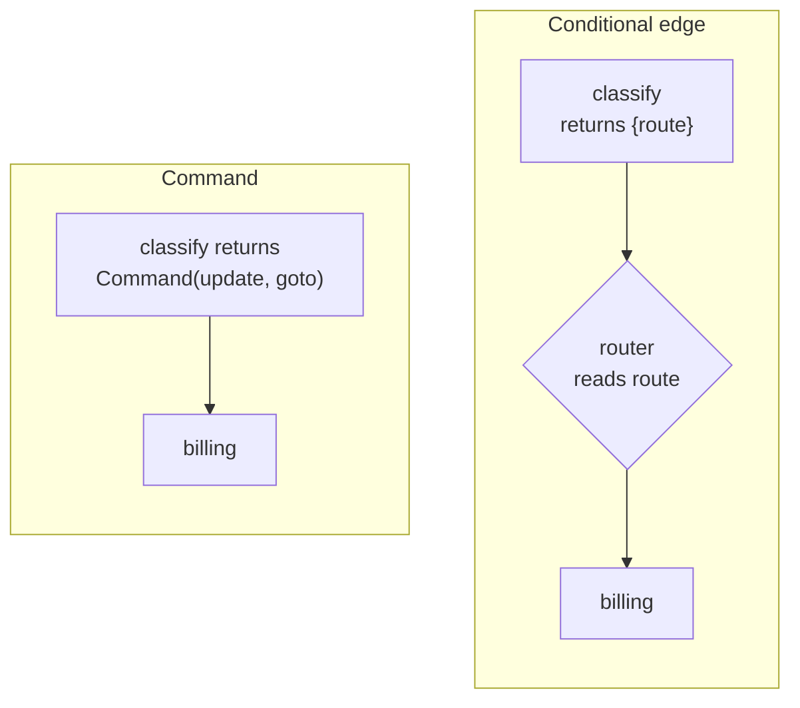

# M09.4 Theory: Nodes, runtime context and Command

*[M09 theory](../README.md) · Lesson 9.4 · Notebooks: [`04a_Node_Patterns.ipynb`](../../../../course/p03_langchain_and_langgraph/m09_langgraph_core/notebooks/04a_Node_Patterns.ipynb), [`04b_Runtime_Context.ipynb`](../../../../course/p03_langchain_and_langgraph/m09_langgraph_core/notebooks/04b_Runtime_Context.ipynb), [`04c_Command_Objects.ipynb`](../../../../course/p03_langchain_and_langgraph/m09_langgraph_core/notebooks/04c_Command_Objects.ipynb) · [All theory pages](../../../README.md)*

## Node signatures and runtime context

A node always receives the state first. It can ask for more by declaring a second parameter, and LangGraph passes it in:

| Signature | The node also gets | Larkspur use |
|---|---|---|
| `f(state)` | nothing | `classify` reads the question |
| `f(state, config: RunnableConfig)` | `config["configurable"]` | the `thread_id` for logs |
| `f(state, runtime: Runtime[Ctx])` | `runtime.context` | the customer's plan, a database client |

Runtime context is typed. The graph declares its shape with `StateGraph(State, context_schema=Ctx)`, and each call passes values with `invoke(..., context={...})`. Notebook 04b uses a dataclass, so fields without a default are required and the rest can be overridden per call: `user_agent` has no default, while `docs_url` and `db_connection` do. In LangGraph 1.2.18 a missing context fails when the node reads it, not when the graph starts:

- **`invoke` with no `context`:** the node raises `AttributeError: 'NoneType' object has no attribute 'user_agent'`.
- **`context={}`:** the call raises `TypeError` for the missing `user_agent` argument.

Context holds things the graph uses but does not produce: connections, clients, the caller's identity. None of it appears in the returned state. Lesson [9.5](../05_input_output_schemas_and_configuration/README.md) sets context beside config and state.

## Command

A node can route by itself. Instead of a dict, it returns `Command(update=..., goto=...)`: the update is merged like any node return, and `goto` names the next node. Notebook 04c's `check_temp_node` sends a reading above 90 to `warn_user` with `warning_sent: True`, and anything else to `success`, without a single edge leaving the node. Both handlers end the run because no edge leaves them either.

```python
def classify(state) -> Command[Literal["billing", "technical", "human"]]:
    route = route_for(state["messages"])
    return Command(update={"route": route}, goto=route)
```



The return annotation looks like a check, and notebook 04c calls it compile-time safety. In LangGraph 1.2.18 it is a drawing hint, and three behaviours follow:

- **The `Literal` list draws the graph.** With it, the drawn graph shows dashed edges to `warn_user` and `success`. Without it, routing still works, but the drawing shows the node going straight to `END`. A `goto` to a node missing from the `Literal` still runs that node.
- **A `goto` to a node that does not exist is ignored.** LangGraph logs "wrote to unknown channel branch:to:nowhere, ignoring it" and the run ends with no error and no handler output.
- **`goto` adds to static edges.** If the node also has `add_edge("check_temp_node", "success")`, a hot reading runs `warn_user` and `success` in the same step, and both write `final_action_performed`, so the run fails with `InvalidUpdateError: Can receive only one value per step`.

Choose a conditional edge when routing is a pure read of state: the router is testable alone, and the graph lists every destination at build time. Choose `Command` when the node that decides must also write, such as the route with the reason for it, or when the target lies outside the current graph. The same object carries `resume` for a paused run in [M10](../../m10_langgraph_runtime/README.md) and `graph=Command.PARENT` for handoffs between agents in [M35](../../../p10_memory_and_multi_agent/m35_multi_agent_architectures/README.md).

## Check yourself

<details>
<summary>1. When should a node return a Command instead of leaving the route to a conditional edge?</summary>

When the node that decides must also write, such as the route with the reason for it, or when the target lies outside the current graph. When routing is a pure read of state, a conditional edge is better: the router is testable alone and the graph lists every destination at build time.

</details>

<details>
<summary>2. Notebook 04c's check_temp_node also gets a static edge to success, and a reading of 95 arrives. What happens?</summary>

The run fails. A reading above 90 makes the node `goto` `warn_user`, and `goto` adds to static edges, so `warn_user` and `success` run in the same step. Both write `final_action_performed`, and LangGraph raises `InvalidUpdateError: Can receive only one value per step`.

</details>

<details>
<summary>3. A node reads user_agent from runtime context and fails with an AttributeError on NoneType. What went wrong?</summary>

The graph was invoked with no `context`. In LangGraph 1.2.18 a missing context fails when the node reads it, not when the graph starts. Pass it with `invoke(..., context={...})`, and include `user_agent`, which has no default; `context={}` raises `TypeError` for it.

</details>

---
*Previous: [9.3 State schemas and validation](../03_state_schemas_and_validation/README.md). Next: [9.5 Input/output schemas and configuration](../05_input_output_schemas_and_configuration/README.md).*
