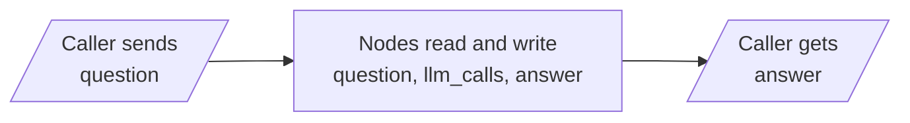

# M09.5 Theory: Input/output schemas and configuration

*[M09 theory](../README.md) · Lesson 9.5 · Notebooks: [`05a_Advanced_State.ipynb`](../../../../course/p03_langchain_and_langgraph/m09_langgraph_core/notebooks/05a_Advanced_State.ipynb) · [All theory pages](../../../README.md)*

## Input, output and private state

With one schema, the caller sends and receives the graph's whole state. Notebook 05a's `ChatMessages` holds `question`, `answer` and `llm_calls`, a counter the node bumps on each call, and `invoke({"question": ...})` returns all three. The counter is bookkeeping, but every caller now sees it and may start to depend on it.

The fix gives the graph three views of one state:

```python
class InputState(TypedDict):    question: str
class PrivateState(TypedDict):  llm_calls: int
class OutputState(TypedDict):   answer: str
class OverallState(InputState, PrivateState, OutputState): pass

StateGraph(state_schema=OverallState, input_schema=InputState, output_schema=OutputState)
```



Nodes still read and write every key of `OverallState`. Only what crosses the boundary changes: rerun on LangGraph 1.2.18 with a stub in place of the model, the split graph returns `{"answer": ...}` and nothing else. For the Larkspur support graph the input is the question, the output is the structured answer (`route`, `source`, `text`), and the message history and the top-level `route` key stay private. That leaves room to rename or add internal keys later without breaking the web widget.

A `TypedDict` output schema filters keys and checks no types. As lesson [9.3](../03_state_schemas_and_validation/README.md) shows, type checks come from a Pydantic state schema, and they cover the input only.

## Config, context or state

Some values a node needs are not data the graph works on. Notebook 05a's `call_model` reads `config["configurable"].get("language", "English")` and answers the same mountain question in Spanish, then in German, from the same graph; `language` never appears in the returned state. Three places hold values, and each has one job:

| Place | Holds | Returned? |
|---|---|---|
| State | data the graph reads and changes | yes, through the output schema |
| `config["configurable"]` | per-call settings: language, `thread_id` | no |
| Runtime context | dependencies: clients, the caller's identity | no |

For Larkspur, the question, route and answer are state; the reply language and the conversation's `thread_id` go in config; the customer id and the database client go in runtime context ([lesson 9.4](../04_nodes_runtime_context_and_command/README.md)). Putting a client or a secret in state is the usual mistake: state is returned to the caller, and once [M10](../../m10_langgraph_runtime/README.md) adds a checkpointer, it is saved after every step. The `thread_id` in config is what that checkpointer uses to find a conversation's saved state.

## Key Takeaways

- Give a graph separate input, private and output schemas so callers send only the question and receive only the answer. Internal keys can then change without breaking callers.
- A `TypedDict` output schema filters keys but checks no types. Type checks come from a Pydantic state schema and cover input only.
- Put data the graph changes in state, per-call settings such as language and `thread_id` in config, and clients and identity in runtime context. Never put a client or secret in state.

## Check yourself

<details>
<summary>1. Why split a graph's state into input, private and output schemas when the nodes still read and write every key?</summary>

Because only what crosses the boundary changes. The caller sends the question and gets the answer, so bookkeeping such as `llm_calls` stays private and no caller starts to depend on it. For Larkspur, that leaves room to rename or add internal keys without breaking the web widget.

</details>

<details>
<summary>2. The Larkspur graph needs a reply language, a thread id, a customer id and a database client. Where does each one go?</summary>

The reply language and the `thread_id` go in `config["configurable"]`, as per-call settings. The customer id and the database client go in runtime context, as dependencies. Neither place is returned; state holds only the question, route and answer the graph works on.

</details>

<details>
<summary>3. A teammate puts the database client and a secret in state. Why is that a mistake, and why does it get worse once a checkpointer is added?</summary>

State is returned to the caller, so the client and the secret leave the graph with the answer. Once M10 adds a checkpointer, state is also saved after every step. Dependencies and secrets belong in runtime context, which is never returned.

</details>

---
*Previous: [9.4 Nodes, runtime context and Command](../04_nodes_runtime_context_and_command/README.md). Next: [M09 interview questions](../README.md#interview-spotlight-5-questions-you-might-get-asked).*
