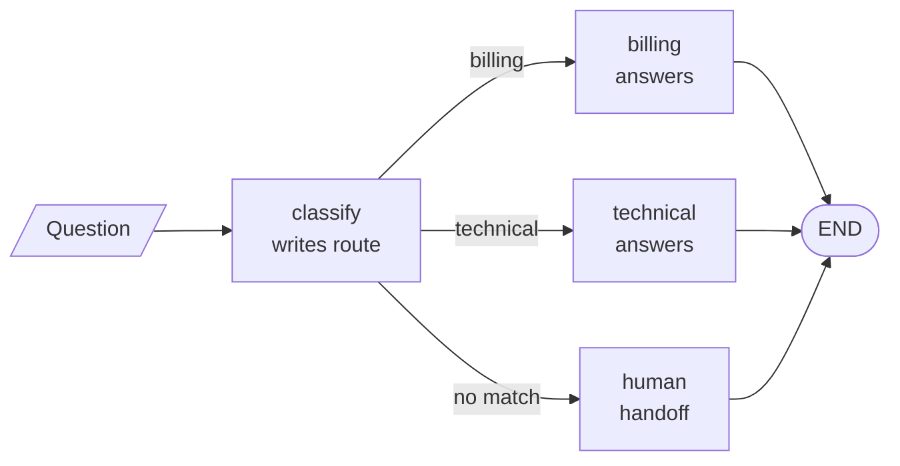

# M09 Theory: LangGraph core

*Part III · LangChain & LangGraph Fundamentals · [Module README](../../../course/p03_langchain_and_langgraph/m09_langgraph_core/README.md) · [All theory pages](../../README.md)*

A LangGraph application is a state object and the functions that update it. Nodes read the state and return a partial update, a reducer per key decides how that update merges, and edges, fixed or conditional, decide which node runs next. Agentic RAG, memory and multi-agent systems later in the course are all built from these parts. The M09 notebooks build on four ideas: the graph and its state, the reducers that merge updates, conditional edges that route on state, and `Command`, which updates and routes in one return. Each idea has a page in the folder of the lesson that teaches it, listed under [Lessons](#lessons). This page has the overview, the interview questions and the takeaways.

The running example is a Larkspur Cloud support graph over the same handbook as M11 to M13. A `classify` node reads the customer's question and writes a route; a conditional edge sends it to a `billing`, `technical` or `human` node; the handler answers from the handbook. The notebooks use their own small demos (weather, comic books, a temperature alarm), and they ship without saved outputs. Every figure and error message on these pages comes from running the notebooks' code, or small variations of it, against the installed LangGraph 1.2.18, or from the lab, which matches that version's graph on all 24 of its settings.

## TL;DR

- A `StateGraph` is a schema, nodes that return partial updates, and edges from `START` to `END`. `compile()` turns it into a runnable; `invoke` returns the final state and starts from a fresh state every call.
- Each state key can have a reducer. Without one, the last write wins. In the lab the support graph ends with 1 message and no question when nodes return only their new message, with 3 under `add_messages`, and with 7 (four copies of the question) when `operator.add` meets nodes that return the whole list.
- A conditional edge calls a router after its source node and goes to the node name it returns. A name outside the destination list raises `KeyError`, and the order of the router's rules decides close calls: *Can I export my data after I cancel my plan?* goes to billing.
- `Command(update=..., goto=...)` writes and routes in one return. Its `Literal` annotation only draws the graph; a `goto` to a node that does not exist ends the run with a logged warning and no error.
- `TypedDict` state is hints only, and Pydantic state validates the input at `invoke` before any node runs, though not what nodes write. Input and output schemas hide private keys; config and runtime context carry settings and dependencies that are not state.

## Mental model

<!-- animated: diagrams/support-graph.anim.html -->

Every node gets the whole state and returns only the keys it changes. Between nodes the graph merges each returned key with that key's reducer, so a node never sees another node's raw return value, only the merged state. The three-way choice after `classify` is a conditional edge: a plain function reads `route` and names the next node.

## Lessons

| Lesson | Topic | Theory |
|---|---|---|
| 9.1 | State, graphs and reducers | [StateGraph](01_state_graphs_and_reducers/README.md#stategraph) [Reducers](01_state_graphs_and_reducers/README.md#reducers) |
| 9.2 | Conditional edges and LLM nodes | [Conditional edges](02_conditional_edges_and_llm_nodes/README.md#conditional-edges) [A chat model inside a node](02_conditional_edges_and_llm_nodes/README.md#a-chat-model-inside-a-node) |
| 9.3 | State schemas and validation | [Choosing a state schema](03_state_schemas_and_validation/README.md#choosing-a-state-schema) |
| 9.4 | Nodes, runtime context and Command | [Node signatures and runtime context](04_nodes_runtime_context_and_command/README.md#node-signatures-and-runtime-context) [Command](04_nodes_runtime_context_and_command/README.md#command) |
| 9.5 | Input/output schemas and configuration | [Input, output and private state](05_input_output_schemas_and_configuration/README.md#input-output-and-private-state) [Config, context or state](05_input_output_schemas_and_configuration/README.md#config-context-or-state) |

## Interactive lab

[**Reducers and the message list**](01_state_graphs_and_reducers/interactive/reducer-lab.html): open the file in a browser. Keep the refund question and set the reducer to *None (overwrite)*: the question disappears after the first node and the billing node has nothing to answer. Switch to *operator.add* and let each node return the whole list: the state grows 1, 3, 7. Then pick *add_messages* with the same setting and watch it stay at 3. Last, try the export question and see the router send it to billing.

## How it connects

- **Before:** M07 introduced chat models and message types, and [M08](../m08_lcel_runnables_and_chains/README.md) composed them into LCEL chains. A chain runs one fixed path; a `StateGraph` adds shared state, branches and loops.
- **Next:** [M10](../m10_langgraph_runtime/README.md) adds the runtime: checkpointers that save the state between steps, `interrupt()` and `Command(resume=...)` for human approval, and streaming. [M23](../../p08_agent_foundations/m23_agent_loop_and_tools/README.md) builds the tool loop from a model node and a conditional edge, [M25](../../p08_agent_foundations/m25_agentic_workflow_patterns/README.md) builds its workflow patterns from reducers and routers, [M30](../../p09_agentic_rag/m30_adaptive_rag_routing/README.md) routes questions between knowledge bases, and [M35](../../p10_memory_and_multi_agent/m35_multi_agent_architectures/README.md) hands work between agents with `Command`.

## Interview Spotlight: 5 Questions You Might Get Asked

*Production questions in the style of OpenAI, Anthropic and Google interviews for applied AI roles.*

### 1. After a refactor of Larkspur's support graph, token cost per conversation doubles and the model starts repeating the customer's question back. No test fails. What do you look for?

**What a strong answer covers:**
- Prints the `messages` list after each node with `stream_mode="values"` and counts copies of the first human message, rather than reading the final answer
- Checks the reducer on `messages` and what each node returns: `operator.add` with a node that returns `state["messages"] + [msg]` doubles the list on every step (1, 3, 7 in the M09 lab)
- Fixes it at the schema with `add_messages`, which replaces messages with a known id, or by returning only the new message, and keeps one convention across the graph
- Adds a test that asserts the message count and the number of human messages after a two-node run

### 2. The triage step can be a conditional edge reading `route`, or a `classify` node that returns `Command(goto=...)`. Which do you choose for Larkspur, and what changes in testing and debugging?

**What a strong answer covers:**
- A conditional edge keeps routing a pure function of state: it can be unit-tested without the graph, and the graph shows every destination at build time
- `Command` fits when the node that decides also writes, for example the route plus the reason for it, in one return
- Names the `Command` traps: the `Literal` annotation is only for drawing, a misspelled `goto` ends the run with a warning, and a static edge from the same node runs as well
- Logs the route in state either way, so a trace shows which branch ran and why

### 3. How do you know, week by week, that the router sends questions to the right handler?

**What a strong answer covers:**
- Keeps a labelled set of real questions with the handler each should reach, and runs the router alone against it on every rule or prompt change
- Reads the confusion matrix as well as accuracy: a billing question sent to technical costs less than a refund question sent nowhere
- Tracks the route distribution and the fallback rate in production; a jump in `human` handoffs after a release means the rules stopped matching
- Samples close calls such as *Can I export my data after I cancel my plan?*, where rule order, not meaning, picked billing

### 4. A release renames the `technical` node to `tech_support`. The router node returns `Command(goto="technical")`. Outage questions now get no answer and the error rate stays at zero. Why, and how do you stop it happening again?

**What a strong answer covers:**
- In LangGraph 1.2.18 a `goto` to a missing node logs "wrote to unknown channel … ignoring it" and the run ends normally with no answer key
- Finds it in the output: the final state has no `answer` key, so a caller that reads it gets nothing, while the error logs stay empty
- Prevents it with names held in one constant or enum, a test that every route reaches an answer node, and an alert on runs that end without an `answer`
- Notes that a conditional edge with a destination list fails loudly instead, with a `KeyError` for an unknown name

### 5. The support graph becomes an API that a web widget calls. What do you put at the boundary, and what stays inside the graph?

**What a strong answer covers:**
- A Pydantic state schema, so a malformed request fails at `invoke` before any node or model call runs; a Pydantic `input_schema` on a `TypedDict` state does not check types in LangGraph 1.2.18
- An input schema with only `question` and an output schema with only the structured `answer`, so `route`, the message history and counters such as `llm_calls` never leak to the client
- Remembers that Pydantic checks the input but not node writes, so nodes that produce the answer still validate it themselves
- Passes the customer id and database client as runtime context and per-call settings such as language in `config`, not as state the graph would return or save

## Key Takeaways

- Decide the reducer for every key that more than one node writes. Use `add_messages` for message lists and keep one convention for what nodes return.
- Route with a plain function of state, list every destination, and give the router a fallback; the order of its rules decides the close calls.
- Use `Command` when a node must write and route together, and test that every `goto` names a real node.
- Validate input with a Pydantic state schema, narrow what callers send and receive with input and output schemas, and keep settings and dependencies out of state.

---
*Previous: [M08 LCEL, runnables and chains](../m08_lcel_runnables_and_chains/README.md). Next: [M10 LangGraph runtime](../m10_langgraph_runtime/README.md).*
