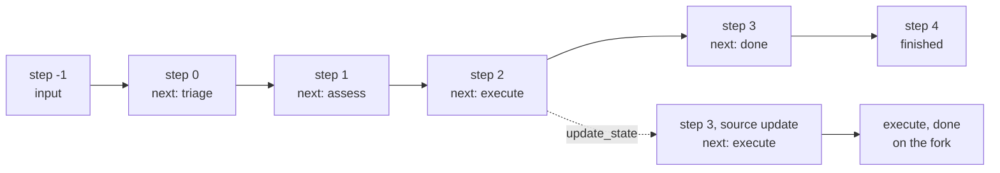

# M10.1 Theory: Checkpointing and threads

*[M10 theory](../README.md) · Lesson 10.1 · Notebooks: [`01a_Checkpointing.ipynb`](../../../../course/p03_langchain_and_langgraph/m10_langgraph_runtime/notebooks/01a_Checkpointing.ipynb) · [All theory pages](../../../README.md)*

## Checkpointer

A graph compiled without a checkpointer forgets everything when `invoke` returns. Compile it with one and pass a thread id in the config, and LangGraph saves a snapshot of the whole state after every step:

```python
app = graph.compile(checkpointer=InMemorySaver())
cfg = {"configurable": {"thread_id": "refund-17"}}
app.invoke(request, cfg)
```

The `thread_id` is the key. Two calls with the same id share one history, so the second turn of a chat sees the first. Different ids never see each other, which is how one compiled graph serves every Larkspur customer at once. `MemorySaver` in the notebook is the older name for `InMemorySaver`; in the installed LangGraph 1.2.18 they are the same class.

For the low-risk refund (triage, assess, execute, done), the thread's history holds 6 checkpoints, one before the first node and one after each step:

| Step | Source | `next` | Events in state |
|---|---|---|---|
| -1 | `input` | `__start__` | 0 |
| 0 | `loop` | `triage` | 0 |
| 1 | `loop` | `assess` | 1 |
| 2 | `loop` | `execute` | 2 |
| 3 | `loop` | `done` | 3 |
| 4 | `loop` | (empty: finished) | 4 |

Each snapshot carries the fields the notebook prints: `values` (the state), `next` (the nodes still to run), `config` (thread id plus a `checkpoint_id`), `parent_config` (the previous checkpoint, so the history is a linked list), `metadata` (source and step) and `created_at`.

Where the checkpoints live decides what survives:

- **`InMemorySaver`** keeps them in the process. Fast, no setup, and gone on restart. Use it in tests and notebooks.
- **`SqliteSaver`** writes a file. The notebook closes the connection, opens a new one, and the second session still knows "ALPHA-7". Fine for one process on one machine.
- **`PostgresSaver`** has the same interface and suits several workers sharing threads, the production case in [lesson 10.6](../06_state_management_in_practice/README.md).

The graph code does not change between them. That is why workers can stay stateless: any worker that can reach the saver can continue any thread.

## History, replay and forks

`app.get_state(cfg)` returns the latest snapshot; `app.get_state_history(cfg)` walks all of them, newest first. Because each snapshot has an id, you can go back:



- **Replay.** `app.invoke(None, older.config)` continues from an old checkpoint with no new input. Replaying `refund-17` from step 2 re-runs `execute` and `done`; `triage` and `assess` stay as recorded. Use it to reproduce what the graph saw when it made a decision.
- **Fork.** `app.update_state(older.config, {"risk": "high"})` writes a new checkpoint (source `update`, step 3, still waiting on `execute`) whose parent is the old one. `invoke(None, fork_config)` continues the fork; the original branch stays in the history. On `refund-17` the history grows from 6 checkpoints to 9.
- **Copy to a new thread.** The notebook's branching demo calls `update_state` on a fresh `thread_id` with an old snapshot's `values`, then lets each thread run on its own.

Use the snapshot's own `config` when you fork. The [06a notebook](../../../../course/p03_langchain_and_langgraph/m10_langgraph_runtime/notebooks/06a_LangGraph_State_Management.ipynb) notes that a hand-built config without `checkpoint_ns` breaks `update_state`.

A replayed node runs its code again. If `execute` sends a refund, replay sends another one; [lesson 10.6](../06_state_management_in_practice/README.md#resume-and-side-effects) shows how to make that harmless.

---
*Previous: [M10 overview](../README.md). Next: [10.2 Interrupts and human-in-the-loop](../02_interrupts_and_human_in_the_loop/README.md).*
