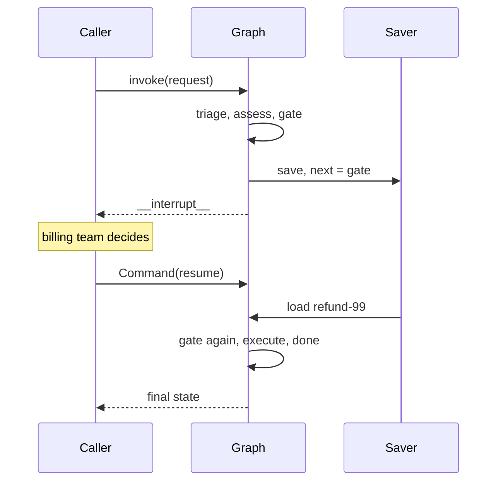

# M10.2 Theory: Interrupts and human-in-the-loop

*[M10 theory](../README.md) · Lesson 10.2 · Notebooks: [`02a_HITL_Mechanics.ipynb`](../../../../course/p03_langchain_and_langgraph/m10_langgraph_runtime/notebooks/02a_HITL_Mechanics.ipynb), [`02b_LangGraph_Interrupt_Primitive.ipynb`](../../../../course/p03_langchain_and_langgraph/m10_langgraph_runtime/notebooks/02b_LangGraph_Interrupt_Primitive.ipynb), [`02c_HITL_Patterns.ipynb`](../../../../course/p03_langchain_and_langgraph/m10_langgraph_runtime/notebooks/02c_HITL_Patterns.ipynb) · [All theory pages](../../../README.md)*

## interrupt()

`interrupt(payload)` called inside a node stops the run at that line. LangGraph saves the state, and `invoke` returns with the payload under `__interrupt__`. The thread now waits at that node; `get_state(cfg).next` is `("human_gate",)`. Days later, any process calls `invoke(Command(resume=value), cfg)` on the same thread, and `interrupt()` returns `value` inside the node.

```python
def human_gate(state):
    approval = interrupt({"question": f"Approve refund for {state['task']}?"})
    return {"decision": "approved", "events": [f"human_gate: human said '{approval}'"]}
```



Three rules follow from the mechanism:

- **A checkpointer is required.** Without one, the first call still returns `__interrupt__`, but nothing was saved, and the resume call raises `RuntimeError: Cannot use Command(resume=...) without checkpointer`.
- **The node runs again from the top.** On resume, LangGraph does not continue mid-function; it calls the node again, and this time `interrupt()` returns the resume value. The 02a resume-lifecycle demo prints "Node execution started" twice. In the refund graph `human_gate` runs 2 times for one approval, so anything above the `interrupt()` call (a notification, a counter, an LLM call) happens twice.
- **The resume value is yours to define.** A string, a dict with `edited_plan`, a list in the Agent Inbox format: `interrupt()` returns whatever you pass, so validate it. The 02a age example calls `interrupt()` in a `while` loop until the answer parses as a non-negative integer.

The notebooks also show the compile-time form, `compile(interrupt_before=["assistant"])` or `interrupt_after=[...]`. It pauses between nodes without touching node code, and you continue with `invoke(None, cfg)`. It suits debugging and step-through review. `interrupt()` suits approvals, because the node decides when to pause and what to show.

## Approval patterns

The 02b and 02c notebooks build four shapes on the same primitive. On the Larkspur refund desk they look like this:

- **Approve or reject.** The gate returns `Command(goto="execute")` or `Command(goto="cancel")` depending on the decision, with `update={"decision": ...}`. Annotate the return type, `Command[Literal["execute", "cancel"]]`, so the graph knows the possible targets.
- **Edit then continue.** The gate shows the draft reply to the customer and resumes with `{"edited_summary": ...}`; the node writes the edited text to state and the graph follows its one path.
- **Edit state while paused.** With `interrupt_before`, the caller runs `update_state(cfg, {...})` on the parked thread, then `invoke(None, cfg)`. The 02c demo swaps "Multiply 2 and 3" for "No, please multiply 15 and 6" this way.
- **Review a tool call.** `interrupt()` inside a sensitive tool, or a wrapper such as the notebook's `add_human_in_the_loop`, lets a person accept, edit or answer instead of running it. `HumanInTheLoopMiddleware` in [M24](../../../p08_agent_foundations/m24_react_agents/README.md) packages the same idea for `create_agent`.

Whichever shape you use, approve on an exact value and treat anything else as no. [M27](../../../p08_agent_foundations/m27_human_approval_applied_agents/README.md) builds that fail-closed gate, with a fingerprint that catches edits made after the review. What can happen twice around the gate is the subject of the lab in [lesson 10.6](../06_state_management_in_practice/README.md#resume-and-side-effects).

---
*Previous: [10.1 Checkpointing and threads](../01_checkpointing_and_threads/README.md). Next: [10.3 Subgraphs](../03_subgraphs/README.md).*
