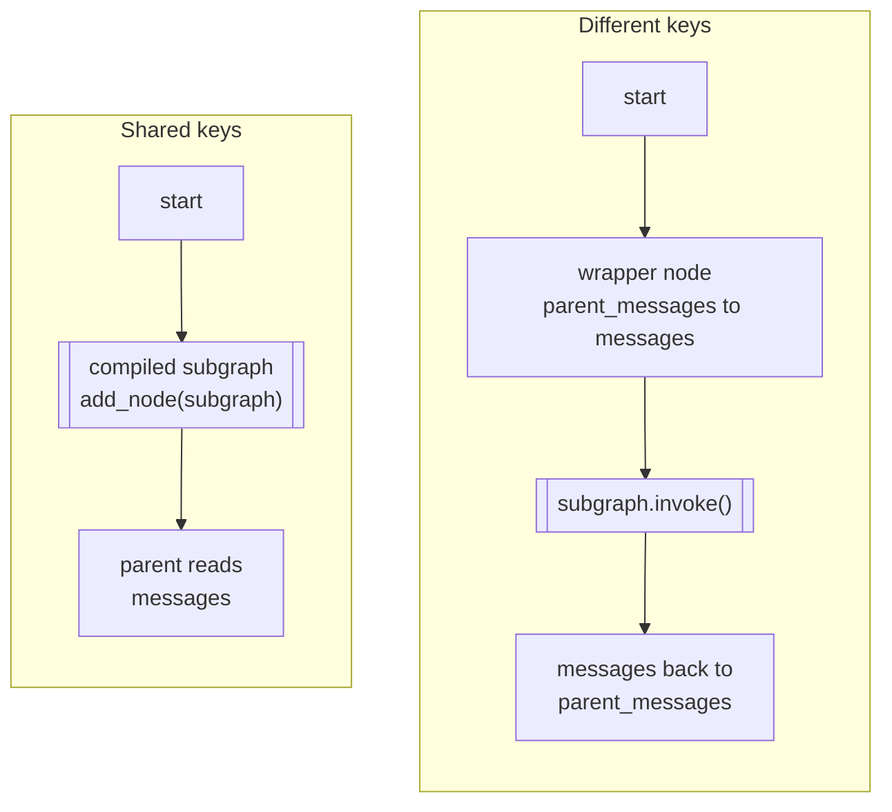

# M10.3 Theory: Subgraphs

*[M10 theory](../README.md) · Lesson 10.3 · Notebooks: [`03a_Subgraphs.ipynb`](../../../../course/p03_langchain_and_langgraph/m10_langgraph_runtime/notebooks/03a_Subgraphs.ipynb) · [All theory pages](../../../README.md)*

## Subgraphs

A subgraph is an ordinary compiled graph used as a node of another graph. The notebook builds a weather agent (an `agent` node, a `ToolNode`, a loop between them), invokes it on its own to check its input and output, then nests it two ways. On the Larkspur desk the same move turns a self-contained "check refund eligibility" agent into one step of the refund graph.

- **Shared keys: add it directly.** When parent and child both use `MessagesState`, `add_node("subgraph", subgraph)` is enough. The parent's `messages` channel is the child's, and the child's reply lands on it with the same reducer.
- **Different keys: wrap it.** The notebook's parent stores the transcript under `parent_messages`. A wrapper node calls `subgraph.invoke({"messages": state["parent_messages"]})` and writes the result back. The child does not change; only the parent knows the mapping.

Only the keys the parent declares come back out of a directly added subgraph. A child that writes a private `scratch` key next to a shared `decision` key returns `decision` to the parent and drops `scratch`. So the child can keep working notes the parent never sees. It also means a key you expected in the parent has to be in the parent's schema.

The runtime features from this module reach inside subgraphs:

- **Checkpoints.** A subgraph compiled without a checkpointer uses the parent's. A parent thread parked in a subgraph reports the subgraph node in `next`, and `get_state(cfg, subgraphs=True)` shows the child's own state and its `next`.
- **Interrupts.** An `interrupt()` inside the child pauses the whole run, in both forms. Resuming re-runs only the interrupted child node; the child's earlier nodes keep their saved results. With a wrapper, the wrapper function also runs again from its first line, so any parent-side code before `subgraph.invoke` repeats. In a two-node child (a check, then a gate) both forms ran the check once and the gate twice; the wrapper ran twice.
- **Streaming.** `stream(..., subgraphs=True)` yields `(namespace, chunk)` pairs, where the namespace names the subgraph node (`("approval:<task id>",)`) and the parent's own events have the empty namespace `()`.

Choose a subgraph when a piece has its own loop or its own state that the parent should not carry, when a team owns it separately, or when several parents reuse it. [M35](../../../p10_memory_and_multi_agent/m35_multi_agent_architectures/README.md) to M37 build multi-agent systems out of exactly these pieces. For a straight sequence of steps on the same state, plain nodes are simpler.

## Key Takeaways

- Add a compiled subgraph directly when it shares keys with the parent, and wrap it in a node that maps keys when it does not. Only keys the parent declares come back out.
- Checkpoints, interrupts and streaming reach inside subgraphs. A resume re-runs only the interrupted child node, but a wrapper also runs again from its first line.
- Use a subgraph for a piece with its own loop or state, a separate owner, or several parents. For a straight sequence on one state, plain nodes are simpler.

## Check yourself

1. When can you add a compiled subgraph directly as a node, and when do you need a wrapper node?

Add it directly when parent and child share keys, as with `MessagesState` on both sides: the parent's `messages` channel is the child's. When the keys differ, as with the notebook's `parent_messages`, a wrapper calls `subgraph.invoke({"messages": ...})` and writes the result back. The child does not change; only the parent knows the mapping.

2. A directly added child writes a private scratch key next to a shared decision key. What does the parent receive?

Only `decision`. A directly added subgraph returns only the keys the parent declares, so `scratch` is dropped. The child can keep working notes the parent never sees, and a key you expect in the parent has to be in the parent's schema.

3. A two-node approval child (a check, then a gate) runs through a wrapper, pauses at the gate and resumes. What runs twice?

The gate and the wrapper. Resuming re-runs only the interrupted child node, so the check runs once and the gate twice. The wrapper function also runs again from its first line, so any parent-side code before `subgraph.invoke` repeats.

---
*Previous: [10.2 Interrupts and human-in-the-loop](../02_interrupts_and_human_in_the_loop/README.md). Next: [10.4 Async and streaming](../04_async_and_streaming/README.md).*
