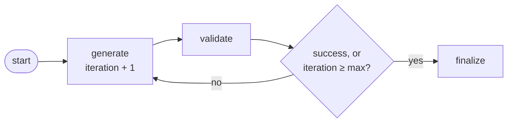

# M10.5 Theory: Retry policies and bounded cycles

*[M10 theory](../README.md) · Lesson 10.5 · Notebooks: [`05a_Retries.ipynb`](../../../../course/p03_langchain_and_langgraph/m10_langgraph_runtime/notebooks/05a_Retries.ipynb), [`05b_Cycles_and_Loops.ipynb`](../../../../course/p03_langchain_and_langgraph/m10_langgraph_runtime/notebooks/05b_Cycles_and_Loops.ipynb) · [All theory pages](../../../README.md)*

## Retry policies

A `RetryPolicy` attached with `add_node(name, fn, retry_policy=...)` re-runs that node when it raises, inside the same `invoke`. The caller sees one call; the `updates` stream shows the node once, when it finally succeeds. The 05a notebook wraps a weather API that fails 70% of the time:

```python
RetryPolicy(max_attempts=5, initial_interval=1.0, backoff_factor=2.0,
            max_interval=10.0, jitter=True, retry_on=APIError)
```

In the installed LangGraph 1.2.18 the wait after the n-th failure is `min(max_interval, initial_interval * backoff_factor ** (n - 1))`, plus a random 0 to 1 second when `jitter` is on. For the notebook's policy:

| After failure | Wait | With jitter |
|---|---|---|
| 1 | 1 s | 1 to 2 s |
| 2 | 2 s | 2 to 3 s |
| 3 | 4 s | 4 to 5 s |
| 4 | 8 s | 8 to 9 s |
| 5 | no wait, the exception reaches the caller | |

So a run that exhausts the policy waits 15 to 19 seconds before it fails. With a 70% failure rate, all five attempts fail with probability 0.7^5 ≈ 0.168, about one run in six. More attempts would lower that and lengthen the worst wait; `max_interval` caps any single wait at 10 seconds.

With no `retry_on`, the default retries `ConnectionError` and HTTP 5xx errors from `httpx` and `requests`, and never retries `ValueError`, `TypeError`, `RuntimeError`, `LookupError` and the other programming errors on its list. Any exception class not on that list is retried, so a custom `APIError(Exception)` is retried even without `retry_on`. Name the exceptions you mean, as the notebook does, so a bug in the node fails on the first attempt instead of after every wait.

A retry repeats the node's side effects. If the payment provider applied a Larkspur refund and then the connection dropped, the retry refunds again. [Lesson 10.6](../06_state_management_in_practice/README.md#resume-and-side-effects) shows the fix and the lab that counts it.

## Bounded cycles

A cycle is a conditional edge that routes back to a node the run already visited. The 05b notebook uses one to regenerate code until it passes its tests, and another to research a topic to a fixed depth. Every cycle needs a reason to stop that does not depend on the model getting it right.


<!-- animated: diagrams/bounded-cycle.anim.html -->

The notebook's guard has three parts:

- **The node counts.** `generate` returns `iteration + 1`. The router only reads it. A router function picks an edge; anything it writes to `state` is discarded, so a counter bumped there never grows.
- **The router checks success first, then the cap.** With `max_iterations=3` and a validator that always fails, the run is generate, validate, three times over, then `finalize`: 7 node runs, 3 errors accumulated through the `operator.add` reducer, and a result with `success` still false that the caller must handle.
- **`recursion_limit` is the backstop.** It counts steps, not loops. The installed LangGraph's default is 10,007 (set by `LANGGRAPH_DEFAULT_RECURSION_LIMIT`), far too high to save an LLM budget. Pass it per run: the same loop with no counter and `{"recursion_limit": 10}` stops after 10 steps (five generates, five validations) with `GraphRecursionError`.

A loop on the Larkspur desk, such as "rewrite the customer reply until the tone checker passes", gets the same treatment: a counter in the rewriting node, a cap in the router, an explicit `recursion_limit`, and a fallback path when the cap is hit. [M29](../../../p09_agentic_rag/m29_crag_and_self_rag/README.md)'s grade-and-rewrite loops are built this way.

## Key Takeaways

- A `RetryPolicy` re-runs a failing node inside one call, with exponential backoff capped by `max_interval`. Name the exceptions in `retry_on` so a bug fails on the first attempt.
- Every retry repeats the node's side effects, so an external write that already succeeded can happen twice.
- Bound every cycle: count in the node, check success then the cap in the router, and pass an explicit `recursion_limit`. The default of 10,007 steps will not protect an LLM budget.

## Check yourself

<details>
<summary>1. Why should a RetryPolicy name its exceptions in retry_on instead of relying on the default?</summary>

So a bug fails on the first attempt instead of after every wait. The default retries `ConnectionError` and HTTP 5xx errors and skips the programming errors on its list, but any class not on that list is retried, including a custom `APIError(Exception)`. Naming the exceptions makes the policy retry only what you mean.

</details>

<details>
<summary>2. With the notebook's policy and a weather API that fails 70% of the time, how long does a run that exhausts the policy wait, and how often does that happen?</summary>

15 to 19 seconds: waits of 1, 2, 4 and 8 seconds, plus up to 1 second of jitter each, and no wait after the fifth failure. All five attempts fail with probability 0.7^5 ≈ 0.168, about one run in six.

</details>

<details>
<summary>3. A rewrite loop bumps its attempt counter in the router function, and the loop runs until GraphRecursionError. What went wrong?</summary>

Anything a router writes to `state` is discarded, so the counter never grows and the cap is never reached. The node must count (`generate` returns `iteration + 1`) and the router only reads it, checking success first, then the cap. Pass an explicit `recursion_limit` as the backstop, since the default of 10,007 steps is far too high to save an LLM budget.

</details>

---
*Previous: [10.4 Async and streaming](../04_async_and_streaming/README.md). Next: [10.6 State management in practice](../06_state_management_in_practice/README.md).*
