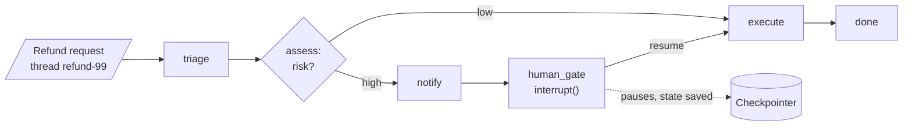

# M10 Theory: LangGraph runtime

*Part III · LangChain & LangGraph Fundamentals · [Module README](../../../course/p03_langchain_and_langgraph/m10_langgraph_runtime/README.md) · [All theory pages](../../README.md)*

M09 builds a graph that runs from start to end in one call. Real workflows stop and start again: a person approves a step hours later, a payment provider times out, a deploy restarts the worker, a user wants to see progress while the graph runs. The M10 notebooks build on four ideas: the checkpointer, `interrupt()`, subgraphs and streaming modes, plus the retry policies, loop bounds and state rules that make a resumed run safe. Each idea has a page in the folder of the lesson that teaches it, listed under [Lessons](#lessons). This page has the overview, the interview questions and the takeaways.

The running example is the refund desk of Larkspur Cloud, the fictional host whose handbook M11 to M13 index. A refund request enters a graph modelled on the refund agent in [`06a_LangGraph_State_Management.ipynb`](../../../course/p03_langchain_and_langgraph/m10_langgraph_runtime/notebooks/06a_LangGraph_State_Management.ipynb): triage, assess risk, refund at once when the risk is low, and wait for the billing team's approval when it is high. Two threads carry the pages and the lab, `refund-17` (low risk) and `refund-99` (high risk).

## TL;DR

- A **checkpointer** saves the whole state after every step under a `thread_id`. The four-node low-risk refund saves 6 checkpoints, steps -1 to 4. Any process with the same saver and thread id can read them, resume from them or fork them.
- **`interrupt()`** pauses a node, saves the run and returns the payload to the caller under `__interrupt__`. `Command(resume=value)` continues it, and the node **runs again from its first line**, so code above the `interrupt()` call runs twice.
- A **subgraph** is a compiled graph used as a node. With shared keys you add it directly; with different keys a wrapper node maps parent state in and out. Keys the parent does not declare are dropped on the way out.
- **Streaming modes** decide what the caller sees while a run is in flight. For the same four-node run, `values` yields 5 chunks, `updates` 4, `checkpoints` 6, `tasks` 8 and `debug` 14. `messages` yields LLM tokens from every model call inside every node.
- Every resumed or retried node can repeat a side effect. In the lab, a refund whose provider response is lost reaches the customer twice unless the call carries an idempotency key.

## Mental model

<!-- animated: diagrams/refund-run.anim.html -->

The checkpointer writes after every step. At the gate, the first `invoke` returns while `refund-99` waits at `human_gate`, and nothing runs until somebody calls `Command(resume="approve")` on the same thread, minutes or days later, from any worker that can reach the saver. Everything this module adds is about what happens between those two calls and after them: which code runs again, what the caller sees, and what the outside world receives twice.

## Lessons

| Lesson | Topic | Theory |
|---|---|---|
| 10.1 | Checkpointing and threads | [Checkpointer](01_checkpointing_and_threads/README.md#checkpointer) [History, replay and forks](01_checkpointing_and_threads/README.md#history-replay-and-forks) |
| 10.2 | Interrupts and human-in-the-loop | [interrupt()](02_interrupts_and_human_in_the_loop/README.md#interrupt) [Approval patterns](02_interrupts_and_human_in_the_loop/README.md#approval-patterns) |
| 10.3 | Subgraphs | [Subgraphs](03_subgraphs/README.md#subgraphs) |
| 10.4 | Async and streaming | [Streaming modes](04_async_and_streaming/README.md#streaming-modes) [Async nodes](04_async_and_streaming/README.md#async-nodes) |
| 10.5 | Retry policies and bounded cycles | [Retry policies](05_retry_policies_and_bounded_cycles/README.md#retry-policies) [Bounded cycles](05_retry_policies_and_bounded_cycles/README.md#bounded-cycles) |
| 10.6 | State management in practice | [Reducers and parallel writes](06_state_management_in_practice/README.md#reducers-and-parallel-writes) [Resume and side effects](06_state_management_in_practice/README.md#resume-and-side-effects) |

## Interactive lab

[**What runs twice on resume**](06_state_management_in_practice/interactive/resume-side-effects-lab.html): open the file in a browser. Pick the high-risk refund with no fault and guards off: the billing team gets 2 approval notices for one request, because the notice sits above `interrupt()`. Then choose *Response lost, RetryPolicy*: the retry that saves the run also refunds the customer twice. Turn the guards on and both counts drop to 1, with the same number of client calls.

## How it connects

- **Before:** [M09](../m09_langgraph_core/README.md) builds the graphs this module pauses and resumes: state, reducers, nodes, conditional edges. M07 and M08 supply the chat models and tools inside the nodes.
- **Next:** [M11](../../p04_rag_foundations/m11_rag_lifecycle/README.md) starts the RAG pipeline these graphs will orchestrate. [M24](../../p08_agent_foundations/m24_react_agents/README.md)'s `HumanInTheLoopMiddleware` and [M27](../../p08_agent_foundations/m27_human_approval_applied_agents/README.md)'s approval gate are built on `interrupt()`. [M29](../../p09_agentic_rag/m29_crag_and_self_rag/README.md)'s grade-and-retry loops need the bounds from lesson 10.5, [M33](../../p10_memory_and_multi_agent/m33_conversational_memory_rag/README.md) keeps conversations in checkpointer threads, and [M35](../../p10_memory_and_multi_agent/m35_multi_agent_architectures/README.md) to M37 compose agents as subgraphs.

## Interview Spotlight: 5 Questions You Might Get Asked

*Production questions in the style of OpenAI, Anthropic and Google interviews for applied AI roles.*

### 1. Finance reports that refund-99 was paid out twice, and the billing team says it got two approval requests for it. The approval itself was given once. How do you investigate?

**What a strong answer covers:**
- Reads the thread's checkpoint history and the provider's logs side by side, and counts how many times `human_gate` and `execute` ran
- Knows that resuming after `interrupt()` re-runs the gate node from its first line, so a notification above the call goes out again
- Knows that a `RetryPolicy` or an `invoke(None)` after a crash re-runs `execute`, and a provider that applied the refund but lost the response gets called twice
- Fixes both at the source: the notice moves to its own node before the gate, and the refund call carries an idempotency key such as `refund:refund-99` that the provider dedups on

### 2. High-risk refunds wait up to two days for approval, and the service runs on three workers that redeploy daily. The prototype uses `InMemorySaver`. What do you change, and what do you check before launch?

**What a strong answer covers:**
- `InMemorySaver` lives in one process; a redeploy loses every parked refund, and a resume that lands on another worker finds no thread
- Moves to a shared durable saver (`PostgresSaver` for several writers; `SqliteSaver` is fine for one process on one machine), with no change to graph code
- Tests the restart path: start `refund-99`, kill the worker, resume from a fresh process with the same `thread_id`
- Plans retention: checkpoints accumulate per step, so old finished threads need a cleanup job

### 3. Your manager wants a dashboard showing how many refunds are waiting for approval and for how long. Where does the data come from?

**What a strong answer covers:**
- A thread parked at the gate has `get_state(config).next == ("human_gate",)` and a pending interrupt in its tasks
- The latest checkpoint's `created_at` gives the wait time; alerts fire when a refund waits past an agreed limit
- Keeps an append-only `events` field (an `operator.add` reducer) as the audit trail, since `values` alone shows only the latest state
- Records the decision and who made it in state when resuming, so the dashboard and the audit agree

### 4. A refund was assessed as high risk on Friday and approved on Monday. Over the weekend the policy team changed the refund window. Which policy applies when the graph resumes, and should it?

**What a strong answer covers:**
- The checkpoint holds Friday's state; resuming continues from it and does not re-run `triage` or `assess`
- Decides whether stale assessments are acceptable; for money, re-checks the policy in `execute` or routes back to `assess` when the policy version changed
- Stores the policy version in state at assessment time, so the check is a comparison, not a guess
- For a deliberate correction, forks with `update_state` from the checkpoint before `execute` instead of editing the database

### 5. The support chat streams tokens with `stream_mode="messages"`. After a grader node was added, customers briefly see "yes relevant" before the answer. Why, and how do you fix it?

**What a strong answer covers:**
- `messages` mode streams tokens from every chat-model call inside every node, the grader included
- Each chunk comes with metadata; filters on `metadata["langgraph_node"] == "answer"` before rendering
- Uses `updates` mode in parallel for progress labels ("checking the handbook"), passing a list of modes and reading `(mode, chunk)` pairs
- Adds a test that streams a scripted run and asserts no grader tokens reach the client

## Key Takeaways

- Compile with a checkpointer and pass a `thread_id` whenever a run may pause, crash or continue later; use a durable, shared saver in production.
- Treat every node as code that can run more than once. Keep side effects after `interrupt()` or in their own node, and give every external write an idempotency key.
- Pick the stream mode for the screen: `updates` for progress, `messages` filtered by node for typing, `values` when the client renders whole state.
- Bound every loop twice: a counter that a node increments and the router reads, and an explicit `recursion_limit` as the backstop.

---
*Previous: [M09 LangGraph core](../m09_langgraph_core/README.md). Next: [M11 The RAG lifecycle](../../p04_rag_foundations/m11_rag_lifecycle/README.md).*
