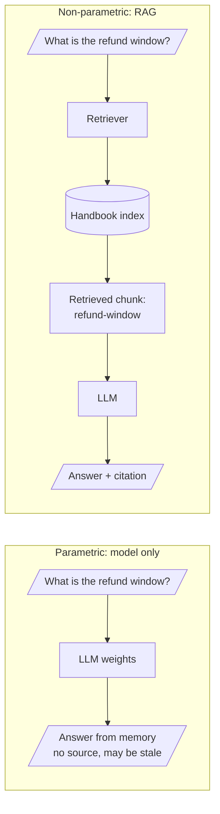

# M11.1 Theory: The knowledge problem: hallucination, freshness, context-window growth, RAG vs fine-tuning vs long context

*[M11 theory](../README.md) · Lesson 11.1 · [All theory pages](../../../README.md)*

## Parametric vs non-parametric knowledge

**Parametric knowledge** is what the model stores in its weights. It is fast and needs no infrastructure, but it has four problems for an application:

- **Stale.** It stops at the training cut-off. Larkspur's refund policy changed in March 2026; no model trained before then knows.
- **Missing.** Private data (your tickets, contracts, runbooks) was never in the training set.
- **Unverifiable.** The model cannot point to where a fact came from, so neither you nor the user can check it.
- **Confident when wrong.** Asked about something it never saw, the model still produces fluent text. That is a hallucination.

**Non-parametric knowledge** lives outside the model, in an index you build and query. RAG retrieves the relevant passages and puts them in the prompt, so the model answers from evidence it can quote.

The three ways to give a model new knowledge solve different problems:

| | RAG | Fine-tuning | Long context |
|---|---|---|---|
| Where the knowledge lives | External index | Model weights | The prompt, every call |
| Updating a fact | Re-index one document | Retrain | Edit the prompt |
| Citations | Yes, per chunk | No | Possible, but nothing narrows the evidence |
| Cost per question | Retrieval + a short prompt | Cheap once trained | Pays for the whole corpus in tokens |
| Best at | Facts that change, private data, auditability | Style, format, domain vocabulary, behaviour | Small corpora that fit, one-off analysis |
| Fails when | Retrieval misses the evidence | Facts change after training | The corpus outgrows the window, or the answer sits mid-context |

Fine-tuning and RAG combine well: fine-tune for tone and format, retrieve for facts. M04 covers when fine-tuning is worth it.

## Check yourself

1. A model trained before March 2026 answers the Larkspur refund-window question fluently. Why can you not trust that answer?

Parametric knowledge stops at the training cut-off, and the refund policy changed in March 2026, so the answer may be stale. The model also cannot point to a source, so nobody can check it, and it produces fluent text even about what it never saw. RAG puts the current policy passage in the prompt, so the model answers from evidence it can quote.

2. The refund window changes again next month. What does updating that fact take under RAG, fine-tuning and long context?

With RAG you re-index one document. With fine-tuning you retrain. With long context you edit the prompt, but every call pays for the whole corpus in tokens.

3. Larkspur wants answers in its house tone that also state current policy with citations. Which approach fits?

Combine them: fine-tune for tone and format, retrieve for facts. Fine-tuning alone gives no citations and goes wrong when facts change after training; RAG cites per chunk and picks up a change with a re-index. M04 covers when fine-tuning is worth it.

---
*Previous: [M11 overview](../README.md). Next: [11.2 Indexing from scratch with TF-IDF and nearest neighbours](../02_indexing_from_scratch_with_tf_idf_and_nearest_neighbours/README.md).*
