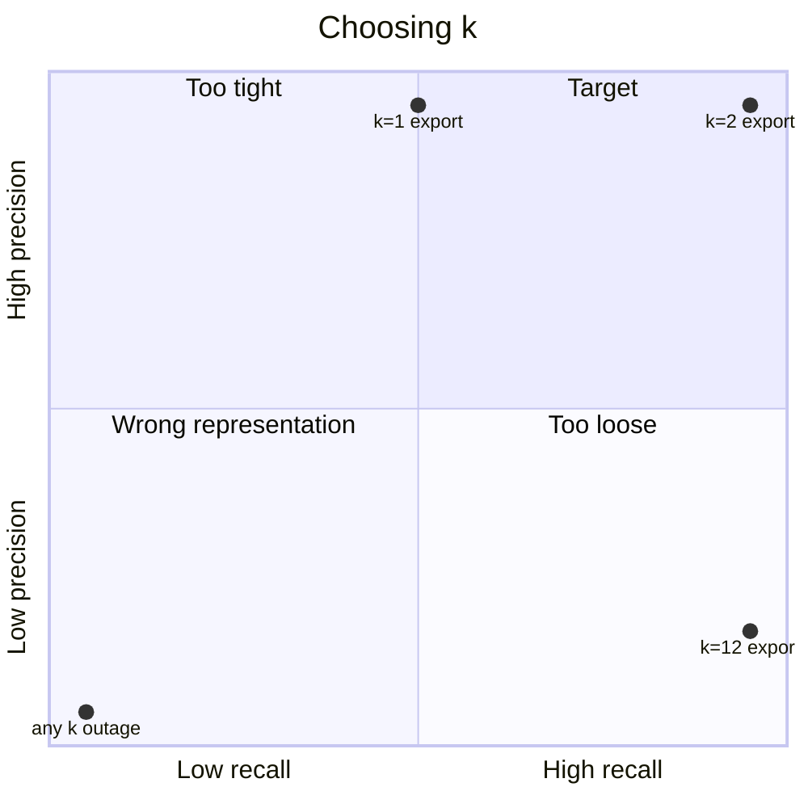

# M11.2 Theory: Indexing from scratch with TF-IDF and nearest neighbours

*[M11 theory](../README.md) · Lesson 11.2 · Notebooks: [`02a_indexing_from_scratch.ipynb`](../../../../course/p04_rag_foundations/m11_rag_lifecycle/notebooks/02a_indexing_from_scratch.ipynb) · [All theory pages](../../../README.md)*

## Top-k

The retriever scores every chunk against the question and returns the `k` best. Those `k` chunks are all the model sees. Two metrics describe the result against a golden set of questions whose evidence chunks you have labelled:

```
Recall@k    = evidence chunks in the top k / all evidence chunks for the question
Precision@k = evidence chunks in the top k / k
```

The [interactive lab](interactive/top-k-retrieval-lab.html) indexes twelve Larkspur handbook chunks with real TF-IDF (the same weighting scikit-learn uses) and three golden questions, each with two evidence chunks. Its numbers:

| Question | k = 1 | k = 2 | k = 5 | k = 12 |
|---|---|---|---|---|
| *Can I export my data after I cancel my plan?* | R 0.50 · P 1.00 | **R 1.00 · P 1.00** | R 1.00 · P 0.40 | R 1.00 · P 0.17 |
| *How long does a refund take?* | R 0.50 · P 1.00 | R 0.50 · P 0.50 | R 0.50 · P 0.20 | R 0.50 · P 0.08 |
| *What happens if my server goes down?* | R 0.00 · P 0.00 | R 0.00 · P 0.00 | R 0.00 · P 0.00 | R 0.00 · P 0.00 |
| Context sent (≈ tokens) | ~30 | ~60 | ~150 | ~348 |

Each question fails in a different way:

- **The export question is a ranking problem, and `k = 2` solves it.** Past that, each extra chunk is noise: precision falls from 1.00 to 0.17 while the prompt grows almost sixfold.
- **The refund question is a representation problem.** The `refund-timing` chunk says "Refunds"; the question says "refund". TF-IDF matches exact tokens, so that chunk scores 0 and no `k` retrieves it. Meanwhile `reboot` scores 0.194 because both contain "does".
- **The outage question is vocabulary mismatch.** The evidence talks about "outage" and "availability"; the question says "server goes down". TF-IDF ranks `reboot` and `sizing` first because they contain "server". Embeddings ([lesson 11.3](../03_semantic_retrieval_with_embedding_similarity/README.md), M14) and query rewriting (M18) fix this. A bigger `k` only adds noise.

<!-- lab: interactive/top-k-retrieval-lab.html -->

Raising `k` has costs beyond tokens. Every extra chunk adds latency and gives the model text it can misread. Long prompts also have a position effect: models use information at the start and end of the context more reliably than information in the middle (Liu et al., *Lost in the Middle*, 2023). Retrieve generously when a reranker (M19) will trim the list afterwards; retrieve tightly when chunks go straight to the model.



## Check yourself

<details>
<summary>1. Why does no value of k let TF-IDF retrieve the refund-timing chunk for How long does a refund take?</summary>

It is a representation problem. The chunk says "Refunds" and the question says "refund", and TF-IDF matches exact tokens, so the chunk scores 0. Recall stays at 0.50 at every `k`, while a bigger `k` only adds noise.

</details>

<details>
<summary>2. For the export question, what are recall and precision at k = 2 and at k = 12, and which k do you pick?</summary>

At `k = 2` recall and precision are both 1.00, for about 60 tokens of context. At `k = 12` recall is still 1.00 but precision falls to 0.17 and the context grows almost sixfold, to about 348 tokens. Pick `k = 2`: past it every extra chunk is noise.

</details>

<details>
<summary>3. When should a pipeline retrieve generously with a large k, and when tightly?</summary>

Retrieve generously when a reranker (M19) will trim the list afterwards. Retrieve tightly when the chunks go straight to the model, because every extra chunk adds latency and text the model can misread, and models use information in the middle of a long context less reliably than at its start and end.

</details>

---
*Previous: [11.1 The knowledge problem: hallucination, freshness, context-window growth, RAG vs fine-tuning vs long context](../01_the_knowledge_problem_hallucination_freshness_context_window_growth_rag_vs_fine_tuning_vs_long_context/README.md). Next: [11.3 Semantic retrieval with embedding similarity](../03_semantic_retrieval_with_embedding_similarity/README.md).*
