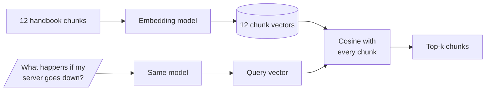

# M11.3 Theory: Semantic retrieval with embedding similarity

*[M11 theory](../README.md) · Lesson 11.3 · Notebooks: [`03a_retrieval_strategies.ipynb`](../../../../course/p04_rag_foundations/m11_rag_lifecycle/notebooks/03a_retrieval_strategies.ipynb) · [All theory pages](../../../README.md)*

## Embedding similarity

An embedding model turns a text into a fixed-length list of numbers, a vector. Texts with similar meaning get vectors that point in similar directions, even when they share no words. Retrieval with embeddings has the same shape as the TF-IDF index in lesson 11.2; only the vectors change:



The chunks are embedded once, at indexing time. The question is embedded when it arrives, and each chunk is scored by the cosine of the angle between the two vectors:

```
cosine(q, d) = (q · d) / (|q| × |d|)   # -1 to 1; higher is closer
distance     = 1 - cosine(q, d)         # NearestNeighbors(metric="cosine")
```

Notebook 03a fits scikit-learn's `NearestNeighbors(metric="cosine")` on the chunk vectors and prints a *distance*, so a lower number there means a closer chunk. When every vector has length 1, cosine is the plain dot product. OpenAI's embeddings come normalised that way, and sentence-transformers returns them so with `normalize_embeddings=True`.

The question and the chunks must go through the same model. Two models produce vectors in different spaces, so the cosine between a vector from one and a vector from the other is meaningless. Notebook 03a uses one function, `get_gpt4_embedding`, for both sides. Changing the embedding model therefore means re-embedding the whole corpus (M14).

## Embeddings against TF-IDF

The comparison below uses the 12 Larkspur chunks and three golden questions from the [lesson 11.2 lab](../02_indexing_from_scratch_with_tf_idf_and_nearest_neighbours/interactive/top-k-retrieval-lab.html), embedded with `all-MiniLM-L6-v2`. That model is small (384 numbers per vector) and runs locally, so anyone can reproduce the scores. Notebook 03a uses OpenAI's `text-embedding-3-small`, whose scores will differ.

```python
from sentence_transformers import SentenceTransformer

model = SentenceTransformer("sentence-transformers/all-MiniLM-L6-v2")
question = "What happens if my server goes down?"
# 12 x 384, embedded once at indexing time
chunks = model.encode(texts, normalize_embeddings=True)
q = model.encode([question], normalize_embeddings=True)[0]
# cosine, because every vector has length 1
scores = chunks @ q
```

Each question has two evidence chunks, so recall moves in steps of 0.50:

| Question | TF-IDF R@2 | TF-IDF R@3 | Embeddings R@2 | Embeddings R@3 | Embedding top three (cosine) |
|---|---|---|---|---|---|
| *How long does a refund take?* | 0.50 | 0.50 | **1.00** | 1.00 | `refund-timing` 0.766, `refund-window` 0.608, `support` 0.297 |
| *What happens if my server goes down?* | 0.00 | 0.00 | 0.50 | **1.00** | `reboot` 0.394, `incidents` 0.314, `sla` 0.257 |
| *Can I export my data after I cancel my plan?* | **1.00** | 1.00 | 0.50 | 1.00 | `retention` 0.817, `cancel` 0.561, `export` 0.479 |

- **Refund: the representation problem is gone.** TF-IDF gave `refund-timing` a score of 0 because "Refunds" and "refund" are different tokens. The embedding model places both word forms close together and ranks that chunk first.
- **Outage: the vocabulary gap narrows.** Both evidence chunks now reach the top three, though `reboot` still ranks first because rebooting a server is close in meaning to a server going down. The top three scores sit within 0.137 of each other, so a small change to the question can reorder them.
- **Export: embeddings lose a question TF-IDF answered.** The question is half about cancelling, so the `cancel` chunk (0.561) outranks `export` (0.479). TF-IDF matched the literal word "export" and found both evidence chunks at `k = 2`.

Embeddings measure how close two texts are in topic, which is not the same as whether a chunk contains the answer. TF-IDF wins when the question and the evidence share a rare exact word (a product name, an error code, "export"); embeddings win on paraphrase and word forms. Hybrid search (M17) combines the two scores, and a reranker (M19) reorders the candidates with a model that reads the question and each chunk together.

The scores are not probabilities either. The best outage match scores 0.394, while the best export match scores 0.817. A fixed cut-off such as "drop chunks below 0.5" would send the outage question to the model with no context at all. Set any threshold per corpus and model from the golden set, and re-check it whenever the model changes.

---
*Previous: [11.2 Indexing from scratch with TF-IDF and nearest neighbours](../02_indexing_from_scratch_with_tf_idf_and_nearest_neighbours/README.md). Next: [11.4 Your first LangChain RAG with Chroma](../04_your_first_langchain_rag_with_chroma/README.md).*
