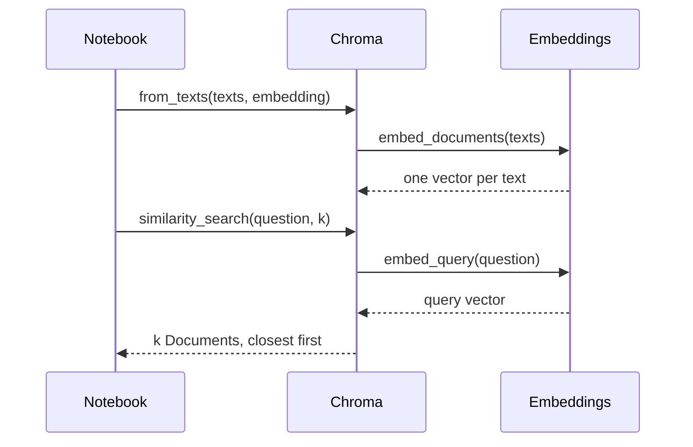

# M11.4 Theory: Your first LangChain RAG with Chroma

*[M11 theory](../README.md) · Lesson 11.4 · Notebooks: [`04a_langchain_rag_quickstart.ipynb`](../../../../course/p04_rag_foundations/m11_rag_lifecycle/notebooks/04a_langchain_rag_quickstart.ipynb) · [All theory pages](../../../README.md)*

## What LangChain replaces

Lessons 11.2 and 11.3 built the index by hand: embed each chunk, keep the vectors in a NumPy array, fit `NearestNeighbors`, embed the question, look up its neighbours. Notebook 04a does the same work through two LangChain interfaces, `Embeddings` and `VectorStore`:

| Step | By hand (notebook 03a) | LangChain with Chroma (notebook 04a) |
|---|---|---|
| Embed the chunks | `get_gpt4_embedding(doc)` in a loop, one API call per chunk | `OpenAIEmbeddings().embed_documents(texts)`, batched |
| Store the vectors | `np.array(embeddings)`, then `NearestNeighbors(...).fit(...)` | `Chroma.from_texts(texts, embedding=embeddings_model)` |
| Embed the question | `get_gpt4_embedding(query)` | `embed_query(question)`, called by the store |
| Search | `index.kneighbors(query_embedding)` | `db.similarity_search(question, k=4)` |
| Hand results to a chain | not covered | `db.as_retriever(search_kwargs={"k": 2})` |



The store keeps the embedding object and calls it for you, so the question always goes through the same model as the chunks. `Embeddings` has separate `embed_documents` and `embed_query` methods because some models encode questions and passages differently. For OpenAI's models the two do the same thing; `embed_query` calls `embed_documents([text])[0]`.

Three defaults in notebook 04a surprise people the first time:

- **`k` is 4** when you call `similarity_search` without it. Set it explicitly, and measure it as in lesson 11.2.
- **Re-running the cell duplicates the index.** `from_texts` without a `collection_name` writes to a collection called `langchain` and adds to whatever is already there. Running it twice on the 12 Larkspur chunks leaves 24 entries, and the refund question's top three comes back with `refund-timing` twice. Pass `ids=` so a re-run overwrites, or give each experiment its own collection.
- **Nothing is saved.** Without `persist_directory`, the collection lives in memory and disappears when the kernel restarts.

The notebook imports `Chroma` from `langchain_community.vectorstores`. That package now warns that it is being sunset; this repo depends on `langchain-chroma`, which has the same class: `from langchain_chroma import Chroma`.

## Distance, not similarity

Chroma ranks by distance, and its default metric is squared Euclidean (L2) distance, so `similarity_search_with_score` returns lower numbers for closer chunks. For vectors of length 1 the two measures are tied by `distance = 2 - 2 × cosine`, so L2 and cosine rank chunks in the same order. On the 12 Larkspur chunks, embedded with `all-MiniLM-L6-v2` as in lesson 11.3 (langchain-chroma 1.1.0, chromadb 1.5.9):

| Question | Chunk | Cosine (11.3) | `similarity_search_with_score` | `similarity_search_with_relevance_scores` |
|---|---|---|---|---|
| *How long does a refund take?* | `refund-timing` (1st) | 0.766 | 0.469 | 0.668 |
| *Can I export my data after I cancel my plan?* | `retention` (1st) | 0.817 | 0.367 | 0.741 |
| *What happens if my server goes down?* | `reboot` (1st) | 0.394 | 1.212 | 0.143 |
| *What happens if my server goes down?* | `sla` (3rd, evidence) | 0.257 | 1.487 | **-0.051** |

The relevance-score method converts L2 distance with `1 - distance / √2`, which assumes a range the distances do not keep to. The `sla` chunk, which holds the evidence for the outage question, gets a negative relevance score, and LangChain prints `Relevance scores must be between 0 and 1`. A retriever built with `search_type="similarity_score_threshold"` and `score_threshold=0.2` returns no chunks at all for the outage question, although all three top chunks have a cosine above 0.25.

Choose the metric when you create the collection:

```python
db = Chroma.from_texts(texts, embedding=embeddings_model,
                       collection_name="handbook",
                       collection_metadata={"hnsw:space": "cosine"})
```

With cosine space, `similarity_search_with_score` returns `1 - cosine` (0.606 for `reboot`) and the relevance score is the cosine itself (0.394). The ranking does not change, and the same 0.2 threshold now returns `reboot`, `incidents` and `sla`. The metric is fixed when the collection is created; changing it means building a new collection (M15).

## Key Takeaways

- A LangChain vector store keeps the embedding object and embeds the question for you, so both sides always use the same model.
- Set `k` explicitly, pass `ids=` so a re-run overwrites instead of duplicating, and set `persist_directory` if the index must survive a restart.
- Chroma ranks by squared L2 distance by default, which breaks relevance-score thresholds. Create the collection with `"hnsw:space": "cosine"` if you plan to filter on scores.

## Check yourself

<details>
<summary>1. Chroma's default metric is squared L2 distance. Why does it rank unit-length vectors in the same order as cosine?</summary>

For vectors of length 1, `distance = 2 - 2 × cosine`, so a higher cosine always means a lower distance. The order is the same; only the direction of the numbers flips, so lower scores from `similarity_search_with_score` mean closer chunks.

</details>

<details>
<summary>2. You run the from_texts cell twice on the 12 Larkspur chunks. What does the refund question's top three look like, and how do you prevent it?</summary>

The default `langchain` collection now holds 24 entries, and `refund-timing` comes back twice in the top three. Pass `ids=` so a re-run overwrites the same entries, or give each experiment its own collection.

</details>

<details>
<summary>3. A retriever with score_threshold 0.2 returns nothing for the outage question, though its top three chunks have cosine above 0.25. Why, and what is the fix?</summary>

The relevance score converts L2 distance with `1 - distance / √2`, which assumes a range the distances do not keep to: `reboot` gets 0.143 and the `sla` evidence chunk -0.051. Create the collection with `collection_metadata={"hnsw:space": "cosine"}`, so the relevance score is the cosine itself and the same threshold returns `reboot`, `incidents` and `sla`. The metric is fixed at creation, so this means a new collection (M15).

</details>

---
*Previous: [11.3 Semantic retrieval with embedding similarity](../03_semantic_retrieval_with_embedding_similarity/README.md). Next: [11.5 The RAG lifecycle and a measured baseline](../05_the_rag_lifecycle_and_a_measured_baseline/README.md).*
