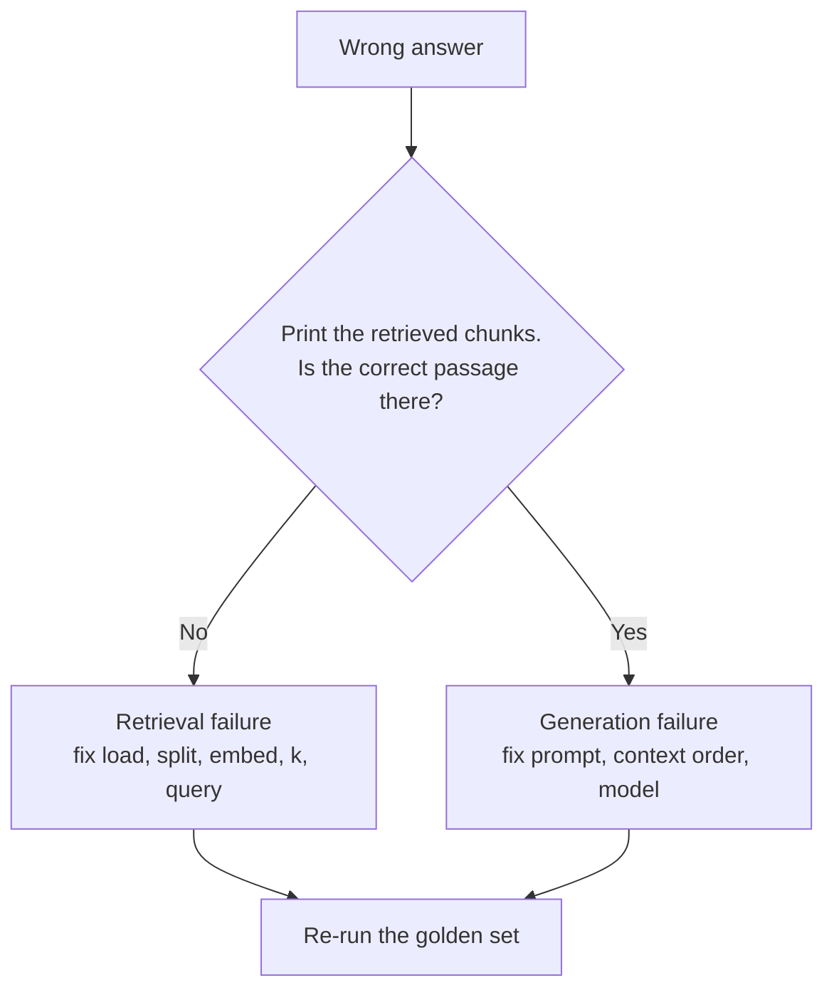
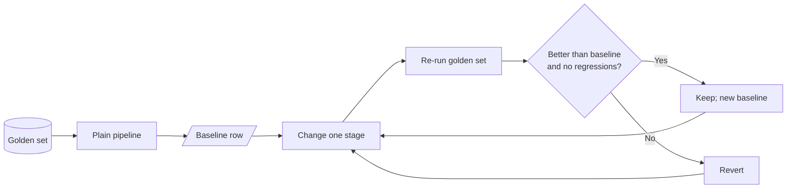

# M11.5 Theory: The RAG lifecycle and a measured baseline

*[M11 theory](../README.md) · Lesson 11.5 · Notebooks: [`05a_rag_lifecycle_and_baseline.ipynb`](../../../../course/p04_rag_foundations/m11_rag_lifecycle/notebooks/05a_rag_lifecycle_and_baseline.ipynb) · [All theory pages](../../../README.md)*

## Indexing vs retrieval vs generation

The lifecycle has seven steps in two phases. Each step has one job and one typical failure.

| Phase | Step | Job | Typical failure | Fixed in |
|---|---|---|---|---|
| Indexing | Load | Turn files into `Document`s with metadata | Garbled PDF text, missing metadata | [M12](../../../p05_ingestion_and_indexing/m12_document_ingestion/README.md) |
| Indexing | Split | Cut documents into retrievable chunks | A fact split across two chunks | [M13](../../../p05_ingestion_and_indexing/m13_chunking/README.md) |
| Indexing | Embed | Turn each chunk into a vector | Model cannot tell paraphrases apart, or blurs exact codes | M14 |
| Indexing | Store | Index vectors for nearest-neighbour search | Chunk count ≠ vector count; no metadata filters | M15 |
| Query | Retrieve | Return the top-k chunks with scores | Evidence ranked below the cut-off, or not at all | M17 to M19 |
| Query | Augment | Format the chunks into the prompt | Sources dropped, so no citations | M20 |
| Query | Generate | Answer from the supplied context | Ignores the evidence, or answers beyond it | M20, M28 and M29 |

When an answer is wrong, one question tells you which half to debug:

Tuning the prompt cannot fix a retrieval failure, because the model never saw the evidence. Lesson 11.5's notebook prints chunks with their scores (`similarity_search_with_score`) for this check.

## Baseline-first optimisation

Every later module in this course changes one stage of the pipeline: chunking, embeddings, hybrid search, reranking, query rewriting. Without a baseline, you cannot tell whether a change helped, hurt, or only moved the failure to another question.

The method:

1. **Fix a golden set.** 20 to 50 real questions, each with its evidence chunks and a reference answer. Freeze it, and add questions when production shows a new failure.
2. **Build the plain pipeline.** Default loader, recursive splitter, one embedding model, top-k similarity, a simple prompt.
3. **Record the baseline row.** Retrieval metrics (recall@k, hit rate, MRR), answer metrics (correctness, faithfulness), latency and cost per question.
4. **Change one stage, re-run, compare.** Keep the change only if the row improves on the questions it targets without breaking the others.

<!-- animated: diagrams/baseline-loop.anim.html -->

At `k = 2` the [top-k lab](../02_indexing_from_scratch_with_tf_idf_and_nearest_neighbours/interactive/top-k-retrieval-lab.html)'s baseline row is mean recall@2 = 0.50 and mean precision@2 = 0.50. That number already points at the next modules: the export question is solved, the refund question needs better term matching (M14, M17), and the outage question needs paraphrase-aware retrieval (M14, M18).

The lifecycle notebook ends with the map from symptom to module:

| What you observe | Likely cause | Where it is fixed |
|---|---|---|
| Question worded unlike the documents; evidence never retrieved | Vocabulary mismatch | M14 embeddings, M18 query transformation |
| Exact codes or names missed (`ORD-88213`) | Dense retrieval blurs rare tokens | M17 hybrid search |
| Half an answer; one fact found, another missed | Question needs several chunks | M18 query decomposition |
| Evidence retrieved but ranked low | Ranking noise | M19 reranking |
| Retrieved chunk holds half the fact | Chunk boundary | M13 chunking |
| Answer contradicts the retrieved chunk | Generation | M20 per-claim citations, M29 Self-RAG |

## Check yourself

1. An answer is wrong. What one check tells you whether to debug retrieval or generation?

Print the retrieved chunks and look for the correct passage. If it is missing, retrieval failed: fix loading, splitting, embedding, `k` or the query. If it is there, generation failed: fix the prompt, the context order or the model.

2. A teammate rewrites the prompt and the refund question is still wrong. The refund chunk never appears in the top-k. Why did the rewrite not help?

The model never saw the evidence, so no prompt can make it use that evidence. This is a retrieval failure. The refund question needs better term matching (M14 embeddings, M17 hybrid search), measured against the golden set.

3. A new chunking strategy lifts recall@2 on two questions and breaks a third. Do you keep it?

Not as it stands. The loop keeps a change only when the row improves on the questions it targets without breaking the others. Revert it, or fix the regression and re-run the golden set before it becomes the new baseline.

---
*Previous: [11.4 Your first LangChain RAG with Chroma](../04_your_first_langchain_rag_with_chroma/README.md). Next: [M11 interview questions](../README.md#interview-spotlight-5-questions-you-might-get-asked).*
