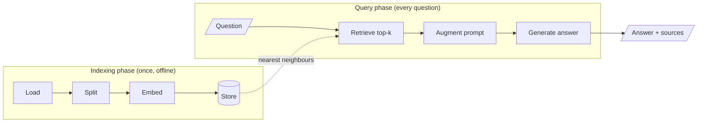

# M11 Theory: The RAG lifecycle

*Part IV · RAG Foundations · [Module README](../../../course/p04_rag_foundations/m11_rag_lifecycle/README.md) · [All theory pages](../../README.md)*

A language model answers from what it memorised during training. RAG adds a second source: passages retrieved from your own documents at the moment the question arrives. The M11 notebooks build on four ideas: where knowledge lives, the stages of the pipeline, how many chunks to retrieve, and why you measure a baseline before you optimise anything. Each idea has a page in the folder of the lesson that teaches it, listed under [Lessons](#lessons). This page has the overview, the interview questions and the takeaways.

The running example throughout these pages and the lab is a small product handbook for a fictional cloud host, Larkspur Cloud. M12 and M13 reuse the same handbook.

## TL;DR

- RAG moves knowledge out of model weights (parametric) into an index you control (non-parametric), so you can update it, restrict it and cite it.
- The pipeline has an offline **indexing** phase (load → split → embed → store) and an online **query** phase (retrieve → augment → generate). A mistake made at indexing time often surfaces only in the generated answer.
- `k` controls how much context the model reads. It trades recall against precision, tokens and latency, and it cannot recover a chunk the retriever scores as irrelevant.
- Embeddings match meaning where TF-IDF matches exact words. On the handbook they find the refund and outage evidence TF-IDF misses, and lose the export question TF-IDF answered at `k = 2`.
- Build the plain pipeline first, record its numbers on a fixed question set, then change one stage at a time and compare.

## Mental model

<!-- animated: diagrams/lifecycle.anim.html -->

The index is the only thing the two phases share. A bad chunk written at indexing time is retrieved, quoted and cited at query time, and nothing in the query phase can repair it.

## Lessons

| Lesson | Topic | Theory |
|---|---|---|
| 11.1 | The knowledge problem: hallucination, freshness, context-window growth, RAG vs fine-tuning vs long context | [Parametric vs non-parametric knowledge](01_the_knowledge_problem_hallucination_freshness_context_window_growth_rag_vs_fine_tuning_vs_long_context/README.md#parametric-vs-non-parametric-knowledge) |
| 11.2 | Indexing from scratch with TF-IDF and nearest neighbours | [Top-k](02_indexing_from_scratch_with_tf_idf_and_nearest_neighbours/README.md#top-k) |
| 11.3 | Semantic retrieval with embedding similarity | [Embedding similarity](03_semantic_retrieval_with_embedding_similarity/README.md#embedding-similarity) [Embeddings against TF-IDF](03_semantic_retrieval_with_embedding_similarity/README.md#embeddings-against-tf-idf) |
| 11.4 | Your first LangChain RAG with Chroma | [What LangChain replaces](04_your_first_langchain_rag_with_chroma/README.md#what-langchain-replaces) [Distance, not similarity](04_your_first_langchain_rag_with_chroma/README.md#distance-not-similarity) |
| 11.5 | The RAG lifecycle and a measured baseline | [Indexing vs retrieval vs generation](05_the_rag_lifecycle_and_a_measured_baseline/README.md#indexing-vs-retrieval-vs-generation) [Baseline-first optimisation](05_the_rag_lifecycle_and_a_measured_baseline/README.md#baseline-first-optimisation) |

## Interactive lab

[**Top-k and the baseline**](02_indexing_from_scratch_with_tf_idf_and_nearest_neighbours/interactive/top-k-retrieval-lab.html): open the file in a browser. Pick *Can I export my data after I cancel my plan?* and slide `k` from 1 to 12 to see recall saturate at `k = 2` while tokens keep climbing. Then switch to *What happens if my server goes down?* and look for a `k` that helps; there is none.

## How it connects

- **Before:** M07 to M10 teach the LangChain and LangGraph pieces this pipeline is built from.
- **Next:** [M12](../../p05_ingestion_and_indexing/m12_document_ingestion/README.md) and [M13](../../p05_ingestion_and_indexing/m13_chunking/README.md) open up the first two indexing steps. M14 to M16 cover embedding, storing and changing what gets indexed; M17 to M19 improve retrieval against this module's baseline.

## Interview Spotlight: 5 Questions You Might Get Asked

*Production questions in the style of OpenAI, Anthropic and Google interviews for applied AI roles.*

### 1. Larkspur's support assistant answers billing questions from the handbook. The policy team changes the refund window on Monday. A teammate proposes fine-tuning the model on the new handbook. What do you recommend, and what has to happen on Monday?

**What a strong answer covers:**
- Facts that change belong in the index, not the weights; fine-tuning would need repeating at every policy change and gives no citations
- Monday's work is re-indexing the changed document: load, split, embed, upsert, and remove the stale chunks
- Uses `date` or `version` metadata so retrieval can prefer the current policy and the old one can be filtered out
- Adds the new policy question to the golden set and checks that the assistant now cites the new chunk

### 2. A customer asks "Can I get a refund after 45 days?" and the assistant says "No, refunds are only available within 30 days." The handbook says refunds after day 30 are prorated. How do you find out what went wrong?

**What a strong answer covers:**
- Prints the retrieved chunks with scores before touching the prompt
- If the proration chunk was not retrieved: retrieval failure. Check its rank, whether it was split from its context, and whether "45 days" matches nothing lexically
- If it was retrieved but ignored: generation failure. Check its position in the prompt, conflicting chunks, and the instruction to answer only from context
- Turns the case into a golden-set question so the fix is measured and stays fixed

### 3. Your team runs at `k = 20` "to be safe". Latency is 3.1 s, and the product requirement is 1.5 s. How do you choose a new `k` without hurting quality?

**What a strong answer covers:**
- Measures recall@k on the golden set for k = 1…20 and finds where the curve flattens
- Separates the decision: retrieve wide (20 to 50), rerank, then send a small `k` to the model, if a reranker fits in the latency budget
- Reports answer quality, not only recall, because fewer distractors often improves faithfulness
- Watches per-question regressions, not just the mean; one lost question type can matter more than the average

### 4. The baseline went live last month. How do you know whether retrieval quality is degrading in production before users complain?

**What a strong answer covers:**
- Logs every query with retrieved chunk ids, scores and the final answer
- Tracks retrieval signals: top-1 score distribution, the share of queries below a score floor, out-of-scope fallback rate
- Samples traffic for offline grading with an LLM judge (faithfulness, relevance) and re-runs the golden set on every index or model change
- Alerts on drift after content updates, such as a new document type that the loader parses badly

### 5. Someone suggests skipping RAG because the new model has a 1M-token context and the whole handbook fits. When is that right, and when does it break?

**What a strong answer covers:**
- Right for a small, stable corpus with low query volume, or for one-off analysis
- Cost and latency scale with corpus size on every call, while RAG pays for a few chunks
- Accuracy can fall for facts mid-context, and the model has no ranked evidence to cite
- Access control is coarse: every user's prompt holds every document, unless you filter per user, which is retrieval again

## Key Takeaways

- RAG answers from an index you control. Update it by re-indexing, and cite chunks instead of trusting memory.
- Indexing happens once and is where most failures start. Always ask whether the correct passage was retrieved before you change the prompt.
- `k` trades recall against precision, tokens and latency. If a chunk scores zero, no `k` will retrieve it; fix the representation instead.
- Record a baseline on a frozen golden set, change one stage at a time, and keep only the changes that beat it.

---
*Previous: M10 LangGraph runtime (no theory page yet). Next: [M12 Document ingestion](../../p05_ingestion_and_indexing/m12_document_ingestion/README.md).*
