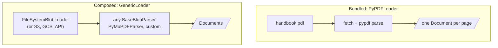
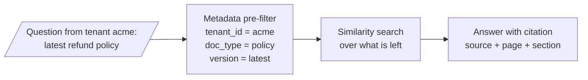

# M12.1 Theory: The Document abstraction and metadata design

*[M12 theory](../README.md) · Lesson 12.1 · Notebooks: [`01a_document_loading_and_metadata.ipynb`](../../../../course/p05_ingestion_and_indexing/m12_document_ingestion/notebooks/01a_document_loading_and_metadata.ipynb), [`01b_document_loaders_overview.ipynb`](../../../../course/p05_ingestion_and_indexing/m12_document_ingestion/optional/01b_document_loaders_overview.ipynb) (optional) · [All theory pages](../../../README.md)*

## Loader vs parser

People say "loader" for the whole step, but LangChain separates two jobs:

| | Loader | Parser |
|---|---|---|
| Job | Find and fetch the source, yield Documents | Turn raw bytes into text and structure |
| LangChain type | `BaseLoader` (`load`, `lazy_load`) | `BaseBlobParser` (`lazy_parse(blob)`) |
| Examples | `PyPDFLoader`, `DirectoryLoader`, `WebBaseLoader`, your own `BaseLoader` | `PyPDFParser`, `PyMuPDFParser`, Unstructured's `partition_pdf` |
| What it decides | Where documents come from, how many per file | What text is extracted, in what order, with what structure |

Most built-in loaders bundle both: `PyPDFLoader` fetches the file and runs pypdf on it. `GenericLoader` keeps them apart (a blob loader plus a parser), which lets one parser read from a folder, a bucket or an API without new code.

When someone says "the PDF loader is bad", they usually mean the parser extracts the wrong text. Swapping the parser fixes that; changing how files are fetched does not.

## Metadata schema

Metadata answers questions about a chunk that similarity search cannot: where it came from, who may see it, how recent it is, what kind of content it is. The schema has to exist before ingestion, because every field you forget costs a full re-ingest to add.

Plan four kinds of field:

| Kind | Examples | Enables |
|---|---|---|
| Provenance | `source`, `page`, `row`, `loader`, `ingested_at` | Citations, debugging, re-ingesting one file |
| Filtering | `doc_type`, `section`, `date`, `language`, `version` | Narrowing the search before similarity |
| Access control | `tenant_id`, `visibility`, `owner` | Multi-tenant isolation; never optional |
| Quality | `extraction_method`, `confidence`, `verified` | Excluding low-quality text, audits |

The M12 lab asks for one shared schema across PDF, DOCX, Markdown, CSV and a web page: `source`, `type`, `section`, `page`, `date`. On the handbook page, PyPDF fills three of those directly (`source`, `page`, `date`), and Unstructured fills four (`source`, `type`, `section` via `parent_id`, `page`). The rest you derive yourself, for example `date` from your CMS instead of the file's modification time.

Design against three hard constraints:

- **Metadata is not embedded.** A title that lives only in metadata never matches a query. If a field should affect similarity, also put it into the text (M16's contextual chunk headers do this).
- **Value types are restricted.** Chroma 1.5, the version this course installs, accepts `str`, `int`, `float`, `bool`, `None` and non-empty lists of a single one of those types. A nested dict, an empty list or a mixed list such as `[1, "x"]` fails the write. Flatten before you index.
- **Filters match exactly.** `{"department": "Engineering"}` does not match `"engineering"`. Normalise values when you load.

---
*Previous: [M12 overview](../README.md). Next: [12.3 Semi-structured sources: CSV rows and JSON / JSONL with jq schemas](../03_semi_structured_sources_csv_rows_and_json_jsonl_with_jq_schemas/README.md).*
