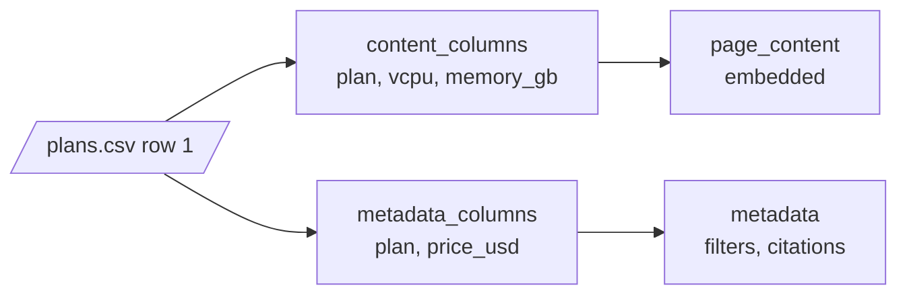

# M12.3 Theory: Semi-structured sources: CSV rows and JSON / JSONL with jq schemas

*[M12 theory](../README.md) · Lesson 12.3 · Notebooks: [`03a_csv_loader.ipynb`](../../../../course/p05_ingestion_and_indexing/m12_document_ingestion/optional/03a_csv_loader.ipynb) (optional), [`03b_json_loader.ipynb`](../../../../course/p05_ingestion_and_indexing/m12_document_ingestion/optional/03b_json_loader.ipynb) (optional) · [All theory pages](../../../README.md)*

## One record, one Document

A PDF gives you pages and asks what is inside them. A CSV or JSON file already has records, and the loader's job is to decide which record becomes one Document. That choice sets the smallest thing retrieval can return, the same way element-level parsing does for a PDF (lesson 12.4).

`CSVLoader` makes one Document per row. Each line of `page_content` is `column: value`, and `metadata` gets the file and the 0-based row number. The handbook's pricing table, exported as `plans.csv`, gives three Documents. The Business row:

```text
page_content: 'plan: Business\nvcpu: 4\nmemory_gb: 16\ntraffic_tb: 5\nprice_usd: 48'
metadata:     {'source': 'plans.csv', 'row': 1}
```

`UnstructuredCSVLoader` goes the other way and returns the whole file as one table Document. Use it when the question is about the table as a whole; use `CSVLoader` when each row answers a question on its own ("How much memory does Business have?").

`JSONLoader` has no fixed record. The `jq_schema` argument says where one Document starts, and the notebook's `chat_data.json` shows how much that decides:

| `jq_schema` | Documents | Each Document holds |
|---|---|---|
| `.` | 1 | The whole file as JSON text, 1,612 characters |
| `.messages[]` | 11 | One message object as JSON text, keys included |
| `.messages[].content` | 11 | One message's text; one of them is empty, because a photo message has no `content` |

The empty Document is the common failure here. A jq path that misses on some records still yields a Document for them, with `page_content=''`, and it gets embedded like any other. Count empty Documents after every load. For JSON Lines files, `json_lines=True` runs the schema once per line.

## Content fields and metadata fields

Every column or key ends up in one of three places: the embedded text, the metadata, or both. Text is what similarity search can match; metadata is what a filter can match exactly (lesson 12.1). Decide per field.



`CSVLoader` takes `content_columns`, `metadata_columns` and `source_column`, and its defaults hold three traps. All three show up when you run it on `plans.csv`:

- **`metadata_columns` alone removes those columns from the text.** With `metadata_columns=["plan", "price_usd"]` and no `content_columns`, the Business Document's text becomes `vcpu: 4\nmemory_gb: 16\ntraffic_tb: 5`. The word "Business" is gone from what gets embedded, so a question about the Business plan can no longer match it. List `plan` in `content_columns` as well to keep it in both places.
- **Every value stays a string.** The metadata reads `'price_usd': '48'`. A range filter such as "plans under $50" compares numbers, so cast the value to `int` when you load.
- **`source_column` replaces `source`.** With `source_column="plan"` the metadata says `'source': 'Business'`, and nothing records which file the row came from. Keep the file path in a separate field if you use it.

One more from the notebook: passing `csv_args={"fieldnames": [...]}` to rename columns on a file that already has a header row turns that header into a Document. The notebook's five-row `data.csv` loads as six Documents, and the first one reads `Property ID: Property_ID`, `Address: Address`. Rename the columns in the file instead, or drop that first Document.

`JSONLoader` splits the same decision across two arguments. `content_key` names the field that becomes `page_content`, and `metadata_func(record, metadata)` copies the fields you want to filter on. The notebook copies `sender_name` and `timestamp_ms`, so a query can ask for one person's messages in a time range. The loader adds `source` as an absolute path and `seq_num` counting from 1, while `CSVLoader` writes `source` as you passed it and counts `row` from 0. Lesson 12.5 maps these differences onto one schema.

---
*Previous: [12.1 The Document abstraction and metadata design](../01_the_document_abstraction_and_metadata_design/README.md). Next: [12.4 PDF and Word: parser comparison and element-level parsing](../04_pdf_and_word_parser_comparison_and_element_level_parsing/README.md).*
