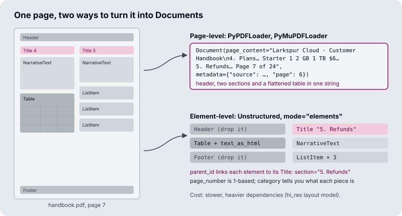

# M12.4 Theory: PDF and Word: parser comparison and element-level parsing

*[M12 theory](../README.md) · Lesson 12.4 · Notebooks: [`04a_pdf_loader.ipynb`](../../../../course/p05_ingestion_and_indexing/m12_document_ingestion/notebooks/04a_pdf_loader.ipynb), [`04b_ms_word_loader.ipynb`](../../../../course/p05_ingestion_and_indexing/m12_document_ingestion/optional/04b_ms_word_loader.ipynb) (optional) · [All theory pages](../../../README.md)*

## Element-level parsing

A page-level parser returns the page as one string. An element-level parser (Unstructured with `mode="elements"`) returns one Document per layout element, each with a `category` such as `Title`, `NarrativeText`, `Table`, `ListItem`, `Header` or `Footer`.

What the three PDF loaders in lesson 12.4 produce from the handbook page:

| | `PyPDFLoader` | `PyMuPDFLoader` | `UnstructuredPDFLoader`, `mode="elements"`, `hi_res` |
|---|---|---|---|
| Documents from the page | 1 | 1 | 10 |
| Header and footer | Inside the text | Inside the text | Separate elements you can drop |
| Pricing table | Rows of space-separated values | One cell per line | `Table` element with `text_as_html` |
| Section of each piece | Unknown | Unknown | `parent_id` points to its `Title` |
| Page number | `page` (0-based) | `page` (0-based) | `page_number` (1-based) |
| Speed and dependencies | Fast, pure Python | Fastest; AGPL licence | Slowest; layout models and system packages |

Three consequences for retrieval:

- **Boilerplate pollutes embeddings.** If every chunk starts with "Larkspur Cloud · Customer Handbook", every chunk shares that text, and similarity between chunks from different pages rises. Drop `Header` and `Footer` elements, or strip repeated lines from page-level text.
- **Flattened tables lose their meaning.** "Business 4 16 GB 5 TB $48" can be read, but once a splitter cuts it, "16 GB" no longer has a column name. Keep a table as one chunk and give the model its HTML or Markdown form.
- **Granularity is decided at load time.** One Document per file, page, row or element sets the smallest thing retrieval can return, and changing it later means re-ingesting.

The [interactive lab](interactive/pdf-parsers-lab.html) puts the handbook page through all three loaders. Hover a Document to see which part of the page it came from, and read how many of the five schema fields each loader fills: three for PyPDF and PyMuPDF, four for Unstructured.

<!-- lab: interactive/pdf-parsers-lab.html -->

Element-level parsing costs time and dependencies, so use it where layout carries meaning: reports, manuals, forms, anything with tables. Plain prose PDFs do fine with PyPDF or PyMuPDF.

Word and Markdown files have the same switch. In this lesson's Word notebook, `UnstructuredWordDocumentLoader` returns the file as one Document by default; with `mode="elements"` and `chunking_strategy="by_title"` it returns pieces of at most 3,000 characters and starts a new one at every heading. Lesson 12.2 does the same for Markdown with `UnstructuredMarkdownLoader`: `mode="single"` gives one Document, `mode="elements"` one per heading, paragraph or list item, each with a `category`.

## Check yourself

1. Why does leaving the handbook's page header in every chunk hurt retrieval?

If every chunk starts with "Larkspur Cloud · Customer Handbook", every chunk shares that text, and similarity between chunks from different pages rises. An element-level parser returns `Header` and `Footer` as separate elements you can drop; with page-level text, strip the repeated lines instead.

2. The pricing table was loaded with PyPDFLoader and then split. Why can a question about which plan has 16 GB of memory fail, and what would Unstructured give instead?

PyPDF flattens the table into rows of space-separated values, and once a splitter cuts a row, "16 GB" no longer has a column name. `UnstructuredPDFLoader` with `mode="elements"` and `hi_res` returns the table as one `Table` element with `text_as_html`. Keep it as one chunk and give the model its HTML or Markdown form.

3. Your corpus is plain prose PDFs with no tables or forms. Should you switch everything to element-level parsing?

No. Element-level parsing is the slowest option and needs layout models and system packages, and plain prose PDFs do fine with PyPDF or PyMuPDF. Use it where layout carries meaning: reports, manuals, forms, anything with tables. Choose before you ingest, because changing granularity later means re-ingesting.

---
*Previous: [12.3 Semi-structured sources: CSV rows and JSON / JSONL with jq schemas](../03_semi_structured_sources_csv_rows_and_json_jsonl_with_jq_schemas/README.md). Next: [12.5 Web, YouTube and arXiv sources; bulk directory loading](../05_web_youtube_and_arxiv_sources_bulk_directory_loading/README.md).*
