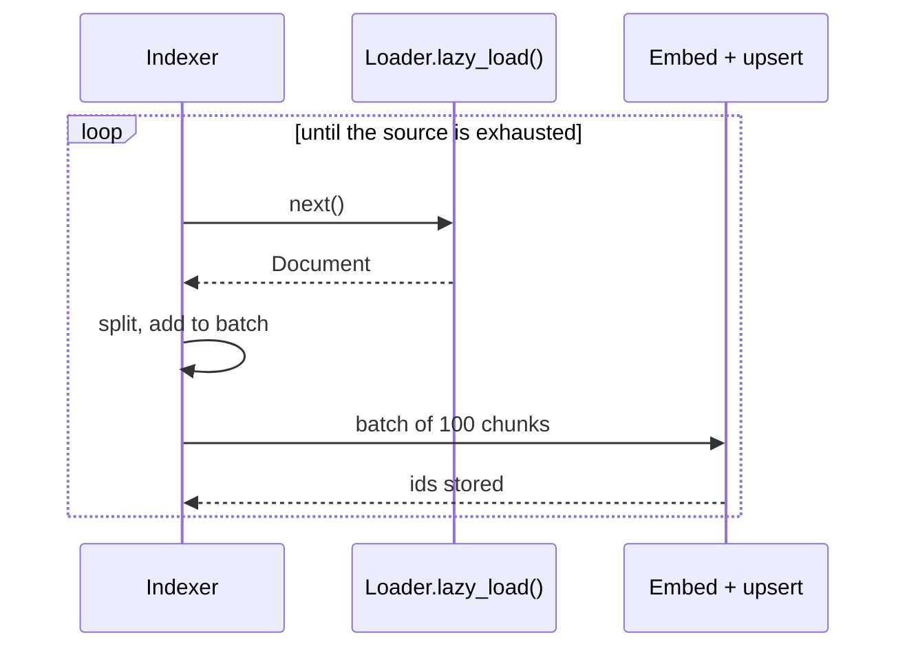

# M12.6 Theory: Custom loaders with lazy loading

*[M12 theory](../README.md) · Lesson 12.6 · Notebooks: [`06a_custom_loader.ipynb`](../../../../course/p05_ingestion_and_indexing/m12_document_ingestion/notebooks/06a_custom_loader.ipynb) · [All theory pages](../../../README.md)*

## Lazy loading

`load()` returns a list, so the whole corpus sits in memory before anything else runs. `lazy_load()` is a generator: it yields one Document at a time, and the pipeline can split, embed and upsert in batches while the loader keeps reading.

```python
from collections.abc import Iterator
from langchain_core.document_loaders import BaseLoader
from langchain_core.documents import Document

class TicketLoader(BaseLoader):
    def __init__(self, api, since):
        self.api, self.since = api, since

    def lazy_load(self) -> Iterator[Document]:
        for page in self.api.tickets(since=self.since):  # paginated API
            for t in page:
                yield Document(
                    page_content=t["body"],
                    metadata={"source": f"ticket:{t['id']}", "type": "ticket",
                              "date": t["updated_at"], "tenant_id": t["org"]},
                )
```

`BaseLoader` derives `load()` from `lazy_load()`, so implementing the generator gives you both.


<!-- animated: diagrams/lazy-load-loop.anim.html -->

Lazy loading keeps memory flat for a million-record source, and the first vectors reach the index while the loader is still reading. A failure part-way through only loses the current batch, as long as you record a checkpoint (the last id or `updated_at` written).

---
*Previous: [12.5 Web, YouTube and arXiv sources; bulk directory loading](../05_web_youtube_and_arxiv_sources_bulk_directory_loading/README.md). Next: [M12 interview questions](../README.md#interview-spotlight-5-questions-you-might-get-asked).*
