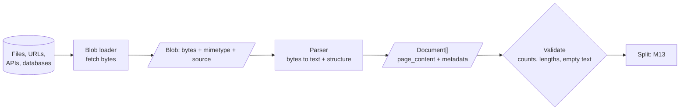

# M12 Theory: Document ingestion and metadata design

*Part V · The Ingestion & Indexing Pipeline · [Module README](../../../course/p05_ingestion_and_indexing/m12_document_ingestion/README.md) · [All theory pages](../../README.md)*

Retrieval can only return text that ingestion extracted, labelled with metadata that ingestion attached. M12 rests on four ideas: what a loader does compared with a parser, why element-level parsing matters for PDFs, how to design a metadata schema before you need it, and why loaders should stream. Each idea has a page in the folder of the lesson that teaches it, listed under [Lessons](#lessons). This page has the overview, the interview questions and the takeaways.

The running example is page 7 of the Larkspur Cloud customer handbook: two columns, a pricing table, a refund section, a header and a footer.

## TL;DR

- Every loader returns `Document(page_content, metadata)`. `page_content` is embedded and shown to the model; `metadata` is never embedded, and it is the only thing you can filter on exactly.
- A **loader** gets bytes from a source; a **parser** turns those bytes into text and structure. Which parser you choose decides what the index can contain.
- **Element-level parsing** gives one typed Document per title, paragraph, table or list item, so you can drop boilerplate, keep tables whole and tag every chunk with its section.
- Design the **metadata schema** for the filters, citations and access rules you will need later. Adding a field after indexing means re-ingesting the corpus.
- Implement `lazy_load` so a large source streams through the pipeline instead of loading into memory at once.

## Mental model

Loading is lossy. A PDF parser drops layout, an HTML loader drops visual hierarchy, a Word loader drops comments, and a CSV loader drops column types. Know what each loader drops; you cannot retrieve what was never extracted.

## Lessons

| Lesson | Topic | Theory |
|---|---|---|
| 12.1 | The Document abstraction and metadata design | [Loader vs parser](01_the_document_abstraction_and_metadata_design/README.md#loader-vs-parser) [Metadata schema](01_the_document_abstraction_and_metadata_design/README.md#metadata-schema) |
| 12.2 | Plain text and Markdown (single vs element mode) | *planned* |
| 12.3 | Semi-structured sources: CSV rows and JSON / JSONL with jq schemas | *planned* |
| 12.4 | PDF and Word: parser comparison and element-level parsing | [Element-level parsing](04_pdf_and_word_parser_comparison_and_element_level_parsing/README.md#element-level-parsing) |
| 12.5 | Web, YouTube and arXiv sources; bulk directory loading | *planned* |
| 12.6 | Custom loaders with lazy loading | [Lazy loading](06_custom_loaders_with_lazy_loading/README.md#lazy-loading) |

## Interactive lab

[**One PDF page, three parsers**](04_pdf_and_word_parser_comparison_and_element_level_parsing/interactive/pdf-parsers-lab.html): open the file in a browser. Switch between `PyPDFLoader`, `PyMuPDFLoader` and `UnstructuredPDFLoader`, hover each output Document to see which part of the page it came from, and compare how many schema fields each loader fills.

## How it connects

- **Before:** [M11](../../p04_rag_foundations/m11_rag_lifecycle/README.md) puts Load first in the lifecycle and gives you the baseline to measure against.
- **Next:** [M13](../m13_chunking/README.md) splits these Documents into chunks; structure-aware splitting works best when the parser kept the structure. M15 uses the metadata for filtered search, and M16 copies section titles into chunk text.

## Interview Spotlight: 5 Questions You Might Get Asked

*Production questions in the style of OpenAI, Anthropic and Google interviews for applied AI roles.*

### 1. A customer uploads 4,000 product manuals as PDFs: two-column layouts, spec tables, scanned appendices. You have a week to make them searchable. How do you choose a parsing approach?

**What a strong answer covers:**
- Samples 20 to 30 pages of each layout type and compares parser output side by side before choosing
- Uses element-level parsing (or a layout model) for tables and multi-column pages, and a fast text parser for plain prose; routes by document type
- Detects scanned pages (empty or near-empty text layer) and sends only those to OCR
- Sets acceptance checks: no empty Documents, tables kept whole, page numbers that match the printed page

### 2. Users report that the assistant cites "page 6" when the answer is on page 7. What happened, and how do you fix it for existing data?

**What a strong answer covers:**
- PyPDF and PyMuPDF `page` metadata is 0-based; the citation code shows it raw
- Fixes it at the presentation layer at once (`page + 1`, or prefer `page_label`), so no re-index is needed
- Normalises to one 1-based `page` field in the schema for future ingests, and documents it
- Adds a citation test to the golden set: question, expected source and expected page

### 3. You run a multi-tenant RAG product. Should tenant isolation be a metadata filter in one shared index, or one index per tenant?

**What a strong answer covers:**
- A shared index with a `tenant_id` filter is cheaper to run but depends on every query path applying the filter
- Per-tenant indexes (or namespaces) make cross-tenant leaks structurally impossible and simplify deletion, at operational cost
- Whatever the choice, the filter comes from the authenticated session, never from the user's text or the model
- Tests for leaks with canary documents and a cross-tenant query suite on every release

### 4. Ingestion runs nightly over a document store. How do you know it is silently degrading?

**What a strong answer covers:**
- Tracks per-run counts by source and type: files seen, Documents produced, empty or tiny Documents, parse errors
- Alerts on distribution shifts, such as average characters per page dropping (a new scanned batch) or a type disappearing
- Remembers that many loaders fail quietly (`silent_errors=True`, empty text from scans, JS-rendered pages) and checks their output explicitly
- Samples parsed Documents for human or LLM review, and re-runs the golden set after big ingests

### 5. Your custom loader pulls 2 million support tickets from an API. It crashes at 1.4 million with an out-of-memory error. What changes?

**What a strong answer covers:**
- Implements `lazy_load` as a generator and calls it from the indexer instead of `load()`
- Splits, embeds and upserts in fixed-size batches so memory stays flat
- Checkpoints the last `updated_at` or id written, so a restart resumes instead of starting over
- Makes upserts idempotent with stable ids (`ticket:{id}`), so a retried batch does not create duplicates

## Key Takeaways

- `page_content` is what gets embedded; `metadata` is what you filter and cite by, and it is never embedded.
- Choose the parser by what the documents contain. Element-level parsing keeps structure and costs speed.
- Write the metadata schema down before the first ingest, including access control, and normalise values at load time.
- Stream with `lazy_load`, batch the downstream work, and validate counts after every run.

---
*Previous: [M11 The RAG lifecycle](../../p04_rag_foundations/m11_rag_lifecycle/README.md). Next: [M13 Chunking](../m13_chunking/README.md).*
