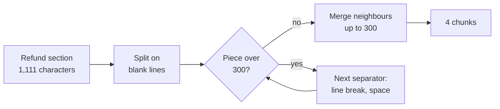
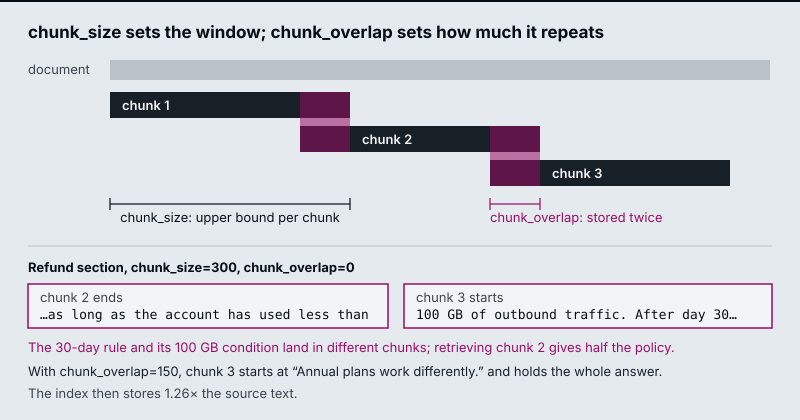
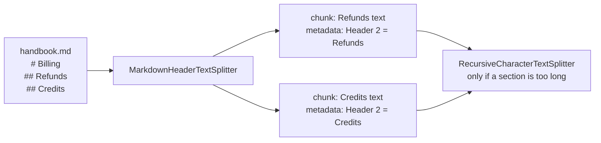

# M13.1 Theory: Splitter fundamentals: character, recursive, token and structure-aware

*[M13 theory](../README.md) · Lesson 13.1 · Notebooks: [`01a_document_splitting_and_chunking.ipynb`](../../../../course/p05_ingestion_and_indexing/m13_chunking/notebooks/01a_document_splitting_and_chunking.ipynb), [`01b_document_splitters_and_chunkers.ipynb`](../../../../course/p05_ingestion_and_indexing/m13_chunking/optional/01b_document_splitters_and_chunkers.ipynb) (optional), [`01c_text_splitters_and_chunking_strategies.ipynb`](../../../../course/p05_ingestion_and_indexing/m13_chunking/optional/01c_text_splitters_and_chunking_strategies.ipynb) (optional) · [All theory pages](../../../README.md)*

## Chunk size and overlap

`RecursiveCharacterTextSplitter` tries the separators `["\n\n", "\n", " ", ""]` in order. It splits on the first one present, merges pieces back up to `chunk_size`, and recurses into any piece that is still too long. `chunk_overlap` is how many trailing characters of one chunk it may repeat at the start of the next.

<!-- animated: diagrams/recursive-split.anim.html -->

At `chunk_size=300` the blank lines give five pieces of 25, 262, 525, 151 and 148 characters, each counting the blank line in front of it. The first two merge into chunk 1 (287 characters). The 525-character paragraph is too long, and a line break only peels off its leading blank line, so the splitter falls through to spaces, splits the paragraph into 95 words and merges them into chunks 2 and 3. The last two paragraphs merge into chunk 4. The cut between chunks 2 and 3 lands inside the answer sentence.

The [interactive lab](interactive/chunk-size-overlap-lab.html) runs a JavaScript port of the LangChain splitter on the refund section; it matches `langchain_text_splitters` exactly at all 1,061 slider positions. Five settings from the lab:

| `chunk_size` / `chunk_overlap` | Chunks | Stored ÷ source | Answer in one chunk? | Answer share of its chunk |
|---|---|---|---|---|
| 140 / 0 | 11 | 0.99× | No: the sentence is longer than the chunk | none |
| 300 / 0 | 4 | 1.00× | No: cut after "…used less than" | none |
| 300 / 150 | 5 | 1.26× | Yes, chunk 3 | 47% |
| 500 / 50 | 4 | 1.04× | Yes, chunk 2 | 28% |
| 1200 / 0 | 1 | 1.00× | Yes, the whole section | 13% |

- **A chunk smaller than the fact can never hold it.** At 140 characters, no overlap helps.
- **A boundary cut produces a confident half-answer.** At 300/0, chunk 2 says refunds are available "within 30 days of purchase, as long as the account has used less than" and stops. A retriever that returns chunk 2 gives the model the 30-day rule without the 100 GB condition.
- **Overlap only rescues a piece that fits inside it.** At 300/100 the answer is still cut, because the part left in chunk 2 is longer than 100 characters. At 300/150 it fits, and the index stores 26% more text.
- **Bigger chunks keep facts whole and dilute them.** At 1200 the answer is 13% of the chunk; the other 87% is about monthly plans, refund timing and credits. The chunk's embedding averages all of it, and the model reads all of it.

<!-- lab: interactive/chunk-size-overlap-lab.html -->

At 500/50 the splitter leaves a 72-character stub ("to the original payment method and take 5 to 10 business days…"); tiny trailing chunks like this retrieve badly, so merge them or set a minimum size. At 300/150, chunk 4 starts mid-phrase with "GB of outbound traffic", because overlap carries whole words and ignores sentence boundaries.

Measure length in tokens when the limit that matters is the embedding model's input or the prompt budget. `RecursiveCharacterTextSplitter.from_tiktoken_encoder(...)` keeps the recursive separators and counts tokens, and the notebook makes it the default for prose. English prose runs about four characters per token, but the ratio shifts by 2× or more for code, URLs and compound words, so a character limit drifts across content types. Characters are fine for comparing settings on one document, as the lab does.

## Structure-aware splitting

Many documents already mark their own boundaries. Splitting on them keeps each section intact and gives you metadata for free.

| Content | Splitter | What it uses |
|---|---|---|
| Markdown | `MarkdownHeaderTextSplitter` | `#`, `##`, `###`; header text goes into metadata (`{"Header 2": "Refunds"}`) |
| HTML | `HTMLHeaderTextSplitter`, `HTMLSectionSplitter` | `<h1>` to `<h6>` and sections |
| Code | `RecursiveCharacterTextSplitter.from_language(Language.PYTHON, …)` | `class`, `def`, then blank lines |
| Elements from M12 | Group Unstructured elements by `parent_id` | Titles and their children |

Run a size-based splitter after the structural one, because one long section can still exceed your limit. Use the header metadata in two places. Filter on it at query time ("only the Refunds section"), and prepend it to the chunk text so the embedding knows which section a sentence came from; M16 calls that a contextual chunk header.

---
*Previous: [M13 overview](../README.md). Next: [13.2 Semantic chunking: breakpoints on embedding distance](../02_semantic_chunking_breakpoints_on_embedding_distance/README.md).*
