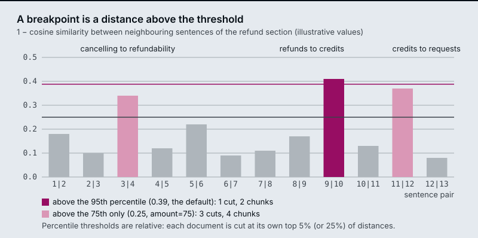
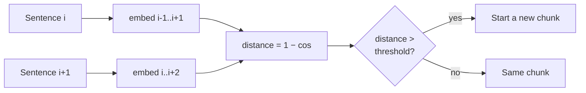

# M13.2 Theory: Semantic chunking: breakpoints on embedding distance

*[M13 theory](../README.md) · Lesson 13.2 · Notebooks: [`02a_semantic_chunking.ipynb`](../../../../course/p05_ingestion_and_indexing/m13_chunking/notebooks/02a_semantic_chunking.ipynb), [`02b_semantic_chunking_walkthrough.ipynb`](../../../../course/p05_ingestion_and_indexing/m13_chunking/optional/02b_semantic_chunking_walkthrough.ipynb) (optional), [`02c_semantic_chunking_rag_techniques.ipynb`](../../../../course/p05_ingestion_and_indexing/m13_chunking/optional/02c_semantic_chunking_rag_techniques.ipynb) (optional) · [All theory pages](../../../README.md)*

## Breakpoint threshold

Semantic chunking cuts on meaning instead of length:

1. Split the text into sentences.
2. Embed each sentence, combined with its neighbours (`buffer_size=1` adds one sentence on each side).
3. Compute the distance between consecutive sentences: `1 − cosine similarity`.
4. Mark every distance above the **breakpoint threshold** as a boundary.
5. Group the sentences between boundaries into chunks.

`SemanticChunker` turns the distances into a threshold in one of four ways:

| `breakpoint_threshold_type` | Default amount | Cuts where the distance is above… |
|---|---|---|
| `percentile` | 95 | the 95th percentile of this document's distances |
| `standard_deviation` | 3 | mean + 3 standard deviations |
| `interquartile` | 1.5 | mean + 1.5 × IQR |
| `gradient` | 95 | the 95th percentile of the distance *gradient* (for text where everything is similar) |

All four are relative to the document. In the diagram, the refund section has three real topic changes, but the default 95th percentile cuts only once, because a 13-sentence section has only 12 distances and only the largest clears its own 95th percentile. Lowering the amount to 75 cuts at all three. The reverse also happens: a document with no topic change still gets cut at its own top 5% of distances. Read the chunks before you trust the boundaries, and cap chunk size afterwards, because semantic chunks can grow past the embedding model's limit.

The cost is a full extra embedding pass over every sentence at index time, before the chunks themselves are embedded.

---
*Previous: [13.1 Splitter fundamentals: character, recursive, token and structure-aware](../01_splitter_fundamentals_character_recursive_token_and_structure_aware/README.md). Next: [13.3 Proposition chunking with LLM quality checks](../03_proposition_chunking_with_llm_quality_checks/README.md).*
