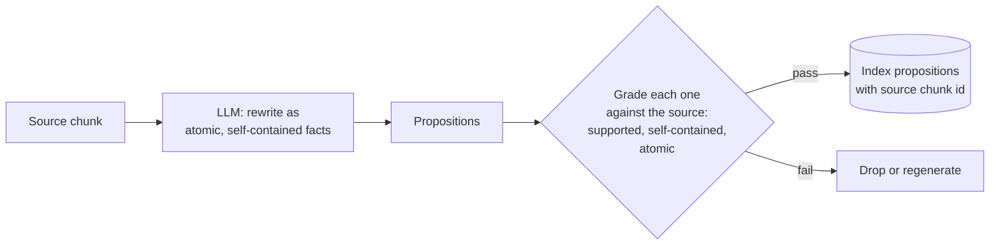

# M13.3 Theory: Proposition chunking with LLM quality checks

*[M13 theory](../README.md) · Lesson 13.3 · Notebooks: [`03a_proposition_chunking.ipynb`](../../../../course/p05_ingestion_and_indexing/m13_chunking/notebooks/03a_proposition_chunking.ipynb), [`03b_proposition_chunking_rag_techniques.ipynb`](../../../../course/p05_ingestion_and_indexing/m13_chunking/optional/03b_proposition_chunking_rag_techniques.ipynb) (optional) · [All theory pages](../../../README.md)*

## Propositions

A proposition is one fact written so it stands alone. It has to be:

- **Atomic:** one claim. "Annual plans can be refunded within 30 days and refunds take 5 to 10 business days" is two.
- **Self-contained:** no unresolved references. "It takes 5 to 10 business days" means nothing once retrieved alone; "A Larkspur Cloud refund takes 5 to 10 business days to appear" does.

The refund sentence becomes three propositions:

1. Larkspur Cloud gives a full refund on an annual plan requested within 30 days of purchase.
2. A full refund on a Larkspur Cloud annual plan requires the account to have used less than 100 GB of outbound traffic.
3. After day 30, a Larkspur Cloud annual-plan refund is prorated to the unused whole months, minus a 15% early-termination fee.

Each proposition names its own subject and condition, so the golden question can match proposition 1 and the retriever can return proposition 2 beside it.

Grade every proposition against its source chunk before indexing it. A splitter can only cut text, while an LLM can merge two facts, drop a qualifier ("less than 100 GB" disappears) or state something the source only implied. The mandatory notebook's grader returns three yes-or-no checks through structured output (supported by the source with nothing added, self-contained, atomic) plus a short issue note, and keeps only propositions that pass all three. The optional `03b` notebook scores accuracy, clarity, completeness and conciseness from 1 to 10 and drops anything under 7 on any of them. In the notebook the grader is the same model as the generator, so it shares its blind spots and can pass a proposition it should reject. Treat it as a filter for obvious damage; independent verification needs a different model or a human. Keep the source chunk id in metadata so you can show the original text at answer time.

Cost decides where propositions are worth it: one LLM call per source chunk to generate, about one more to grade, and usually several times as many vectors. Use them for dense, high-value text (policies, specs, medical or legal facts) where a missed qualifier is expensive, not for a whole document lake.

## Check yourself

1. What two properties make a proposition, and why does each matter once it is retrieved alone?

It is atomic, holding one claim, and self-contained, with no unresolved references. "It takes 5 to 10 business days" means nothing when retrieved alone, while "A Larkspur Cloud refund takes 5 to 10 business days to appear" does. Because each proposition names its own subject and condition, a question can match one and the retriever can return a related one beside it.

2. A generated proposition reads: Annual plans can be refunded within 30 days and refunds take 5 to 10 business days. Which grader check fails, and what happens to it?

The atomic check fails, because the sentence makes two claims. The mandatory notebook's grader keeps only propositions that pass all three checks (supported by the source, self-contained, atomic), so this one is dropped or regenerated.

3. Your team plans to turn its whole document lake into propositions, graded by the same model that writes them. What two concerns do you raise?

Cost: one LLM call per source chunk to generate, about one more to grade, and usually several times as many vectors, so keep propositions for dense, high-value text such as policies and specs. Grading: a grader that is the same model shares the generator's blind spots and can pass a proposition it should reject. Treat it as a filter for obvious damage, and use a different model or a human for independent verification.

---
*Previous: [13.2 Semantic chunking: breakpoints on embedding distance](../02_semantic_chunking_breakpoints_on_embedding_distance/README.md). Next: [13.4 Choosing chunk size empirically: retrieval quality, faithfulness, latency](../04_choosing_chunk_size_empirically_retrieval_quality_faithfulness_latency/README.md).*
