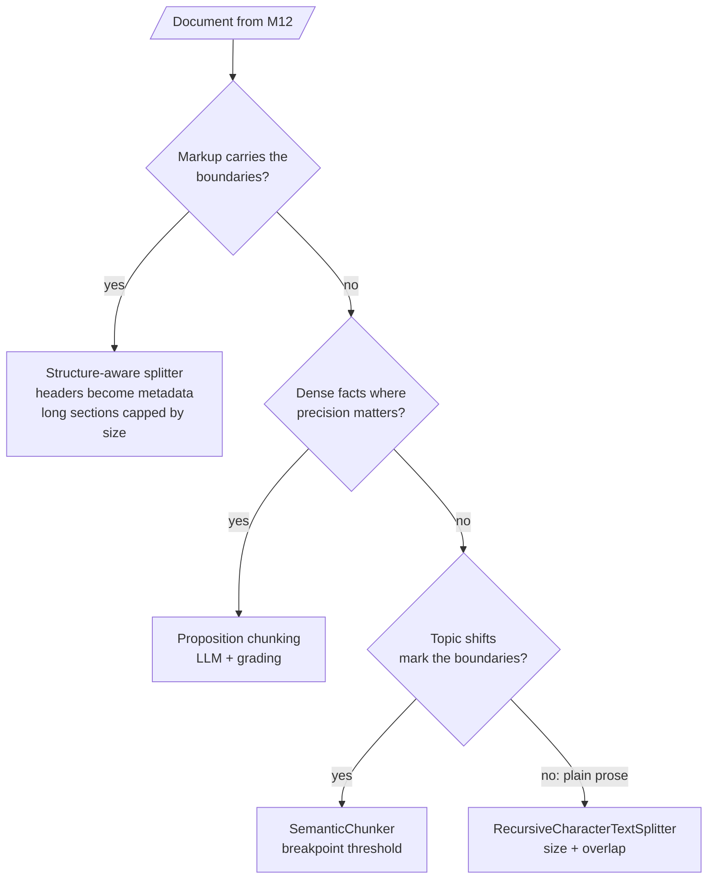

# M13 Theory: Chunking strategies

*Part V · The Ingestion & Indexing Pipeline · [Module README](../../../course/p05_ingestion_and_indexing/m13_chunking/README.md) · [All theory pages](../../README.md)*

The chunk is the unit of retrieval. The retriever scores chunks, returns chunks and hands chunks to the model, so a chunk boundary decides whether a fact can be found whole. M13 rests on four ideas: chunk size and overlap, the breakpoint threshold in semantic chunking, propositions, and structure-aware splitting. Each idea has a page in the folder of the lesson that teaches it, listed under [Lessons](#lessons). This page has the overview, the interview questions and the takeaways.

The running example is the "Refunds and cancellations" section of the Larkspur Cloud handbook, 1,111 characters long, and one golden question: *How long do I have to get a full refund on an annual plan?* The answer is one 141-character sentence: *You can get a full refund on an annual plan within 30 days of purchase, as long as the account has used less than 100 GB of outbound traffic.*

## TL;DR

- Small chunks retrieve precisely but can cut a fact in two; large chunks keep facts whole but dilute the embedding and cost tokens. The right size comes from measurement on your own corpus.
- Overlap repeats the tail of one chunk at the head of the next. It rescues facts that straddle a boundary, but only when the cut piece fits inside the overlap, and it inflates the index.
- Semantic chunking cuts where neighbouring sentences drift apart in embedding space. The **breakpoint threshold** is computed from each document's own distances; the default `percentile` type always produces some cuts, while `standard_deviation` and `interquartile` can find none.
- **Propositions** are atomic, self-contained facts written by an LLM. They retrieve sharply, cost an LLM call per chunk, and need a grading pass because an LLM can invent text and a splitter cannot.
- **Structure-aware splitting** uses the document's own boundaries (headings, HTML tags, code blocks) first, and falls back to size limits second.

## Mental model

Every route then feeds the embedder (M14) and ends with the same check. Read a sample of the chunks, because the parameters say what the splitter was asked to do and only the chunks show what it did, then run the golden set.

## Lessons

| Lesson | Topic | Theory |
|---|---|---|
| 13.1 | Splitter fundamentals: character, recursive, token and structure-aware | [Chunk size and overlap](01_splitter_fundamentals_character_recursive_token_and_structure_aware/README.md#chunk-size-and-overlap) [Structure-aware splitting](01_splitter_fundamentals_character_recursive_token_and_structure_aware/README.md#structure-aware-splitting) |
| 13.2 | Semantic chunking: breakpoints on embedding distance | [Breakpoint threshold](02_semantic_chunking_breakpoints_on_embedding_distance/README.md#breakpoint-threshold) |
| 13.3 | Proposition chunking with LLM quality checks | [Propositions](03_proposition_chunking_with_llm_quality_checks/README.md#propositions) |
| 13.4 | Choosing chunk size empirically: retrieval quality, faithfulness, latency | [Choosing chunk size](04_choosing_chunk_size_empirically_retrieval_quality_faithfulness_latency/README.md#choosing-chunk-size) [Choosing a strategy](04_choosing_chunk_size_empirically_retrieval_quality_faithfulness_latency/README.md#choosing-a-strategy) |

## Interactive lab

[**Chunk size and overlap**](01_splitter_fundamentals_character_recursive_token_and_structure_aware/interactive/chunk-size-overlap-lab.html): open the file in a browser. Click **300 and 0** to see the refund answer cut after "used less than", then **300 and 150** to watch overlap carry it whole into chunk 3, and **1200 and 0** to see the answer shrink to 13% of its chunk.

## How it connects

- **Before:** [M12](../m12_document_ingestion/README.md) decides what text and structure reach the splitter; [M11](../../p04_rag_foundations/m11_rag_lifecycle/README.md) gives the baseline the M13 lab is measured against.
- **Next:** [M14](../m14_embeddings/README.md) embeds these chunks; [M16](../m16_advanced_indexing/README.md) changes what gets indexed (parent documents, multi-representation, contextual headers) when no single chunk size works.

## Interview Spotlight: 5 Questions You Might Get Asked

*Production questions in the style of OpenAI, Anthropic and Google interviews for applied AI roles.*

### 1. Your support assistant tells a customer "Annual plans are refundable within 30 days" and the customer gets a refund denied: they had used 300 GB of traffic. The retrieved chunk is correct as far as it goes. What happened, and what do you change?

**What a strong answer covers:**
- Recognises a boundary cut: the condition ("less than 100 GB") sits in the next chunk
- Confirms it by printing both chunks and their scores for this question, rather than guessing
- Fixes it at index time: structure-aware or larger chunks for policy text, enough overlap to carry the condition, or propositions that keep each condition with its rule
- Adds the case to the golden set, with a check that the answer mentions the condition

### 2. A teammate set `chunk_size=2000` "so nothing gets cut". Hit rate went up, but answers got worse and the token bill doubled. Explain why, and propose a fix that keeps the hit rate.

**What a strong answer covers:**
- Large chunks raise hit rate because almost everything is "in" some chunk, but each one mixes topics, diluting the embedding and adding distractors
- Measures faithfulness and correctness, not only hit rate, plus tokens per answer
- Proposes small chunks for matching with larger parents (or neighbour expansion) for context, or a reranker to cut what reaches the model
- Validates with a sweep on the golden set, not a single comparison

### 3. You are indexing a 50,000-page internal wiki in Markdown and a 2,000-page set of scanned legal contracts. Would you use the same chunking strategy for both?

**What a strong answer covers:**
- No: the wiki has markup, so header-based splitting with header metadata, capped by size
- Contracts have long clauses where qualifiers matter, and OCR noise; clause-aware splitting, overlap, and possibly propositions for key obligations, with grading
- Budgets the cost: propositions over 2,000 pages may be affordable; over 50,000 they probably are not
- Uses separate golden sets per corpus, because the right settings differ

### 4. You switch from recursive to semantic chunking. How do you know in production that it helped, and how would you notice if it silently got worse after a content change?

**What a strong answer covers:**
- Compares against the recursive baseline on the same golden set: hit rate, faithfulness, latency, index size
- Monitors the chunk length distribution; semantic chunks can balloon on uniform text or fragment on noisy text
- Watches the extra embedding cost at index time, and re-runs the golden set when the embedding model changes, because breakpoints depend on it
- Spot-checks boundaries on newly ingested document types

### 5. Proposition chunking improved retrieval precision in your offline eval. Before shipping, what failure mode worries you most, and how do you guard against it?

**What a strong answer covers:**
- The LLM rewriting step can drop qualifiers, merge facts or hallucinate, and the index would then serve text the source never said
- Grades every proposition against its source chunk (accuracy, completeness) and drops failures
- Keeps the source chunk id so answers cite and show the original text, not only the proposition
- Samples graded propositions for human review, and tracks the cost of regeneration when the source changes

## Key Takeaways

- The chunk boundary decides whether a fact can be retrieved whole. Read the chunks as well as the parameters.
- Overlap only rescues a cut piece that fits inside it, and you pay for it in storage.
- Semantic thresholds come from each document's own distances and do not transfer between corpora; propositions need a grading pass; structural boundaries come first when the document has them.
- Choose chunk size by sweeping it on your golden set against the M11 baseline. If no size wins on both precision and completeness, index small and return large (M16).

---
*Previous: [M12 Document ingestion](../m12_document_ingestion/README.md). Next: [M14 Embeddings](../m14_embeddings/README.md).*
