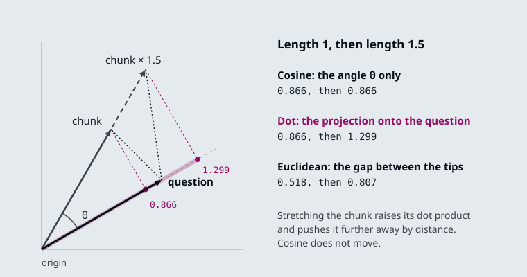
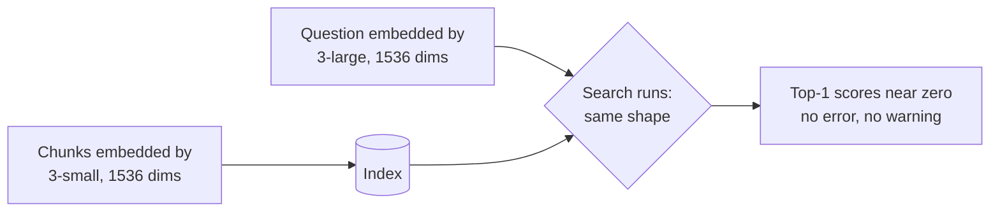

# M14.1 Theory: Embedding fundamentals, similarity metrics and model selection

*[M14 theory](../README.md) · Lesson 14.1 · Notebooks: [`01a_embeddings_and_model_selection.ipynb`](../../../../course/p05_ingestion_and_indexing/m14_embeddings/notebooks/01a_embeddings_and_model_selection.ipynb) · [All theory pages](../../../README.md)*

## Cosine similarity

Retrieval needs one number per chunk that says how close it is to the question. Three formulas are in common use, and every vector store offers at least one of them:

```
cosine(q, d)    = q · d / (‖q‖ ‖d‖)     the angle only; from −1 to 1, higher is closer
dot(q, d)       = q · d                 angle and length; higher is closer
euclidean(q, d) = ‖q − d‖               the straight-line gap; lower is closer
```



Cosine measures direction only, so a vector's length cannot change it. The dot product is cosine multiplied by both lengths, so a longer vector scores higher at the same angle. Euclidean distance measures the gap between the two tips, so a longer vector moves away. The figure shows one pair: stretching the chunk to 1.5× leaves its cosine at 0.866, raises its dot product from 0.866 to 1.299, and pushes its distance from 0.518 to 0.807.

When both vectors have length 1, the three agree. The dot product equals the cosine, and Euclidean distance is √(2 − 2·cos), which falls as cosine rises, so all three return the same chunks in the same order. Notebook 14.1 checks this on two real `text-embedding-3-small` vectors, and it is why the first thing to print about a new model is the norm of one of its vectors:

| Model output | Norm | Which metric |
|---|---|---|
| OpenAI `text-embedding-3-*` | 1.0, give or take float rounding | Any of the three; pick the one your store computes fastest, usually dot product |
| sentence-transformers through `HuggingFaceEmbeddings`, default settings | not 1 | Cosine, or pass `encode_kwargs={"normalize_embeddings": True}` and then any of the three |

The [interactive lab](interactive/similarity-metrics-lab.html) draws ten Larkspur handbook chunks as 2D vectors so the angles are visible. The vectors are hand-placed, and every score is computed; the lab's cosine, dot and Euclidean values match scikit-learn's `cosine_similarity` and `euclidean_distances` to within 2e-15 at all 156 settings. Every chunk has length 1 except `plans-overview`, the long pricing page, whose length the slider sets, the way notebook 14.1 scales one vector by 3.0 to imitate a model that does not normalize:

| `plans-overview` length | *How long does a refund take?* | *Can I export my data after I cancel?* | *What happens if my server goes down?* |
|---|---|---|---|
| 1.0× | All three rank `refund-timing` first | All three rank `retention` first | All three rank `sla` first |
| 1.2× | Dot product ranks `plans-overview` first | Dot product moves it from #4 to #3 | No change |
| 1.5× | Dot: `plans-overview` first; Euclidean: #4 | Dot: `plans-overview` first; Euclidean: #5 | Euclidean moves it to last |
| 3.0× | Dot: first; Euclidean: last of 10 | Dot: first; Euclidean: last of 10 | Dot and Euclidean both rank it last |

- **A small length difference reorders close scores.** For the refund question, dot product prefers the pricing page from 1.15× onward. Its cosine with the question is 0.866 against `refund-timing`'s 0.998, and that gap is all the stretch has to overcome.
- **Cosine never moves.** In every row, cosine ranks the evidence first and `plans-overview` third or worse. Normalizing every vector first gives the same result for all three metrics.
- **Length cannot rescue a wrong direction.** For the outage question `plans-overview` points away (cosine −0.122), so a longer vector only makes its dot product more negative.

<!-- lab: interactive/similarity-metrics-lab.html -->

Two cautions. Cosine scores are not probabilities, and their range differs between models, so a threshold such as "answer only above 0.7" (notebook 14.2's optional tutorial gives bands like this) has to be re-measured after a model change. And embeddings encode topic more than truth: notebook 14.1 warns that a sentence and its negation embed close together, so "the plan is refundable" and "the plan is not refundable" can retrieve each other. Negation, numeric comparison and exact identifiers such as invoice numbers are weak spots, which is what hybrid search in M17 is for.

## The same model on both sides

The model that embeds the chunks must also embed the questions, with the same `dimensions` setting. Breaking this rule raises no error. Notebook 14.1 indexes with `text-embedding-3-small`, queries with `text-embedding-3-large` truncated to 1536 dimensions, and gets vectors of the same shape on both sides; the search runs and returns scores from two unrelated coordinate systems.



The tell is the score itself: if the best match for a question that plainly has an answer in the corpus scores near zero, suspect a mismatch before you touch chunking or prompts. It happens three ways in practice:

1. **Config drift.** The indexing job and the query service read the model name from different places, and only one gets updated.
2. **An unnamespaced cache.** The cache returns the old model's vectors for the new model's requests ([Embedding cache](../04_production_concerns_batching_caching_and_similarity_behaviour/README.md#embedding-cache), lesson 14.4).
3. **A provider-side update.** A pinned model name is not always pinned weights.

The defence is cheap: write the model name and dimensions into the index metadata when you build it, and have the query service compare them with its own configuration before it serves a request.

The other notebook topics, `embed_query` against `embed_documents` and caching, are on the [lesson 14.4 page](../04_production_concerns_batching_caching_and_similarity_behaviour/README.md); dimensions and the `dimensions` parameter are on the [lesson 14.2 page](../02_hosted_embeddings_openai_models_and_dimensions/README.md).

## Check yourself

<details>
<summary>1. Why do cosine, dot product and Euclidean distance rank chunks identically when every vector has length 1?</summary>

With unit vectors the dot product equals the cosine, and Euclidean distance is √(2 − 2·cos), which falls as cosine rises. All three then return the same chunks in the same order. That is why the first thing to print about a new model is the norm of one of its vectors.

</details>

<details>
<summary>2. In the lab, the plans-overview vector is stretched to 1.5 times its length. Which chunk does dot product rank first for the refund-timing question, and what does cosine do?</summary>

Dot product ranks `plans-overview` first; it overtakes from 1.15× onward, because its cosine of 0.866 is not far below `refund-timing`'s 0.998. Cosine never moves and keeps `refund-timing` first. Normalising every vector makes all three metrics agree with cosine.

</details>

<details>
<summary>3. After a config change, the top match for an answerable question scores near zero, and no error is raised. What do you suspect first, and what prevents it?</summary>

A model mismatch: chunks and questions embedded by different models, such as `text-embedding-3-small` and `text-embedding-3-large` truncated to 1536, give vectors of the same shape from unrelated coordinate systems. Write the model name and dimensions into the index metadata when you build it. Have the query service compare them with its own configuration before it serves a request.

</details>

---
*Previous: [M14 overview](../README.md). Next: [14.2 Hosted embeddings: OpenAI models and dimensions](../02_hosted_embeddings_openai_models_and_dimensions/README.md).*
