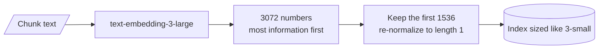

# M14.2 Theory: Hosted embeddings: OpenAI models and dimensions

*[M14 theory](../README.md) · Lesson 14.2 · Notebooks: [`02a_openai_embeddings.ipynb`](../../../../course/p05_ingestion_and_indexing/m14_embeddings/notebooks/02a_openai_embeddings.ipynb), [`02b_openai_embeddings_tutorial.ipynb`](../../../../course/p05_ingestion_and_indexing/m14_embeddings/optional/02b_openai_embeddings_tutorial.ipynb) (optional) · [All theory pages](../../../README.md)*

## Vector dimensionality

An embedding's dimensionality is how many numbers the model returns per text. It is fixed by the model (or by the `dimensions` parameter, below), and every stored vector and every query vector in one index must have the same count. The notebooks use three hosted OpenAI models:

| Model | Default dimensions | Max input tokens | Listed price per 1M tokens | 1,000 chunks of 500 characters |
|---|---|---|---|---|
| `text-embedding-3-small` | 1536 | 8191 | $0.02 | $0.0025 |
| `text-embedding-3-large` | 3072 | 8191 | $0.13 | $0.016 |
| `text-embedding-ada-002` (previous generation) | 1536 | 8191 | $0.10 | $0.0125 |

Dimensions, token limits and prices are as the lesson 14.2 notebooks list them; check the provider's current price list before you budget. The last column is arithmetic: 500 characters is about 125 tokens at four characters per token, the rule of thumb the M11 lab uses, so 1,000 such chunks are about 125,000 tokens.

Embedding the corpus is a one-off bill and small. The dimensions are paid again on every query, for as long as the index exists: the store keeps every number, holds them in memory to search fast, and multiplies through them for each similarity. Stored as 32-bit floats, before any index overhead or compression:

| Dimensions | Bytes per vector | 1 million chunks |
|---|---|---|
| 384 (`all-MiniLM-L6-v2`, lesson 14.3) | 1,536 | 1.5 GB |
| 1024 (`BAAI/bge-large-en`, lesson 14.3) | 4,096 | 4.1 GB |
| 1536 (`3-small`) | 6,144 | 6.1 GB |
| 3072 (`3-large`) | 12,288 | 12.3 GB |

Notebook 14.1 puts it as a rule: a 3072-dimension index is twice the size of a 1536-dimension one and costs roughly twice as much per search. Some vector stores can compress vectors into fewer bytes per number, which lowers these figures at some cost in accuracy.

### Shortening a vector with `dimensions`

The `text-embedding-3` models are trained with Matryoshka representation learning, which puts the most useful information in the first numbers. The API can therefore cut a vector short and re-normalize it, and the shorter vector still works for search:

```python
OpenAIEmbeddings(model="text-embedding-3-small", dimensions=512)    # 512 numbers instead of 1536
OpenAIEmbeddings(model="text-embedding-3-large", dimensions=1536)   # large model, small model's index size
```



Shorter vectors are worse; the question is how much worse on your data for what you save. Notebook 14.1 measures it on six labelled queries at 1536, 512, 256, 128, 64 and 32 dimensions and reports two numbers per setting:

- **recall@1**, which saturates on an easy set: six well-separated documents score perfectly at almost any size, and then the metric says nothing more.
- **margin**, the correct document's similarity minus the best wrong document's. It keeps shrinking as dimensions fall, and a shrinking margin is where recall will break on a large corpus with near-duplicates, such as Larkspur's `refund-window` and `refund-timing` chunks.

The notebook's most useful row is `3-large` truncated to 1536: a stronger model at the same index cost as `3-small`. Run the same comparison on the M11 golden set before you pick a size, and treat the choice as permanent, because changing dimensions means re-embedding every chunk and querying with the new setting.

## Key Takeaways

- Embedding the corpus is a small one-off bill; dimensions are paid on every query in memory and compute. One million 1536-dimension vectors take about 6.1 GB as 32-bit floats.
- The `text-embedding-3` models can be shortened with `dimensions`. `3-large` at 1536 gives a stronger model at the same index cost as `3-small`.
- Judge a dimension cut by the margin, not only recall@1, which saturates on easy sets. Treat the choice as permanent, because changing it means re-embedding every chunk.

## Check yourself

<details>
<summary>1. Embedding the corpus is a small one-off bill. Why do the dimensions keep costing you for as long as the index exists?</summary>

The store keeps every number of every vector, holds them in memory to search fast, and multiplies through them for each similarity. A 3072-dimension index is twice the size of a 1536-dimension one and costs roughly twice as much per search.

</details>

<details>
<summary>2. How much memory do one million chunks need at 3072 dimensions compared with 1536, stored as 32-bit floats?</summary>

12,288 bytes per vector gives 12.3 GB at 3072 dimensions, against 6,144 bytes and 6.1 GB at 1536, before any index overhead or compression. Truncating `text-embedding-3-large` to 1536 with `dimensions` gives a stronger model at the smaller index's size.

</details>

<details>
<summary>3. A dimension sweep on six labelled queries shows perfect recall at 1 even at 64 dimensions. Should you ship 64?</summary>

No. Recall@1 saturates on an easy set of well-separated documents and then says nothing more. The margin keeps shrinking as dimensions fall, and a shrinking margin is where recall breaks on a large corpus with near-duplicates such as `refund-window` and `refund-timing`. Run the comparison on the M11 golden set, and treat the choice as permanent, since changing it means re-embedding every chunk.

</details>

---
*Previous: [14.1 Embedding fundamentals, similarity metrics and model selection](../01_embedding_fundamentals_similarity_metrics_and_model_selection/README.md). Next: [14.3 Open-source embeddings with Hugging Face](../03_open_source_embeddings_with_hugging_face/README.md).*
