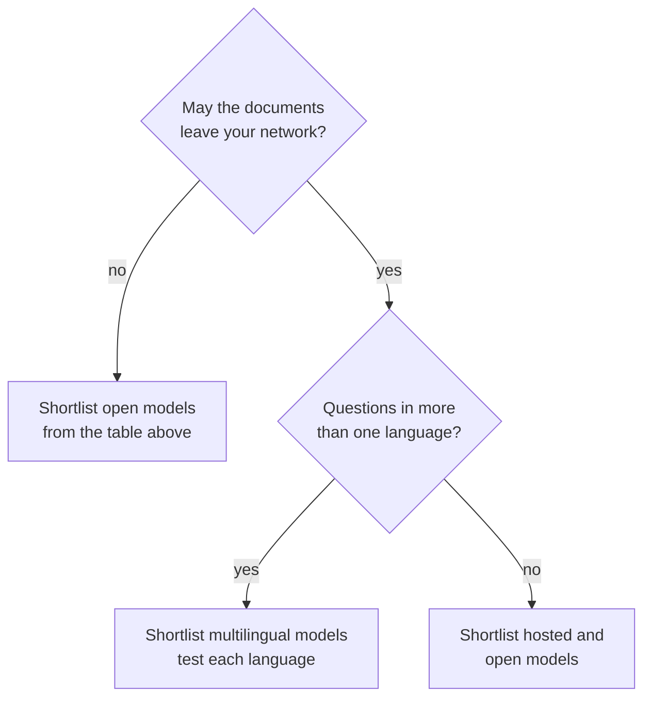

# M14.3 Theory: Open-source embeddings with Hugging Face

*[M14 theory](../README.md) · Lesson 14.3 · Notebooks: [`03a_huggingface_embeddings.ipynb`](../../../../course/p05_ingestion_and_indexing/m14_embeddings/notebooks/03a_huggingface_embeddings.ipynb), [`03b_huggingface_embeddings_tutorial.ipynb`](../../../../course/p05_ingestion_and_indexing/m14_embeddings/optional/03b_huggingface_embeddings_tutorial.ipynb) (optional), [`03c_embedding_models.ipynb`](../../../../course/p05_ingestion_and_indexing/m14_embeddings/optional/03c_embedding_models.ipynb) (optional) · [All theory pages](../../../README.md)*

## Domain fit

A model fits a domain when texts that mean the same thing in *your* documents land close together and texts that differ land apart. General-purpose models are trained on broad web text. They can place two Larkspur chunks that differ by one condition (a full refund within 30 days, a prorated one after) almost on top of each other, miss that a customer's "bandwidth" is the handbook's "outbound traffic", or fail on a language they were not trained on. None of this raises an error; it shows up as the wrong chunk ranked first.

`HuggingFaceEmbeddings` runs sentence-transformers models on your own machine, with no API key, which widens the choice. The models the lesson's notebooks load:

| Model | Dimensions | What the notebooks say it is for |
|---|---|---|
| `sentence-transformers/all-MiniLM-L6-v2` | 384 | Fast, general purpose; the default in the notebooks |
| `sentence-transformers/all-MiniLM-L12-v2` | 384 | A little better than L6, a little slower |
| `sentence-transformers/all-mpnet-base-v2` | 768 | Higher quality, slower than MiniLM |
| `sentence-transformers/multi-qa-MiniLM-L6-cos-v1` | 384 | Tuned for question answering and semantic search |
| `sentence-transformers/paraphrase-multilingual-MiniLM-L12-v2` | 384 | More than 50 languages |
| `BAAI/bge-large-en` | 1024 | High-accuracy applications; the slowest in 03b's table |
| `mixedbread-ai/mxbai-embed-large-v1` | not printed in the notebook | Loaded in 03c as a second open model to compare with OpenAI |

Two settings decide whether a local model behaves like the hosted ones in lessons 14.1 and 14.2:

- **Normalization is off by default.** Pass `encode_kwargs={"normalize_embeddings": True}`, or score with cosine. Otherwise dot product rewards longer vectors, as the [lesson 14.1 lab](../01_embedding_fundamentals_similarity_metrics_and_model_selection/interactive/similarity-metrics-lab.html) shows.
- **Some models are asymmetric.** They are trained so that short questions and long passages meet, and they treat the two sides differently, so `embed_query` and `embed_documents` can return different vectors for the same text. Keep the two calls separate in your code even when today's model is symmetric.

Hosted or self-hosted is part of the fit, because some corpora may not leave your network. The trade, from notebook 14.1:

| | Hosted API | Self-hosted |
|---|---|---|
| Cost | Per token, for as long as you use it | Hardware and operations |
| Data | Leaves your network | Stays on your machines |
| Latency | A network round trip | Local compute; a GPU helps a lot |
| Ops burden | None | Versioning, serving, scaling, capacity |
| Deprecation | The provider can retire the model, forcing a re-index | You decide when it changes |

### Measuring fit

Leaderboards such as MTEB average many public datasets; they are good for a shortlist. The decision comes from scoring the shortlist on your own documents and questions. A short decision chain:

Every shortlist then goes through the same scoring on the golden set: recall@k, margin, cost and latency. A useful golden set for Larkspur holds the M11 questions plus **hard negatives**: chunks on the same topic that do not answer the question, such as `cancel` for *Can I export my data after I cancel my plan?* Notebook 14.1's exercise asks for exactly this, because a six-document toy set separates no models.

Score more than one thing. The optional lesson 14.5 notebook, [`05a_compare_embedding_models_databricks.ipynb`](../../../../course/p05_ingestion_and_indexing/m14_embeddings/optional/05a_compare_embedding_models_databricks.ipynb), indexes eight short documents with three open models in Databricks Vector Search and grades the top-5 results for 15 queries with MLflow's `RetrievalRelevance` and `RetrievalGroundedness` scorers. Its recorded result:

| Model | Retrieval relevance | Retrieval groundedness |
|---|---|---|
| `all-MiniLM-L6-v2` | 0.36 (tied best) | 0.8 |
| `thenlper/gte-large` | 0.36 (tied best) | 0.8 |
| `BAAI/bge-large-en-v1.5` | below 0.36 (value not given) | 0.8667 (best) |

The smallest model tied for best relevance, and the ranking reversed on the second metric. Read the second column with care: the notebook's `rag_app` returns the retrieved text itself as the response, so groundedness here grades retrieved text, not an LLM's answer. Eight documents and 15 queries cannot settle a model choice; they show the method. Run it on the full golden set, and decide which metric your product needs before you look at the results.

## Check yourself

1. How does a poor domain fit show up, given that it raises no error?

As the wrong chunk ranked first. A general-purpose model can place two Larkspur chunks that differ by one condition almost on top of each other, or miss that a customer's "bandwidth" is the handbook's "outbound traffic". Leaderboards such as MTEB give a shortlist; the decision comes from scoring that shortlist on your own documents and questions.

2. You are building a golden set for the question about exporting data after cancelling a plan. What kind of chunk should it include besides the answer, and why?

A hard negative: a chunk on the same topic that does not answer the question, such as `cancel`. Hard negatives are what separate models; a six-document toy set separates none.

3. You swap a hosted OpenAI model for all-MiniLM-L6-v2 with default settings and keep scoring by dot product. What goes wrong?

Normalisation is off by default in `HuggingFaceEmbeddings`, so the vectors do not have length 1 and dot product rewards longer vectors. Pass `encode_kwargs={"normalize_embeddings": True}` or score with cosine.

---
*Previous: [14.2 Hosted embeddings: OpenAI models and dimensions](../02_hosted_embeddings_openai_models_and_dimensions/README.md). Next: [14.4 Production concerns: batching, caching and similarity behaviour](../04_production_concerns_batching_caching_and_similarity_behaviour/README.md).*
