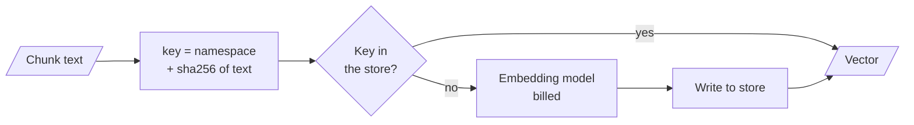

# M14.4 Theory: Production concerns: batching, caching and similarity behaviour

*[M14 theory](../README.md) · Lesson 14.4 · Notebooks: [`04a_embeddings_deep_dive.ipynb`](../../../../course/p05_ingestion_and_indexing/m14_embeddings/notebooks/04a_embeddings_deep_dive.ipynb) · [All theory pages](../../../README.md)*

## Embedding cache

Every re-run of an indexing notebook, and every re-ingest after a change elsewhere in the pipeline, embeds the whole corpus again and pays for it again, for vectors identical to the ones you already had. `CacheBackedEmbeddings` wraps any embedding model with a key-value store: text it has seen comes back from the store, and only new text reaches the model.

```python
from langchain_classic.embeddings import CacheBackedEmbeddings   # LangChain 1.x; 0.x: langchain.embeddings
from langchain_classic.storage import LocalFileStore             # 0.x: langchain.storage

cached = CacheBackedEmbeddings.from_bytes_store(
    underlying_embeddings=OpenAIEmbeddings(model="text-embedding-3-small"),
    document_embedding_cache=LocalFileStore("./.embedding_cache/"),
    namespace="text-embedding-3-small:1536:",   # model and dimensions
    key_encoder="sha256",                        # the default, sha1, warns
)
```


<!-- animated: diagrams/cache.anim.html -->

The key is the namespace followed by a hash of the text, so a cache entry matches only the exact text under the exact namespace. To see what that means for the Larkspur handbook, the 12 chunks of the M11 lab were run through the real `CacheBackedEmbeddings` with a counting stand-in for the API (LangChain's `DeterministicFakeEmbedding`, so the counts are exact and free):

| Run | Texts sent to the model | Keys in the store |
|---|---|---|
| 1. Index the 12 chunks | 12 of 12 | 12 |
| 2. Index the same 12 again | 0 of 12, identical vectors | 12 |
| 3. Edit one chunk ("100 GB" to "200 GB"), index again | 1 of 12 | 13 |
| 4. A second model under its own namespace | 12 of 12 | 25 |
| 5. A second model, both with no namespace | 0 of 12: every vector is the first model's | 12, shared by both |

- **Re-indexing after an edit costs the edit.** When M13's chunking changes only some chunks, only those are embedded again; chunks whose text is unchanged hit the cache.
- **Old entries stay.** Run 3 leaves the pre-edit vector in the store. A file store grows until you clear it, so give it a home you can delete or expire.
- **The namespace is part of correctness.** `from_bytes_store` defaults to an empty namespace. Run 5 swaps the model and gets the old model's vectors back with no error, an index mixing two vector spaces, which is the mismatch from [lesson 14.1](../01_embedding_fundamentals_similarity_metrics_and_model_selection/README.md#the-same-model-on-both-sides). Put the model name and its `dimensions` setting in the namespace.

Only documents are cached by default (`query_embedding_cache=False`), which suits most traffic, since few queries repeat word for word. `LocalFileStore` writes one file per vector; for a cache shared between workers, any other `ByteStore`, such as Redis, works the same way. Notebook 14.4 uses a `TemporaryDirectory`, so its cache is discarded when the cell ends.

## Batching

`embed_documents(texts)` sends many texts in one request; `embed_query(text)` sends one. Looping `embed_query` over a corpus pays one network round trip per chunk, and on a real corpus that is the difference between minutes and hours. Use `embed_documents` for the index and `embed_query` for questions.

Notebook 14.1 runs both paths on the same six texts and compares the vectors. They are semantically identical (cosine about 1.0) but not bit-identical, because a batched request and a single request take different paths through the server. The difference is numerical noise, so never use exact equality to decide whether two vectors came from the same text; that is the cache's job. For an asymmetric model the two methods differ on purpose, which is one more reason to keep the two calls separate (lesson 14.3).

---
*Previous: [14.3 Open-source embeddings with Hugging Face](../03_open_source_embeddings_with_hugging_face/README.md). Next: [M14 interview questions](../README.md#interview-spotlight-5-questions-you-might-get-asked).*
