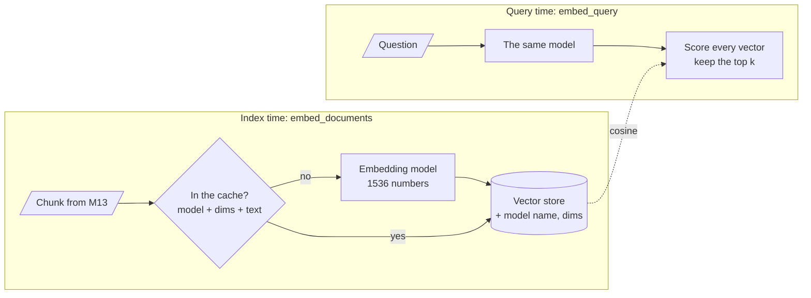

# M14 Theory: Embeddings and model selection

*Part V · The Ingestion & Indexing Pipeline · [Module README](../../../course/p05_ingestion_and_indexing/m14_embeddings/README.md) · [All theory pages](../../README.md)*

An embedding model turns each chunk into a fixed-length list of numbers, and retrieval ranks chunks by how close those lists are to the question's. The model therefore decides what "similar" means for your corpus, and changing it later means re-embedding every chunk. The M14 notebooks build on four ideas: how to compare two vectors, what the number of dimensions costs, how to stop paying twice for the same vector, and how to tell whether a model fits your documents. Each idea has a page in the folder of the lesson that teaches it, listed under [Lessons](#lessons). This page has the overview, the interview questions and the takeaways.

The running example is the Larkspur Cloud handbook from M11 to M13, cut into the chunks the M11 lab uses, and the same three golden questions: *How long does a refund take?*, *Can I export my data after I cancel my plan?* and *What happens if my server goes down?* The lab adds one chunk that answers none of them: `plans-overview`, the long pricing page kept as a single chunk.

## TL;DR

- **Check the norm before you choose a metric.** OpenAI returns unit-length vectors, and for those cosine, dot product and Euclidean distance rank identically. sentence-transformers does not normalize by default; there, dot product favours longer vectors. In the lab, stretching one off-topic chunk to 1.15× its length is enough for dot product to rank it above the refund answer.
- **Dimensions are a cost paid on every query.** `text-embedding-3-small` returns 1536 numbers, `-large` 3072. At four bytes each, a million chunks take 6.1 GB at 1536 and 12.3 GB at 3072 before any index overhead. The `dimensions` parameter shortens the vector; measure what that costs on your own questions.
- **Cache embeddings, and namespace the cache by model and dimensions.** `CacheBackedEmbeddings` keys each vector by `namespace + sha256(text)`. Re-embedding the 12 handbook chunks after one edit sends 1 text to the model instead of 12. Without a namespace, a model swap silently returns the old model's vectors.
- **Domain fit is measured on your own golden set, not read off a leaderboard.** The same model must embed documents and queries; a mismatch raises no error and returns noise.

## Mental model

<!-- animated: diagrams/embedding-path.anim.html -->

A chunk becomes a vector once, at index time, and the cache makes sure it stays once. A question becomes a vector on every request, and it has to come from the same model with the same dimensions as the stored vectors; otherwise the scores compare two unrelated coordinate systems. Recording the model name and dimensions beside the vectors is how a query service can check that before it searches.

## Lessons

| Lesson | Topic | Theory |
|---|---|---|
| 14.1 | Embedding fundamentals, similarity metrics and model selection | [Cosine similarity](01_embedding_fundamentals_similarity_metrics_and_model_selection/README.md#cosine-similarity) [The same model on both sides](01_embedding_fundamentals_similarity_metrics_and_model_selection/README.md#the-same-model-on-both-sides) |
| 14.2 | Hosted embeddings: OpenAI models and dimensions | [Vector dimensionality](02_hosted_embeddings_openai_models_and_dimensions/README.md#vector-dimensionality) |
| 14.3 | Open-source embeddings with Hugging Face | [Domain fit](03_open_source_embeddings_with_hugging_face/README.md#domain-fit) |
| 14.4 | Production concerns: batching, caching and similarity behaviour | [Embedding cache](04_production_concerns_batching_caching_and_similarity_behaviour/README.md#embedding-cache) [Batching](04_production_concerns_batching_caching_and_similarity_behaviour/README.md#batching) |
| 14.5 | Benchmarking embedding models with MLflow (Databricks) | *planned* |

## Interactive lab

[**Cosine, dot and Euclidean**](01_embedding_fundamentals_similarity_metrics_and_model_selection/interactive/similarity-metrics-lab.html): open the file in a browser. With *How long does a refund take?* selected, move the length of `plans-overview` from 1.0× to 1.2×: dot product now ranks the pricing page first while cosine still ranks `refund-timing` first. Push it to 3.0×, the scaling notebook 14.1 uses, and Euclidean distance drops the same chunk to last place. Then press **Normalize first** and watch the three rankings agree again.

## How it connects

- **Before:** [M13](../m13_chunking/README.md) decides what text each vector stands for; a chunk that mixes topics gets a vector that averages them. [M11](../../p04_rag_foundations/m11_rag_lifecycle/README.md) gives the golden questions and the baseline any model choice is measured against.
- **Next:** [M15](../m15_vector_stores/README.md) stores these vectors and runs the nearest-neighbour search; its distance setting must match the metric chosen here. M16 changes what gets embedded (summaries, parents, contextual headers), and M17 adds keyword search for the identifiers and negations embeddings handle badly.

## Interview Spotlight: 5 Questions You Might Get Asked

*Production questions of the kind asked in applied AI engineering interviews.*

### 1. Larkspur's support assistant was fine on Friday. On Monday every answer is vague, and the logged top-1 similarity for golden questions has fallen from its usual range to near zero. Nobody touched the prompt. What do you check first?

**What a strong answer covers:**
- Suspects a model mismatch before a quality problem: scores collapsing toward zero on questions that clearly have answers is the signature
- Compares the model name and dimensions the query service uses with the ones recorded in the index metadata; matching dimensions prove nothing, since `3-large` truncated to 1536 has the same shape as `3-small`
- Checks the usual causes: config read from two places, an unnamespaced embedding cache, a provider-side model update
- Adds a startup check that refuses to serve when the query model differs from the index model, and keeps the golden-set run in the deploy pipeline

### 2. The handbook must stay in the EU, and the team proposes replacing `text-embedding-3-small` with self-hosted `all-MiniLM-L6-v2`. What do you need to know before you agree?

**What a strong answer covers:**
- Data residency may decide it, but the quality cost still has to be measured: 384 dimensions against 1536, on the M11 golden set plus hard negatives such as the two refund chunks
- Checks normalization: sentence-transformers does not normalize by default, so either pass `normalize_embeddings=True` or make sure the store uses cosine
- Counts the operational cost: serving, scaling, GPU or CPU capacity, model versioning, in exchange for no per-token bill and no provider deprecations
- Plans the migration as a full re-index into a new collection, with a new cache namespace, switched over only after the golden set passes

### 3. Storage for the vector index is the biggest line on the bill. Someone suggests `dimensions=256`. How do you decide?

**What a strong answer covers:**
- Computes the saving first: 256 against 1536 dimensions is one sixth of the raw vector storage and similarity work
- Measures recall@k and the margin between the correct chunk and the best wrong one at each candidate size; recall saturates on easy sets while the margin keeps shrinking
- Tries `3-large` truncated to the same size as an alternative: a stronger model at the same index cost
- Remembers that truncation is a re-index, so it is decided once on real traffic samples, not tuned weekly

### 4. A new embedding model goes live. How would you notice in production, within a day, that it retrieves worse than the old one?

**What a strong answer covers:**
- Keeps the old index serving in shadow and logs both top-k lists for a sample of real queries
- Tracks the top-1 score distribution and the share of queries under a score floor, recalibrated for the new model because score ranges differ between models
- Runs the golden set and an LLM-judged sample of live traffic on both, comparing recall and answer faithfulness
- Watches slices separately: other languages, product names and numeric questions can regress while the average improves

### 5. The vector store is configured for dot product, and the embedding model is a sentence-transformers model loaded with default settings. Retrieval keeps returning the longest pages in the handbook. Explain the bug and the fix.

**What a strong answer covers:**
- Without normalization, vector length varies, and dot product scores length as well as direction; cosine scores direction only
- Confirms it by printing the norms of the stored vectors, which a normalized model keeps at 1.0
- Fixes it by normalizing at embedding time (`encode_kwargs={"normalize_embeddings": True}`) or by switching the store to cosine, then re-indexes
- Adds a test that asserts unit norms on a sample of stored vectors, so a config change cannot bring the bug back

## Key Takeaways

- Print a vector's norm before you choose a metric. With unit vectors, use whichever metric your store computes fastest; without them, use cosine or normalize first.
- Dimensions cost storage and search time on every query. Shrink them only after measuring the margin on your own golden set.
- Wrap the embedder in `CacheBackedEmbeddings` with a namespace that names the model and its dimensions, so re-runs and small edits cost almost nothing.
- Choose a model on your own documents and questions, use the same model on both sides, and record it in the index metadata so a mismatch fails loudly.

---
*Previous: [M13 Chunking](../m13_chunking/README.md). Next: [M15 Vector stores](../m15_vector_stores/README.md).*
