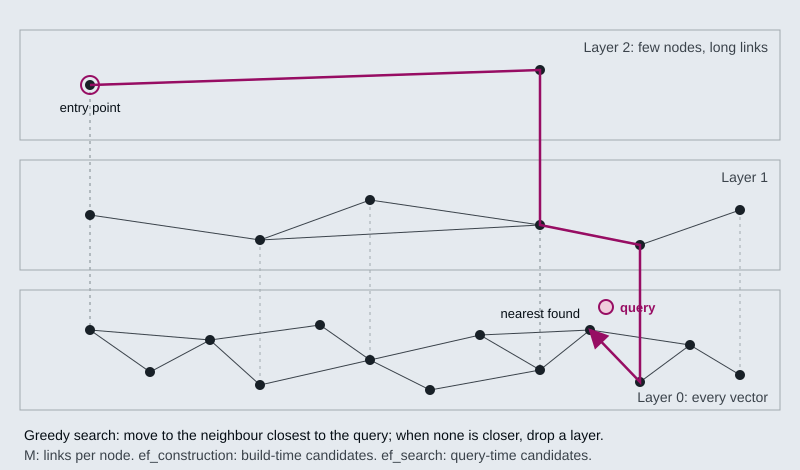

# M15.2 Theory: Embedded stores: Chroma and FAISS

*[M15 theory](../README.md) · Lesson 15.2 · Notebooks: [`02a_chromadb.ipynb`](../../../../course/p05_ingestion_and_indexing/m15_vector_stores/notebooks/02a_chromadb.ipynb), [`02b_faiss.ipynb`](../../../../course/p05_ingestion_and_indexing/m15_vector_stores/notebooks/02b_faiss.ipynb), [`02c_vector_stores_in_practice.ipynb`](../../../../course/p05_ingestion_and_indexing/m15_vector_stores/optional/02c_vector_stores_in_practice.ipynb) (optional) · [All theory pages](../../../README.md)*

## ANN search

Exact nearest-neighbour search compares the query with every stored vector. `FAISS.from_documents` builds exactly that, an `IndexFlatL2`: the answer is always the true top `k`, and the cost grows with every vector you add. At the size of the M15 notebooks (a handful of chunks) exact search is instant, which is why none of them shows a difference between exact and approximate results.

Approximate nearest-neighbour (ANN) indexes give up the guarantee to visit only a small part of the collection. The two families you meet in practice:

- **HNSW** (hierarchical navigable small world) links each vector to its near neighbours in a graph, and keeps sparser copies of the graph in layers above it. A search enters at the top, walks greedily towards the query, and drops a layer each time no neighbour is closer. Chroma's local collections are HNSW indexes, and pgvector offers it as an index type.
- **IVF** (inverted file) clusters the vectors into lists around centroids, then searches only the lists whose centroids are nearest the query. pgvector calls the cluster count `lists` and the number searched `probes`; FAISS calls them `nlist` and `nprobe`.

Each knob moves recall against speed or memory:

| Knob | What it controls | Chroma 1.5.9 default | pgvector default |
|---|---|---|---|
| `M` (Chroma: `max_neighbors`) | Links per node; more links, better recall, more memory | 16 | 16 |
| `ef_construction` | Candidates kept while building the graph; higher builds slower and better | 100 | 64 |
| `ef_search` | Candidates kept while answering a query; higher answers slower and better | 100 | 40 |
| IVF `probes` | Lists searched per query | none (HNSW only) | 1 |

The Chroma values are what `collection.configuration_json` reports for a new collection in the course environment; the pgvector values are from the [pgvector README](https://github.com/pgvector/pgvector). Defaults are a starting point. To tune them, measure recall@k of the ANN index against an exact search on your own queries, and raise `ef_search` until the misses stop mattering for the golden set.

An ANN miss raises no error. An index that skips the refund chunk returns the next-best chunk with a normal-looking score, so a recall drop after the corpus grows shows up as worse answers, not as an error.

## Chroma or FAISS

Both run inside your Python process with no server. They differ in what they do beyond the search:

| | Chroma | FAISS (LangChain wrapper) |
|---|---|---|
| Index | HNSW, `l2` space by default | Exact `IndexFlatL2` from `from_documents`; FAISS itself also has HNSW and IVF indexes |
| Persistence | Writes to `persist_directory` as it goes | `save_local` / `load_local`, metadata in a pickle |
| Metadata filter | Runs inside the store, before ranking; returns every match up to `k` | Runs in Python on `fetch_k=20` candidates after ranking |
| Filter syntax | One key per dict; combine with `$and` / `$or`. `{"dept": "HR", "year": 2026}` raises `ValueError` | A dict of values or operators (`$eq`, `$gt`, `$in`, …), or a callable on the metadata |
| Read by ID | `get(ids=...)` | Through the docstore only |
| Good for | Local development and small production indexes you update | Static, read-heavy corpora where search speed matters |

The filter difference shows up as missing results. In a check run for this page, a FAISS store held 25 chunks tagged `t="no"` that sat close to the query and 3 tagged `t="yes"` further away. `similarity_search(q, k=3, filter={"t": "yes"})` returned 0 results, because none of the 3 was among the 20 nearest candidates; with `fetch_k=28` it returned all 3. Chroma, asked for `k=5` with a filter only 2 entries match, returned those 2.

The notebooks' guidance: start with Chroma for anything you might keep, choose FAISS for a static corpus you search often, and move to a hosted store (lesson 15.3) when you need concurrent writers or more than one machine.

## Check yourself

1. Why can an approximate nearest-neighbour index miss the right chunk without anyone noticing?

An ANN index visits only a small part of the collection and gives up the guarantee of the true top k. A miss raises no error: the index returns the next-best chunk with a normal-looking score, so a recall drop shows up as worse answers. Measure recall@k against an exact search on your own queries, and raise `ef_search` until the misses stop mattering for the golden set.

2. A FAISS store holds 25 chunks tagged no near the query and 3 tagged yes further away. A search filtered to yes with k of 3 returns nothing. Why?

The FAISS wrapper filters in Python after ranking, on the `fetch_k=20` nearest candidates, and none of the 3 matching chunks was among them. With `fetch_k=28` it returns all 3. Chroma filters inside the store before ranking, so it returns every match up to `k`.

3. Your index needs several writers at once across more than one machine. Is Chroma or FAISS the right choice?

Neither. Both run inside your Python process with no server, so the notebooks' guidance is to move to a hosted store (lesson 15.3) when you need concurrent writers or more than one machine. On one machine, choose Chroma for anything you might keep and update, and FAISS for a static corpus you search often.

---
*Previous: [15.1 Index operations: create, query, update, delete, persist](../01_index_operations_create_query_update_delete_persist/README.md). Next: [15.3 Managed stores: Astra DB and Pinecone](../03_managed_stores_astra_db_and_pinecone/README.md).*
