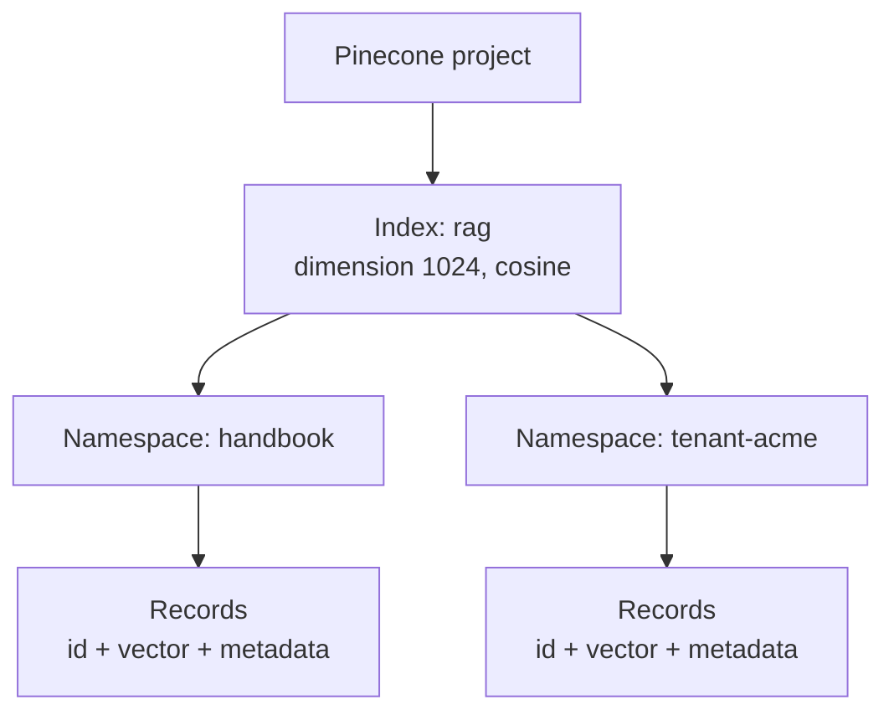

# M15.3 Theory: Managed stores: Astra DB and Pinecone

*[M15 theory](../README.md) · Lesson 15.3 · Notebooks: [`03b_pinecone.ipynb`](../../../../course/p05_ingestion_and_indexing/m15_vector_stores/notebooks/03b_pinecone.ipynb), [`03a_astra_db.ipynb`](../../../../course/p05_ingestion_and_indexing/m15_vector_stores/optional/03a_astra_db.ipynb) (optional) · [All theory pages](../../../README.md)*

## Collections and namespaces

Every store groups its entries, and the grouping decides what one query can see. The names differ:

| Store | Container you create | Partition inside it | What is fixed when you create it |
|---|---|---|---|
| Chroma | Collection (`collection_name`) | none | Distance space and HNSW settings |
| PGVector | A row in `langchain_pg_collection` (`collection_name`) | none; entries in `langchain_pg_embedding` carry its `collection_id` | Nothing, unless you pass `embedding_length`, which fixes the vector column's dimension |
| Pinecone | Index (`pc.create_index(name, dimension, metric, spec)`) | Namespace | Dimension and metric |
| Astra DB | Collection (`collection_name`) inside a namespace, also called a keyspace | none | Vector dimension and metric |

The Pinecone notebook creates a serverless index named `rag` with `dimension=1024` and `metric="cosine"`, and asks OpenAI's `text-embedding-3-small` for 1,024 dimensions to match. The index's dimension cannot change, so the embedding model and its output size are part of the index's identity. The Astra DB notebook does the same with `dimensions=1024` and passes `namespace=None`, so the store falls back to the `ASTRA_DB_KEYSPACE` environment variable or the database's default namespace.

Pinecone's [indexing overview](https://docs.pinecone.io/guides/index-data/indexing-overview) says reads and writes "always target one namespace", that namespaces are created on first upsert, and that you can isolate customers with "one namespace per customer". A query in one namespace cannot return another namespace's records, which is a stronger boundary than a metadata filter that a caller can leave out. In LangChain, `PineconeVectorStore` takes the namespace as an argument.

The record manager in lesson 15.5 has a namespace too: `SQLRecordManager("pgvector/vectordb", db_url=...)`. It scopes the record manager's keys, not the vectors. Keep one record-manager namespace per collection. If two collections share one, a `full` cleanup run on either deletes the other's keys.

For Larkspur, the public handbook goes in one collection or namespace. Customer-specific runbooks, if they arrive, go in their own namespaces, so re-indexing the handbook never touches customer data and a customer's query cannot reach another customer's text.

## When a managed store earns its cost

The managed stores take the same LangChain calls as Chroma: `add_documents`, `similarity_search(query, k, filter=...)`, `as_retriever(...)`. The Pinecone notebook filters with `{"source": "tweet"}` and runs a retriever with `search_type="similarity_score_threshold"` and `score_threshold=0.4`, a threshold that only means something on that index's cosine scale. Switching stores changes the setup and the bill; the calls stay the same.

Lesson 15.1's notebook gives the rule: move to a hosted store when you need concurrent writers, horizontal scale or managed availability, and not before. The move is a re-index, so the embedding model goes with you, and the IDs you derived in lesson 15.1 make the second load as idempotent as the first. Until then an embedded store, or pgvector in a Postgres you already run (lesson 15.4), has no API key to manage, no network hop and no bill per query.

---
*Previous: [15.2 Embedded stores: Chroma and FAISS](../02_embedded_stores_chroma_and_faiss/README.md). Next: [15.4 Postgres + pgvector with metadata-filtered search](../04_postgres_pgvector_with_metadata_filtered_search/README.md).*
