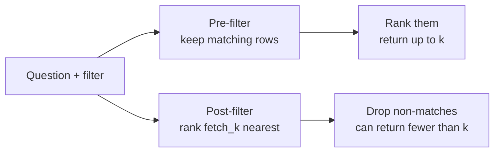

# M15.4 Theory: Postgres + pgvector with metadata-filtered search

*[M15 theory](../README.md) · Lesson 15.4 · Notebooks: [`04a_filtered_search_pgvector.ipynb`](../../../../course/p05_ingestion_and_indexing/m15_vector_stores/notebooks/04a_filtered_search_pgvector.ipynb) · [All theory pages](../../../README.md)*

## Metadata filters

A metadata filter restricts a similarity search to entries whose metadata matches a predicate. It is how one index serves many scopes: one customer, one product, one section of the handbook, documents newer than a date. The notebook indexes two restaurants' FAQs and reviews into one PGVector collection and narrows each query with a filter on `restaurant`, `category` or `cuisine`.

LangChain's `PGVector` (from `langchain_postgres`) keeps everything in two tables. `langchain_pg_collection` has one row per collection. `langchain_pg_embedding` has one row per chunk: the `embedding` vector, the `document` text, a `collection_id`, and the metadata as a JSONB column, `cmetadata`, with a GIN index on it. A filter becomes a `WHERE` clause on `cmetadata`.

| Filter | Meaning |
|---|---|
| `{"source": "refunds.md"}` | Equality on one key |
| `{"source": "refunds.md", "category": "policy"}` | Two keys: PGVector treats it as AND |
| `{"source": {"$in": ["refunds.md", "billing.md"]}}` | Operator form |
| `{"$and": [{...}, {...}]}`, `{"$or": [...]}` | Explicit logic; the portable form |

PGVector accepts `$eq`, `$ne`, `$lt`, `$lte`, `$gt`, `$gte`, `$in`, `$nin`, `$between`, `$exists`, `$like`, `$ilike`, `$and`, `$or` and `$not`. Stores share most of this syntax but differ at the edges. The two-key dict that PGVector reads as AND makes Chroma raise `ValueError: Expected where to have exactly one operator`, so write `$and` when code may move between stores.

Filters are exact. `"Engineering"` does not match `"engineering"`, and a field that was never written matches nothing. Normalise metadata at ingestion (M12) so the filter has something consistent to match.

A filter is not access control. Lesson 15.1's notebook makes the point: a caller who omits the filter sees everything. For tenant isolation, enforce the filter in the service that builds the query, or use a namespace or a separate collection per tenant (lesson 15.3).

## Filtering before or after the search

There are two ways to combine a filter with a top-`k` search, and they return different results:

**Pre-filtering** restricts the candidates, then ranks them. If at least `k` entries match, you get `k`. LangChain's PGVector builds one SQL query, `WHERE collection_id = … AND <filter>` then `ORDER BY distance`, and it creates no vector index of its own, so Postgres compares the query with every matching row: an exact, pre-filtered search.

**Post-filtering** ranks first, then drops what fails the filter. LangChain's FAISS wrapper does this on `fetch_k=20` candidates (lesson 15.2), so a selective filter can return fewer than `k` results or none.

Adding an ANN index to pgvector moves it towards post-filtering. The [pgvector README](https://github.com/pgvector/pgvector) says: "With approximate indexes, filtering is applied *after* the index is scanned." Its example: if a condition matches 10% of rows, an HNSW scan with the default `hnsw.ef_search` of 40 leaves "only 4 rows" on average. From version 0.8.0, iterative index scans (`SET hnsw.iterative_scan = strict_order` or `relaxed_order`) keep scanning until enough rows pass the filter.

The symptom of post-filtering is a query that asks for `k = 5` and gets 2. Log `len(results)` beside `k` on every filtered query; raising `k` hides the problem without fixing it.

---
*Previous: [15.3 Managed stores: Astra DB and Pinecone](../03_managed_stores_astra_db_and_pinecone/README.md). Next: [15.5 Incremental indexing: Indexing API and record manager](../05_incremental_indexing_indexing_api_and_record_manager/README.md).*
