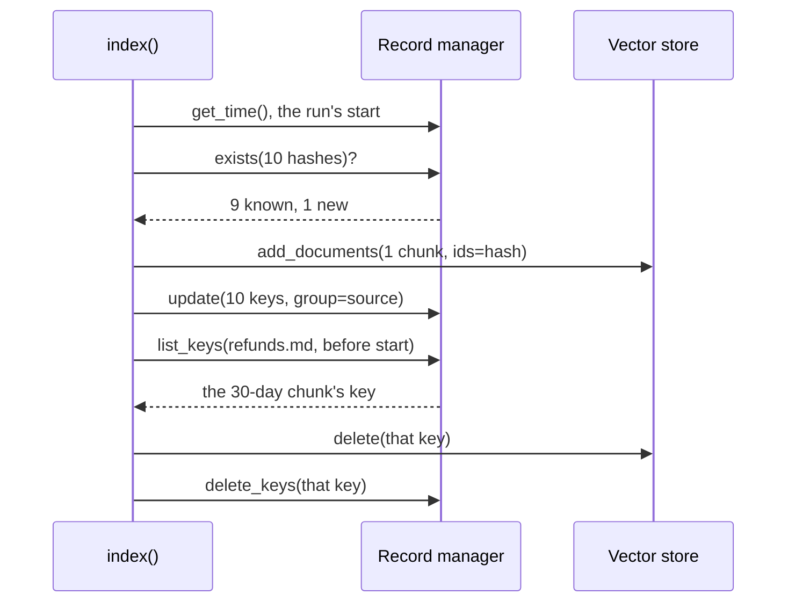

# M15.5 Theory: Incremental indexing: Indexing API and record manager

*[M15 theory](../README.md) · Lesson 15.5 · Notebooks: [`05a_indexing_api.ipynb`](../../../../course/p05_ingestion_and_indexing/m15_vector_stores/notebooks/05a_indexing_api.ipynb) · [All theory pages](../../../README.md)*

## Idempotent re-indexing

A sync job is idempotent when running it twice on the same folder leaves the store as one run did and embeds nothing the second time. LangChain's Indexing API gives you that with three parts: the vector store, a **record manager** that remembers what has been written, and the `index()` function that compares the two on every run.

```python
from langchain_classic.indexes import SQLRecordManager, index

record_manager = SQLRecordManager("pgvector/vectordb", db_url=CONNECTION_STRING)
record_manager.create_schema()
index(docs, record_manager, vectorstore, cleanup="incremental", source_id_key="source")
```

Every chunk's ID is a hash. `index()` hashes the chunk's text, hashes its metadata serialised as sorted JSON, then hashes the two together. With the default `key_encoder="sha1"` the result is written as a UUID, and LangChain warns that SHA-1 is not collision-resistant; pass `key_encoder="sha256"`, `"sha512"` or `"blake2b"` in new code. The record manager stores one row per hash: the key, a group ID (the value of `source_id_key`, here the file name) and the time it was last seen.

A run goes like this, in batches of `batch_size=100`:



Known hashes are skipped and only have their timestamp refreshed. New hashes are embedded and written under the hash as their ID, so writing the same chunk twice overwrites instead of duplicating. Then every key in the batch is stamped with a time no earlier than the run's start. Cleanup deletes keys whose stamp is older than the run's start: the chunks this run never saw.

An edited chunk is a new hash. The lab's refund edit comes back as `{'num_added': 1, 'num_updated': 0, 'num_skipped': 9, 'num_deleted': 1}`. In `langchain-core` 1.7.0, `num_updated` counts only chunks re-written because of `force_update=True`, which re-embeds chunks whose hash is already known; the notebook's comments describe changed content as "updated", but changed text shows up as one add and one delete.

The hash covers text and metadata and nothing else. Add a metadata field to every chunk or change the splitter, and every hash changes, so the next run re-embeds the whole corpus. Change the embedding model, and no hash changes, so the next run skips everything and leaves the old vectors in place. For a model change, build a new collection with its own record-manager namespace, or run once with `force_update=True`.

The notebook's own sequence, replayed for this page with in-memory stores in place of Postgres, returns the numbers its comments expect. Seven chunks of `bella_vista.txt` go in under `cleanup=None`. After one chunk is edited, one removed and one added, the second `None` run adds 2, skips 5, deletes 0 and leaves 9 entries in the store: the old version and the removed chunk are both still there. The third run, under `incremental`, adds 2 and deletes 6. An empty batch under `incremental` changes nothing; under `full` it deletes all 5 remaining entries.

## Choosing a cleanup mode

`cleanup` decides which keys a run may delete. `incremental` and `scoped_full` need `source_id_key`, because they delete by source.

| Mode | Deletes | When it runs |
|---|---|---|
| `None` | Nothing | |
| `"incremental"` | Keys from sources that sent chunks in this batch, not seen in this run | After each batch |
| `"scoped_full"` | Keys from sources seen anywhere in this run, not seen in this run | Once, at the end |
| `"full"` | Every key not seen in this run, whatever its source | Once, at the end |

The [interactive lab](interactive/record-manager-lab.html) runs a JavaScript port of `index()` over the Larkspur folder. Across 26,920 sequences of 1 to 6 runs (100,761 `index()` calls, every folder state and mode, batch sizes 100 and 3), its counts, stored IDs and record-manager keys match `langchain_core` 1.7.0 in every call. Starting from a store loaded with all 10 chunks, one more run gives:

| Change, then one run | `None` | `incremental` | `scoped_full` | `full` |
|---|---|---|---|---|
| `refunds.md` edited, 30 days to 14 | 1 added, 0 deleted; the 30-day chunk stays | 1 added, 1 deleted | 1 added, 1 deleted | 1 added, 1 deleted |
| `outages.md` deleted | 0 deleted; its 2 chunks stay | 0 deleted; its 2 chunks stay | 0 deleted; its 2 chunks stay | 2 deleted |
| `support.md` added | 1 added | 1 added | 1 added | 1 added |
| Loader returns only `refunds.md` | 2 skipped, 0 deleted | 2 skipped, 0 deleted | 2 skipped, 0 deleted | 8 deleted |
| Loader returns nothing | nothing | nothing | nothing | all 10 deleted |

<!-- lab: interactive/record-manager-lab.html -->

- **`None` lets stale chunks pile up.** After the refund edit the store holds 11 chunks, and the golden question can retrieve the 30-day rule and the 14-day rule side by side. Switch `refunds.md` back to 30 days and run again: 0 added, because the 30-day hash was never removed, and now the 14-day chunk is the stale one.
- **`incremental` handles edits and cannot see deleted files.** It cleans a source only when that source sends at least one chunk. A file removed from the folder sends none, so its chunks stay until a `full` run or an explicit `delete()` by ID.
- **`full` treats "not returned" as "deleted".** It is the only mode that removes a deleted file, and the only one that wipes the store when the loader returns a partial folder or nothing at all. Run it only over the whole corpus, and refuse to run it when the loader returns far fewer files than last time.
- **`scoped_full` matches `incremental` at this size.** The difference appears when one source's chunks span several batches: `incremental` cleans after each batch and does redundant work, while `scoped_full` collects the sources it saw and cleans once at the end.

For Larkspur's nightly sync, `incremental` keyed on `source` handles policy edits and new files, and a weekly `full` run over the complete folder, guarded by a file-count check, removes files the team deleted. `SQLRecordManager` keeps the keys in the same Postgres as the vectors and reads the time from the database, so every writer stamps keys on one clock; an update raises a time-sync error if that clock reads earlier than the run's start.

---
*Previous: [15.4 Postgres + pgvector with metadata-filtered search](../04_postgres_pgvector_with_metadata_filtered_search/README.md). Next: [M15 interview questions](../README.md#interview-spotlight-5-questions-you-might-get-asked).*
