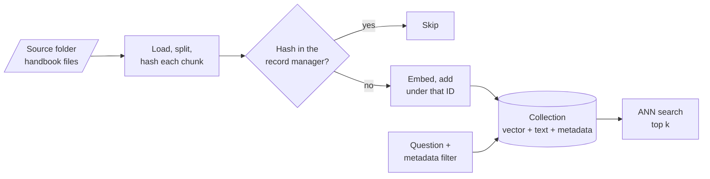

# M15 Theory: Vector stores and index operations

*Part V · The Ingestion & Indexing Pipeline · [Module README](../../../course/p05_ingestion_and_indexing/m15_vector_stores/README.md) · [All theory pages](../../README.md)*

A vector store is a database. Each entry holds a vector, the text it came from and that text's metadata, and you add, read, filter, delete and persist entries the way you would rows. The hard part is keeping the store in step with source files that keep changing. The M15 notebooks build on four ideas: approximate nearest-neighbour (ANN) search, collections and namespaces, metadata filters, and idempotent re-indexing. Each idea has a page in the folder of the lesson that teaches it, listed under [Lessons](#lessons). This page has the overview, the interview questions and the takeaways.

The running example is the Larkspur Cloud handbook kept as a folder of Markdown files: `billing.md`, `refunds.md`, `outages.md`, `servers.md` and `data.md`, ten chunks in all, with the same chunk texts as the M11 lab. A sixth file, `support.md`, arrives later. The event that drives the module is a policy change: the refund window for annual plans drops from 30 days to 14. The golden question is *How long do I have to get a full refund on an annual plan?*, and after the change the index must return the 14-day rule and nothing else.

## TL;DR

- A vector store can add, search, filter and delete. It cannot update text in place: new text means a new vector, so an update is a delete followed by an insert, and both need an ID that stays the same from one run to the next.
- Scores mean different things on different backends. Chroma and FAISS return a distance from `similarity_search_with_score` (lower is closer), and Pinecone's cosine index returns a similarity (higher is closer). A threshold tuned on one is meaningless on another.
- Large indexes use ANN structures such as HNSW and IVF, which trade a little recall for a lot of speed. LangChain's `FAISS.from_documents` builds an exact `IndexFlatL2`; Chroma builds HNSW.
- A metadata filter applied before ranking returns up to `k` matches. One applied after ranking can return fewer, or none. LangChain's FAISS wrapper filters after fetching 20 candidates; PGVector filters in SQL before it ranks.
- The Indexing API hashes every chunk and records the hash. In the lab, editing one refund chunk costs one embedding instead of ten, and `cleanup="incremental"` deletes the old 30-day chunk. With `cleanup=None` both rules stay in the store.

## Mental model

<!-- animated: diagrams/living-index.anim.html -->

The store is the system of record for what retrieval can return, so every change in the source folder has to reach it. The record manager is what makes that cheap: it remembers each chunk's hash, so a run embeds only the chunks whose text or source changed, and its cleanup step deletes the chunks the folder no longer contains. A stale chunk left in the collection is as retrievable as a current one.

## Lessons

| Lesson | Topic | Theory |
|---|---|---|
| 15.1 | Index operations: create, query, update, delete, persist | [Stable IDs and the missing update](01_index_operations_create_query_update_delete_persist/README.md#stable-ids-and-the-missing-update) [What a score means](01_index_operations_create_query_update_delete_persist/README.md#what-a-score-means) [Persisting and reopening](01_index_operations_create_query_update_delete_persist/README.md#persisting-and-reopening) |
| 15.2 | Embedded stores: Chroma and FAISS | [ANN search](02_embedded_stores_chroma_and_faiss/README.md#ann-search) [Chroma or FAISS](02_embedded_stores_chroma_and_faiss/README.md#chroma-or-faiss) |
| 15.3 | Managed stores: Astra DB and Pinecone | [Collections and namespaces](03_managed_stores_astra_db_and_pinecone/README.md#collections-and-namespaces) [When a managed store earns its cost](03_managed_stores_astra_db_and_pinecone/README.md#when-a-managed-store-earns-its-cost) |
| 15.4 | Postgres + pgvector with metadata-filtered search | [Metadata filters](04_postgres_pgvector_with_metadata_filtered_search/README.md#metadata-filters) [Filtering before or after the search](04_postgres_pgvector_with_metadata_filtered_search/README.md#filtering-before-or-after-the-search) |
| 15.5 | Incremental indexing: Indexing API and record manager | [Idempotent re-indexing](05_incremental_indexing_indexing_api_and_record_manager/README.md#idempotent-re-indexing) [Choosing a cleanup mode](05_incremental_indexing_indexing_api_and_record_manager/README.md#choosing-a-cleanup-mode) |

## Interactive lab

[**The record manager and cleanup modes**](05_incremental_indexing_indexing_api_and_record_manager/interactive/record-manager-lab.html): open the file in a browser. Run `index()` once to embed all 10 chunks. Set `refunds.md` to **14 days** and run with cleanup **None**: 1 chunk is added, none is deleted, and the store now holds the 30-day rule and the 14-day rule side by side. Switch to **incremental** and run again to delete the stale one. Then mark `outages.md` **Deleted** and run under **incremental** (nothing is deleted) and under **full** (its 2 chunks go).

## How it connects

- **Before:** [M12](../m12_document_ingestion/README.md) sets the `source` metadata the record manager groups by and the flat metadata types the stores accept; [M13](../m13_chunking/README.md) decides what a chunk is, and so what gets hashed; [M14](../m14_embeddings/README.md) picks the embedding model, which has to match the index for as long as the index lives.
- **Next:** [M16](../m16_advanced_indexing/README.md) indexes more than one representation per document (parent documents, summaries), which needs the stable IDs from lesson 15.1; [M17](../../p06_retrieval_quality/m17_retrievers_hybrid_search/README.md) builds retrieval strategies (MMR, thresholds, hybrid search) on top of `as_retriever()`.

## Interview Spotlight: 5 Questions You Might Get Asked

*Production questions in the style of OpenAI, Anthropic and Google interviews for applied AI roles.*

### 1. Larkspur cut the annual refund window from 30 days to 14 and the nightly sync ran. A week later the assistant still tells some customers "30 days". The new chunk is in the index. What happened, and how do you fix it?

**What a strong answer covers:**
- Checks the store directly: `get()` or a search filtered on `source="refunds.md"` shows both refund chunks, so retrieval picks either one
- Finds the cause in the sync: `cleanup=None` (it never deletes), or random UUIDs per run, so the old chunk has no ID the pipeline can name
- Fixes it with `cleanup="incremental"` keyed on `source`, plus one run to clear the backlog, and checks that the store count equals the folder's chunk count
- Adds the golden question with a negative check: the answer must not contain "30 days"

### 2. Larkspur wants one assistant to answer from each enterprise customer's private runbooks as well as the public handbook. How do you lay out the vector store, and which store do you pick?

**What a strong answer covers:**
- Isolation per customer: a namespace per tenant in Pinecone (queries target one namespace), or a tenant key filtered on every query in pgvector, with the filter enforced server-side rather than trusted from the caller
- Picks pgvector when Postgres already holds the customer data (one backup, SQL joins, JSONB metadata) and a managed store when write concurrency or scale outgrows one database
- Keeps the public handbook in its own collection or namespace and merges results, so a handbook re-index never touches tenant data
- Notes that moving between stores is a re-index with the same embedding model, so the choice can wait until load says it must

### 3. The sync job runs every night. What do you monitor so that you hear about a bad run before a customer does?

**What a strong answer covers:**
- Logs `index()`'s four counts per run and alerts on outliers: `num_added` near the full chunk count means every hash changed (a splitter or metadata change), and a large `num_deleted` under `full` means the loader returned a partial folder
- Compares three numbers after each run: chunks the loader produced, record-manager keys, vectors in the store
- Guards `full` cleanup: refuse to run it when the loader returns fewer files than the previous run, because an empty batch deletes everything
- Re-runs the golden set after any run that added or deleted chunks

### 4. A small customer's queries come back with zero results even though their documents are indexed. Larger customers are fine. What do you suspect?

**What a strong answer covers:**
- A filter applied after ranking: LangChain's FAISS wrapper ranks `fetch_k=20` candidates and then filters, so a tenant whose chunks are not in the global top 20 gets nothing
- The same effect inside pgvector once an HNSW index exists: filtering runs after the index scan, and the pgvector README's example is 4 matching rows out of 40 candidates when the filter matches 10% of rows
- Fixes: pre-filtering in the store, a larger `fetch_k` or `hnsw.ef_search`, iterative index scans (pgvector 0.8.0 and later), or one partition or namespace per tenant
- Logs `len(results)` against `k` on every query, since this failure produces no error

### 5. You switch the embedding model from `text-embedding-ada-002` to `text-embedding-3-small` and re-run the Indexing API over the same folder. What happens, and what should you have done?

**What a strong answer covers:**
- Nothing is re-embedded: the hash covers text and metadata only, so every chunk is skipped and the store keeps the old vectors
- Both models return 1,536 dimensions, so nothing raises an error; queries embedded with the new model are compared with vectors from the old one and the ranking is noise
- Builds a new collection with its own record-manager namespace, back-fills it, runs the golden set, then switches traffic, or re-embeds in place with `force_update=True`
- Stores the model name with the collection and asserts it at startup, because a dimension check alone does not catch this

## Key Takeaways

- Give every chunk an ID derived from the document: its source and position, or a hash of its content. Without one you cannot update, delete or de-duplicate.
- Read what a score means on your backend before you set a threshold, and log how many results a filtered search returned.
- Filter before the search when the filter is selective; after-search filtering silently returns fewer than `k`.
- Sync with the Indexing API and `cleanup="incremental"` keyed on `source`. Use `full` only when the loader returns the whole corpus, and never on a batch that might be empty.

---
*Previous: [M14 Embeddings](../m14_embeddings/README.md). Next: [M16 Advanced indexing](../m16_advanced_indexing/README.md).*
