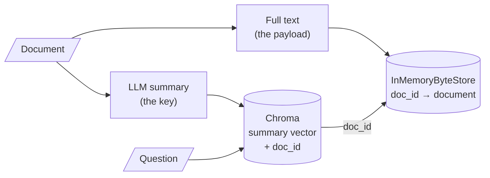

# M16.1 Theory: Multi-representation indexing: search summaries, return documents

*[M16 theory](../README.md) · Lesson 16.1 · Notebooks: [`01a_multi_representation_indexing.ipynb`](../../../../course/p05_ingestion_and_indexing/m16_advanced_indexing/notebooks/01a_multi_representation_indexing.ipynb) · [All theory pages](../../../README.md)*

## Search key vs payload

A plain index stores one text per entry and uses it twice: its embedding is matched against the question, and the text itself goes into the prompt. Those two jobs pull in opposite directions. Matching works best on short, focused text, because one vector has to stand for the whole entry. Answering works best on complete text, because the model can only use what it reads.

Multi-representation indexing gives each job its own text. The **search key** is embedded and matched; the **payload** is returned. Notebook 01a uses an LLM summary as the key and the full document as the payload:

The pieces, as the notebook wires them:

| Piece | In notebook 01a | Job |
|---|---|---|
| Vector store | `Chroma(collection_name="summaries")` | Holds summary embeddings only |
| Docstore | `InMemoryByteStore()` | Holds the full documents, keyed by id |
| Link | `id_key="doc_id"`, one `uuid4` per document | Stored in each summary's metadata |
| Retriever | `MultiVectorRetriever(vectorstore=…, byte_store=…, id_key="doc_id")` | Searches summaries, returns documents |

The notebook loads two LangChain blog posts, splits them at `chunk_size=10000`, which leaves three pieces (the 11,652-character LangSmith post becomes two), and summarises each piece with `gpt-3.5-turbo` and the prompt "Summarize the following document". Two calls show the split. `vectorstore.similarity_search("What is LangSmith?")` returns a summary, and `retriever.invoke("What is LangSmith?")` returns the full post that summary points to.

Every technique in this module is a choice of key and payload:

| Lesson | Search key (embedded) | Payload (returned) | Index-time cost |
|---|---|---|---|
| 16.1 | LLM summary | Full document | One LLM call per document |
| 16.2 | Small child chunk | Larger parent chunk or whole document | Splitting only |
| 16.3 | Page summary, then chunks of that page | Chunks | One summary call per page |
| 16.4 | Questions an LLM wrote for the chunk | The chunk | One LLM call per chunk |
| 16.5 | Chunk with a header or written context | The same text | One LLM call per document for a title, one per chunk for context |

For the Larkspur page, a summary of "Refunds and cancellations" is a sharp key for *What is your refund policy?*. For *How long do I have to get a full refund on an annual plan?* it depends on what the summariser kept. If the summary mentions the 30-day refund on annual plans, the question matches and the payload brings the 100 GB condition back with it. If the summary covers only monthly plans and cancelling, nothing about annual refunds is left to match. Check a summary key on questions about details as well as questions about topics.

---
*Previous: [M16 overview](../README.md). Next: [16.2 Parent-document retrieval, in memory and on Postgres](../02_parent_document_retrieval_in_memory_and_on_postgres/README.md).*
