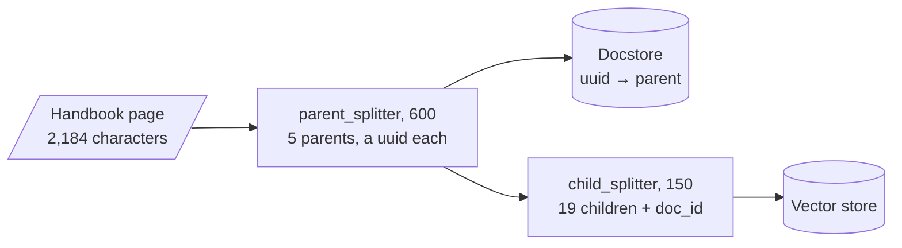

# M16.2 Theory: Parent-document retrieval, in memory and on Postgres

*[M16 theory](../README.md) · Lesson 16.2 · Notebooks: [`02a_parent_document_retrieval.ipynb`](../../../../course/p05_ingestion_and_indexing/m16_advanced_indexing/notebooks/02a_parent_document_retrieval.ipynb), [`02b_parent_document_retriever_postgres.ipynb`](../../../../course/p05_ingestion_and_indexing/m16_advanced_indexing/optional/02b_parent_document_retriever_postgres.ipynb) (optional) · [All theory pages](../../../README.md)*

## Docstore

Parent-document retrieval splits along size instead of meaning. Small **child** chunks are the search keys; the larger **parent** each child was cut from is the payload. The vector store holds the children. The **docstore** holds the parents, keyed by id, and each child carries its parent's id in its metadata (`doc_id` by default).

`ParentDocumentRetriever.add_documents` does the splitting and the bookkeeping:

The counts are the lab's at child 150 and parent 600. Without a `parent_splitter`, each original document is the parent. At query time `invoke` runs a similarity search over the children, collects their parent ids in rank order without repeats, fetches those parents with `docstore.mget`, and drops any id the docstore does not return.

Notebook 02a runs both shapes on two LangChain blog posts. With only `child_splitter` at 400, the parents are the two whole posts, so the docstore lists two keys and every answer arrives as a full post. With `parent_splitter` at 2000 and `child_splitter` at 400 the parents are 2,000-character sections (ten of them for these two posts), and the retriever is wired into a `RetrievalQA` "stuff" chain.

The docstore is any `BaseStore`: four methods, `mget`, `mset`, `mdelete` and `yield_keys`. The notebooks use `InMemoryStore`, which disappears when the process stops, while a vector store such as Chroma can persist on disk. A restart then leaves children whose parents are gone, and `invoke` returns nothing for them, without an error. Optional notebook 02b moves both halves into Postgres: `PGVector` for the children and a custom `PostgresStore` that keeps each parent as JSONB in a `docstore` table.

Check three details in 02b's store before you copy it:

- **Order.** The `BaseStore` contract says `mget` returns one value per key, in key order, with `None` for a missing key. 02b's `mget` returns whatever rows the query yields, in database order, and skips missing keys. `MultiVectorRetriever` relies on that order to keep the parents ranked, so the best parent can arrive second.
- **Errors.** Every method logs exceptions and carries on; `mget` then returns an empty list. A database outage looks like a question with no context.
- **Ids.** `add_documents(docs, ids=None)` gives every parent a fresh `uuid4` on each call. Running ingestion twice stores every parent and child twice. Pass stable ids (one per parent, after the parent splitter) and delete a document's children and parents together when it changes.

## Choosing child and parent sizes

The child size decides what can be matched. The parent size decides what the model reads and what each question costs. The [interactive lab](interactive/search-small-return-large-lab.html) runs a port of `ParentDocumentRetriever` on the Larkspur page with TF-IDF standing in for embeddings and the top 2 children per question, as in the M11 baseline. On all 242 slider settings and all three golden questions it returns the same children, scores and parents as the real retriever (`InMemoryVectorStore` with scikit-learn TF-IDF vectors): 0 mismatches, scores within 2e-16.

<!-- lab: interactive/search-small-return-large-lab.html -->

| Child / parent | Children, parents | Answers whole: children only | Answers whole: parents | Mean tokens: children / parents |
|---|---|---|---|---|
| 150 / 600 | 19, 5 | 0 of 3 | 3 of 3 | 53 / 206 |
| 150 / 400 | 19, 8 | 0 of 3 | 2 of 3 | 53 / 155 |
| 200 / 800 | 16, 4 | 1 of 3 | 3 of 3 | 79 / 182 |
| 400 / 2000, notebook 02a | 9, 2 | 2 of 3 | 3 of 3 | 165 / 478 |
| 400 / whole page | 8, 1 | 2 of 3 | 3 of 3 | 164 / 546 |
| 400 / 400 | 8, 8 | 2 of 3 | 2 of 3 | 164 / 164 |

"Children only" is plain chunking at the child size: the same two matches sent as they are. Tokens use the four-characters-per-token rule.

- **Small children match sharply and cut answers.** At 150, child #5 is the best match for the refund question and ends at "…as long as the account has used less". Sent alone it gives the 30-day rule without the 100 GB condition. Its parent holds the whole sentence.
- **A parent boundary can cut an answer too.** With parents of 400 characters, the outage answer ("The credits are not added automatically. You claim them…") falls across two parents, and no child size gets it back whole.
- **Parents cost tokens on every question.** The notebook's 2,000-character parents return most of this short page: 478 tokens on average against 165 for the children. With no parent splitter, every question costs 546 tokens, the whole page.
- **Children from one parent return it once.** At 200 / 800 both outage matches come from the same parent, so the model reads it once, at 196 tokens.
- **A parent no larger than its child is plain chunking.** At 400 / 400 each parent yields one child identical to itself, and the two columns match.

Across the 217 settings where parents are larger than children, the children alone contain the whole answer in 394 of the 651 question and setting pairs; their parents contain it in 613. Size the child near the length of the evidence your questions need (the refund sentence is 141 characters) and the parent near a section, then check on the golden set that no parent boundary cuts an answer.

## Check yourself

1. At query time, how does the parent-document retriever turn matching children into the text the model reads?

It runs a similarity search over the children, collects their parent ids in rank order without repeats, fetches those parents with `docstore.mget`, and drops any id the docstore does not return. Children from one parent therefore return it once: at 200 / 800 both outage matches come from the same parent, and the model reads it once.

2. At child size 150 and parent size 600, what does the model get for the refund question from the children alone, and what from their parents?

The best child ends at "…as long as the account has used less", so sent alone it gives the 30-day rule without the 100 GB condition. Its parent holds the whole sentence. In the lab table the children answer 0 of 3 questions whole and the parents 3 of 3, at 53 against 206 tokens on average.

3. After a restart, the retriever returns nothing for questions it answered before, and raises no error. What happened?

The docstore was an `InMemoryStore`, which disappears when the process stops, while the vector store persisted the children. `invoke` drops parent ids the docstore does not return, so every hit vanishes silently. Persist both halves, as notebook 02b does with `PGVector` and a Postgres docstore, after checking its `mget` order, error handling and ids.

---
*Previous: [16.1 Multi-representation indexing: search summaries, return documents](../01_multi_representation_indexing_search_summaries_return_documents/README.md). Next: [16.3 Hierarchical indices: summary tier and detail tier](../03_hierarchical_indices_summary_tier_and_detail_tier/README.md).*
