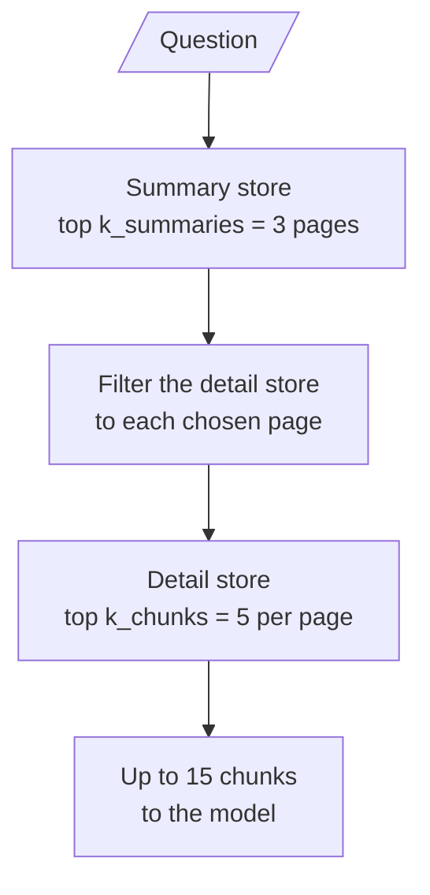

# M16.3 Theory: Hierarchical indices: summary tier and detail tier

*[M16 theory](../README.md) · Lesson 16.3 · Notebooks: [`03a_hierarchical_indices.ipynb`](../../../../course/p05_ingestion_and_indexing/m16_advanced_indexing/notebooks/03a_hierarchical_indices.ipynb) · [All theory pages](../../../README.md)*

## Top-down search

A hierarchical index has two tiers. The **summary tier** has one entry per page or section, and the **detail tier** has the ordinary chunks. Both carry the page number. A question first picks the best pages from the summary tier, then searches the detail tier only inside those pages.

<!-- animated: diagrams/top-down-search.anim.html -->

Notebook 03a builds both tiers from one PDF with `encode_pdf_hierarchical`:

- `PyPDFLoader` gives one Document per page. Each page is summarised with `load_summarize_chain(..., chain_type="map_reduce")` on `gpt-4o-mini`, five pages at a time with a one-second pause between batches and exponential backoff on rate limits.
- The pages are also split into detail chunks at `chunk_size=1000`, `chunk_overlap=200`, each tagged with `page`, `chunk_id` and `summary: False`.
- Each tier goes into its own FAISS store, saved to disk so the summaries are paid for once.

`retrieve_hierarchical(query, summary_store, detailed_store, k_summaries=3, k_chunks=5)` runs the summary search, then for each summary calls `similarity_search(query, k=5, filter=…)` with a filter that keeps only chunks whose `page` matches. The result is up to 15 chunks, grouped by page in the order the summary tier ranked the pages.

What the two tiers buy:

- **Pages compete as wholes.** A page summary says what the page is about, so a broad question ("What is the greenhouse effect?") lands on the right pages before any chunk-level detail is compared.
- **Chunks compete only with their neighbours.** A chunk with matching words on an unrelated page never enters the result.

And what they cost:

- **The summary tier caps recall.** If the right page is not in the top 3 summaries, its chunks are never searched, however well they would score. Log which pages the summary tier chose, so a miss can be traced to the tier that caused it.
- **Summaries are an index-time LLM bill and a staleness risk.** One summarisation per page, repeated whenever the page changes.
- **The result size is a product.** `k_summaries × k_chunks` is the number of chunks the model can receive, so changing either one changes the prompt budget.

For the Larkspur handbook, each section ("Refunds and cancellations", "Outages and service credits", "Data export and retention") would be one summary. *Do I get service credits automatically after an outage?* would pick the outage summary first and then compare only that section's chunks, so a refund chunk about "Credits from SLA breaches" cannot crowd it out.

## Check yourself

1. For the question about service credits after an outage, why can a refund chunk about credits from SLA breaches not crowd out the answer?

The question first picks the best section summaries, so the outage summary wins as a whole. The detail search then runs only inside the chosen pages, and chunks compete only with their neighbours. A chunk with matching words on an unrelated page never enters the result.

2. With 3 summaries and 5 chunks per summary, how many chunks can reach the model, and what happens if you raise the chunk count to 10?

Up to 15 chunks, because the result size is `k_summaries × k_chunks`. Raising `k_chunks` to 10 allows up to 30, so changing either number changes the prompt budget.

3. A chunk that would score well against the question never appears in the results. Which tier do you check first, and what should you log?

The summary tier. If the right page is not in the top 3 summaries, its chunks are never searched, however well they would score. Log which pages the summary tier chose, so a miss can be traced to the tier that caused it.

---
*Previous: [16.2 Parent-document retrieval, in memory and on Postgres](../02_parent_document_retrieval_in_memory_and_on_postgres/README.md). Next: [16.4 Question-side indexing: HyPE and document augmentation](../04_question_side_indexing_hype_and_document_augmentation/README.md).*
