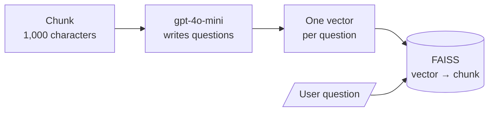

# M16.4 Theory: Question-side indexing: HyPE and document augmentation

*[M16 theory](../README.md) · Lesson 16.4 · Notebooks: [`04a_hypothetical_prompt_embeddings.ipynb`](../../../../course/p05_ingestion_and_indexing/m16_advanced_indexing/notebooks/04a_hypothetical_prompt_embeddings.ipynb), [`04b_document_augmentation.ipynb`](../../../../course/p05_ingestion_and_indexing/m16_advanced_indexing/optional/04b_document_augmentation.ipynb) (optional) · [All theory pages](../../../README.md)*

## HyPE

A question and the passage that answers it are written differently. *How long do I have to get a full refund on an annual plan?* is short and asks; the handbook sentence is long and states. Their embeddings sit apart even when the passage is the right one. **HyPE** (Hypothetical Prompt Embeddings) moves the work to index time: an LLM writes the questions each chunk answers, those questions are embedded as the chunk's search keys, and the chunk stays the payload. Retrieval becomes question-to-question matching.

Notebook 04a, step by step:

- The PDF is split at `chunk_size=1000`, `chunk_overlap=200`. The notebook keeps chunks large on purpose, since the questions, not the chunk text, carry the match.
- For each chunk, `gpt-4o-mini` at temperature 0 gets the prompt "Analyze the input text and generate essential questions that, when answered, capture the main points of the text", one question per line. The reply is split on newlines.
- Each question is embedded with `text-embedding-3-small`. The FAISS store (`IndexFlatL2`) receives one entry per question vector, each holding the full chunk text, so one chunk sits in the index once per question.
- Chunks are processed in parallel with a `ThreadPoolExecutor`. The retriever returns the top 3 entries, and the notebook removes repeats with `set(context)`, because three question vectors from the same chunk return that chunk three times.

The notebook cites the HyPE preprint for "up to 42 percentage points improvement in retrieval precision" and "up to 45 percentage points improvement in claim recall". Those are the authors' best cases across their datasets; the notebook does not reproduce them, so measure on your own golden set.

HyPE and HyDE (M18) attack the same gap from opposite ends:

| | HyDE (M18) | HyPE |
|---|---|---|
| What the LLM writes | A hypothetical answer to the user's question | Hypothetical questions for each chunk |
| When | At query time, on every request | At index time, once per chunk |
| Latency added to a query | One LLM call | None |
| Fails when | The fake answer drifts from the corpus | The generated questions miss how users ask |

For the Larkspur refund paragraph, good generated questions would include ones a customer types ("Can I get my money back on a yearly plan?") as well as the handbook's own wording. Review a sample of generated questions per document type, and regenerate a chunk's questions whenever its text changes.

## Document augmentation

Optional notebook 04b adds generated questions to the index as extra documents beside the original text, instead of replacing the chunk's key:

- The text is split twice: **documents** of 4,000 "tokens" with 100 overlap, the context unit, and **fragments** of 128 with 16 overlap, the search unit. Its `split_document` counts words matched by `\b\w+\b` and rejoins them with spaces, so the stored text loses its punctuation; use a real splitter if you adapt it.
- `gpt-4o-mini` writes at least `QUESTIONS_PER_DOCUMENT = 40` questions per document (or per fragment, with `QuestionGeneration.FRAGMENT_LEVEL`) through structured output. `clean_and_filter_questions` strips numbering and keeps only lines ending in "?".
- Fragments (`type: ORIGINAL`) and questions (`type: AUGMENTED`) go into one FAISS store, and every entry carries its whole parent document in `metadata["text"]`.
- The retriever returns the top 1 entry. Whether it is a fragment or a question, the notebook answers from `metadata["text"]`, the document of up to 4,000 words around it.

So 04b is the payload pattern from 16.2 with two kinds of key in one index. It keeps the original fragments searchable, which protects questions the LLM did not anticipate, and it pays for that with a larger index and a 4,000-word document as context for every answer.

## Key Takeaways

- HyPE embeds LLM-written questions as each chunk's keys, so retrieval matches question to question with no query-time LLM call. Remove repeats, since one chunk appears once per question.
- Measure HyPE on your own golden set rather than trusting published best cases. Review generated questions per document type and regenerate them when a chunk changes.
- Document augmentation keeps original fragments searchable beside generated questions, which covers questions the LLM did not anticipate, at the cost of a larger index.

## Check yourself

1. What gap does HyPE close, and how does its cost differ from HyDE's?

A question and the passage that answers it are written differently, so their embeddings sit apart. HyPE has an LLM write the questions each chunk answers at index time and embeds those as the chunk's keys, so retrieval becomes question-to-question matching with no LLM call at query time. HyDE writes a hypothetical answer at query time, one LLM call on every request.

2. Notebook 04a retrieves the top 3 entries and then removes repeats with a set. Why are there repeats?

The FAISS store holds one entry per generated question, each carrying the full chunk text, so one chunk sits in the index once per question. Three question vectors from the same chunk return that chunk three times.

3. Users ask in ways the generated questions never anticipate. Which variant protects you, and what does it cost?

Document augmentation (04b), which keeps the original fragments searchable beside the generated questions in one index. A question the LLM did not foresee can still match a fragment. It pays with a larger index and a document of up to 4,000 words as context for every answer.

---
*Previous: [16.3 Hierarchical indices: summary tier and detail tier](../03_hierarchical_indices_summary_tier_and_detail_tier/README.md). Next: [16.5 Context-aware chunks: contextual headers and contextual retrieval](../05_context_aware_chunks_contextual_headers_and_contextual_retrieval/README.md).*
