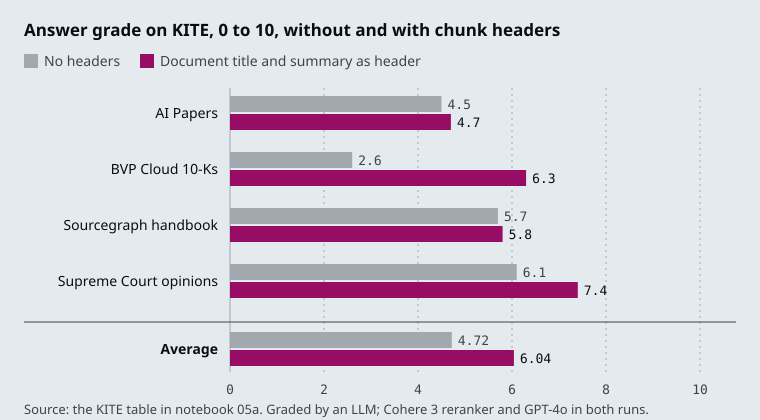
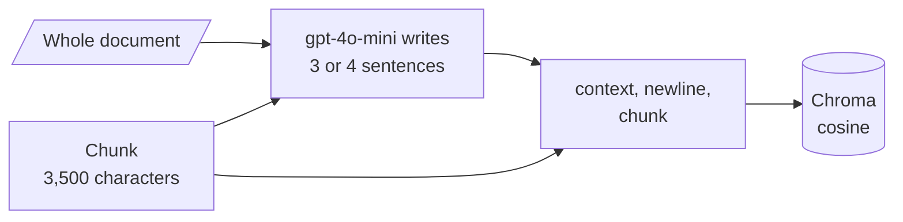

# M16.5 Theory: Context-aware chunks: contextual headers and contextual retrieval

*[M16 theory](../README.md) · Lesson 16.5 · Notebooks: [`05a_contextual_chunk_headers.ipynb`](../../../../course/p05_ingestion_and_indexing/m16_advanced_indexing/notebooks/05a_contextual_chunk_headers.ipynb), [`05b_contextual_retrieval_rag_system.ipynb`](../../../../course/p05_ingestion_and_indexing/m16_advanced_indexing/notebooks/05b_contextual_retrieval_rag_system.ipynb) · [All theory pages](../../../README.md)*

## Contextual chunk headers

Chunks lose their surroundings. A Larkspur chunk that reads "The credits are not added automatically. You claim them by opening a ticket in the Billing category within 30 days of the incident." never says which credits, and the section heading that would tell you, "Outages and service credits", ended up in a different chunk. At child size 150 in the M16 lab, that heading becomes a 27-character child of its own and outscores the body text for the outage question, because it holds the question's words and nothing else.

A **contextual chunk header** puts the missing context back into the chunk's text before embedding: the document title at minimum, and optionally a short document summary and the section path. Notebook 05a does it in three steps:

1. Split the document (Nike's 2023 annual report) with `RecursiveCharacterTextSplitter` at `chunk_size=800`, no overlap.
2. Ask `gpt-4o-mini` for the document's title, passing only the first 4,000 tokens with a note that the text is truncated.
3. Embed `f"Document Title: {document_title}\n\n{chunk_text}"` instead of the bare chunk.

The notebook measures one chunk, number 86, against the query "Nike climate change impact" with Cohere's `rerank-english-v3.0`. The chunk is about the effects of climate change but never says "Nike". The notebook reports a relevance of about 0.1 without the header and 0.92 with it.

It also reports results on KITE, an end-to-end benchmark of 50 questions over four document sets, graded 0 to 10 by an LLM, with the header made of the document title and a document summary:

The average rises from 4.72 to 6.04, a 27.9% increase by the notebook's figure. The gain is largest on the BVP Cloud 10-Ks (2.6 to 6.3) and smallest on the Sourcegraph handbook (5.7 to 5.8). On FinanceBench the notebook reports 83% against a 19% baseline, but for CCH and relevant segment extraction together, so the share due to headers is unknown.

Two rules from the notebook: use the same header-plus-chunk text in the reranker that you embedded, and show the header to the LLM with each result so it reads the chunk in context. For the handbook, the header can come from structure you already have: M13's `MarkdownHeaderTextSplitter` puts the section path in metadata, and M12 keeps titles in metadata, which is not embedded until you copy it into the text.

## Contextual retrieval

A header gives every chunk of a document the same context. **Contextual retrieval** asks an LLM to write context for each chunk, with the whole document in view: what this passage is about and where it sits. The context is prepended to the chunk, and the combined text is what gets embedded and returned.

Notebook 05b builds a small RAG system this way. PDF pages are loaded with `PyMuPDFLoader` and split at `chunk_size=3500` with no overlap. For every chunk, `generate_chunk_context` sends the full document and the chunk to `gpt-4o-mini` with instructions to "Provide a concise context (3-4 sentences max) for this chunk", phrased as "Focuses on …". The context and chunk go into Chroma with `hnsw:space` set to cosine, next to Wikipedia documents indexed without context, and a `k=5` similarity retriever feeds a "stuff" prompt. The notebook gives context to only two of the twelve sample PDFs (the file names must contain "attention", "transformer" or "vision"), because the whole document has to fit in the prompt; its note says this is "to handle GPT4 out of context error".

Anthropic introduced the technique in [Introducing Contextual Retrieval](https://www.anthropic.com/news/contextual-retrieval) (September 2024). Its example adds "This chunk is from an SEC filing on ACME corp's performance in Q2 2023; the previous quarter's revenue was $314 million." before the chunk "The company's revenue grew by 3% over the previous quarter." Its reported results, on its own datasets:

- "Contextual Embeddings reduced the top-20-chunk retrieval failure rate by 35% (5.7% → 3.7%)."
- "Combining Contextual Embeddings and Contextual BM25 reduced the top-20-chunk retrieval failure rate by 49% (5.7% → 2.9%)."
- "Reranked Contextual Embedding and Contextual BM25 reduced the top-20-chunk retrieval failure rate by 67% (5.7% → 1.9%)."

The post says the context is "usually 50-100 tokens" and is prepended "before embedding it and before creating the BM25 index", so the keyword index (M17) benefits as well. On cost, it relies on prompt caching so that each document is loaded into the cache once and reused for its chunks; with its stated assumptions, "the one-time cost to generate contextualized chunks is $1.02 per million document tokens".

| | Contextual chunk header (05a) | Contextual retrieval (05b) |
|---|---|---|
| Context per chunk | The same title or summary for the whole document | Written for each chunk |
| LLM calls at index time | One per document, or none if titles exist | One per chunk, with the document in the prompt |
| Limit | Cannot say where in the document a chunk sits | The document must fit the model's context window |
| Start here when | Chunks lose their subject (company, product, section) | Headers are not enough on the golden set |

## Check yourself

1. Chunk 86 of the Nike report scores about 0.1 against Nike climate change impact without a header and 0.92 with one. Why?

The chunk is about the effects of climate change but never says "Nike". The header prepends `Document Title: ...` to the chunk text, so the company name is part of what gets embedded and reranked.

2. The Larkspur chunk about claiming credits within 30 days never says which credits. What header would you add, and where does it come from?

The document title and the section path, "Outages and service credits". M13's `MarkdownHeaderTextSplitter` already puts the section path in metadata, and M12 keeps titles there, but metadata is not embedded until you copy it into the text. Use the same header-plus-chunk text in the reranker and show it to the LLM with each result.

3. Headers are not enough on your golden set, so you consider contextual retrieval. What does it cost, and what limits it?

One LLM call per chunk, each with the whole document in the prompt; Anthropic relies on prompt caching to bring this to $1.02 per million document tokens under its stated assumptions. The document must fit the model's context window, which is why notebook 05b contextualises only two of its twelve sample PDFs.

---
*Previous: [16.4 Question-side indexing: HyPE and document augmentation](../04_question_side_indexing_hype_and_document_augmentation/README.md). Next: [M16 interview questions](../README.md#interview-spotlight-5-questions-you-might-get-asked).*
