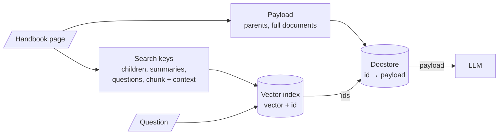

# M16 Theory: Advanced indexing strategies

*Part V · The Ingestion & Indexing Pipeline · [Module README](../../../course/p05_ingestion_and_indexing/m16_advanced_indexing/README.md) · [All theory pages](../../README.md)*

Plain RAG embeds a chunk, matches the question against it and sends that same chunk to the model. M16 separates the two jobs: the text that gets embedded and matched, and the text the model reads, joined by an id. The M16 notebooks build on four ideas: the search key and the payload, the docstore that holds payloads, hypothetical questions as search keys (HyPE), and context written into each chunk before it is embedded (contextual retrieval). Each idea has a page in the folder of the lesson that teaches it, listed under [Lessons](#lessons). This page has the overview, the interview questions and the takeaways.

The running example is one 2,184-character page of the Larkspur Cloud handbook with three sections: "Refunds and cancellations" (the M13 section), "Outages and service credits" and "Data export and retention". It has three golden questions: *How long do I have to get a full refund on an annual plan?*, *Do I get service credits automatically after an outage?* and *What happens to my data after I cancel my plan?*

## TL;DR

- **The search key and the payload can differ.** The key is whatever gets embedded: a small child chunk, a summary, a list of generated questions, or a chunk with context prepended. The payload is what the model reads: a parent chunk, a whole document, the original chunk. An id stored with each key points at its payload.
- **Parent-document retrieval searches small and returns large.** In the lab at child 150 and parent 600, the top 2 children contain the whole answer for 0 of the 3 golden questions (about 53 tokens on average); their parents contain it for 3 of 3 (about 206 tokens).
- **Parent size is a cost dial with an edge.** With the whole page as the parent, every question costs 546 tokens. With parents of 400 characters, the parent splitter cuts the outage answer in two, and no parent returns it whole.
- **An LLM can write the key at index time.** Summaries (16.1, 16.3) and hypothetical questions (16.4) cost one LLM call per chunk or document, paid once, and are only as good as what the LLM kept.
- **Context in the chunk fixes chunks that never name their subject.** In notebook 05a a document title raises a chunk's reranker relevance from about 0.1 to 0.92. Anthropic reports that contextual embeddings reduced top-20 retrieval failures by 35%, and by 49% with contextual BM25.

## Mental model

<!-- animated: diagrams/key-and-payload.anim.html -->

At index time the document is written twice: once as payloads into the docstore and once as search keys into the vector index, each key carrying its payload's id. At query time the question meets only the keys, and the model meets only the payloads. Every technique in M16 is a choice of key, a choice of payload, or both; the retrieval code in between stays the same.

## Lessons

| Lesson | Topic | Theory |
|---|---|---|
| 16.1 | Multi-representation indexing: search summaries, return documents | [Search key vs payload](01_multi_representation_indexing_search_summaries_return_documents/README.md#search-key-vs-payload) |
| 16.2 | Parent-document retrieval, in memory and on Postgres | [Docstore](02_parent_document_retrieval_in_memory_and_on_postgres/README.md#docstore) [Choosing child and parent sizes](02_parent_document_retrieval_in_memory_and_on_postgres/README.md#choosing-child-and-parent-sizes) |
| 16.3 | Hierarchical indices: summary tier and detail tier | [Top-down search](03_hierarchical_indices_summary_tier_and_detail_tier/README.md#top-down-search) |
| 16.4 | Question-side indexing: HyPE and document augmentation | [HyPE](04_question_side_indexing_hype_and_document_augmentation/README.md#hype) [Document augmentation](04_question_side_indexing_hype_and_document_augmentation/README.md#document-augmentation) |
| 16.5 | Context-aware chunks: contextual headers and contextual retrieval | [Contextual chunk headers](05_context_aware_chunks_contextual_headers_and_contextual_retrieval/README.md#contextual-chunk-headers) [Contextual retrieval](05_context_aware_chunks_contextual_headers_and_contextual_retrieval/README.md#contextual-retrieval) |

## Interactive lab

[**Search small, return large**](02_parent_document_retrieval_in_memory_and_on_postgres/interactive/search-small-return-large-lab.html): open the file in a browser. Start at **150 and 600** and read the table at the bottom: children alone find 0 of 3 answers, their parents find 3 of 3. Then pick the outage question and click **150 and 400** to watch the parent boundary cut the answer, and **400 and the whole page** to see every question cost 546 tokens.

## How it connects

- **Before:** [M13](../m13_chunking/README.md) ends on the trade-off this module resolves: small chunks match precisely, large ones keep facts whole. [M14](../m14_embeddings/README.md) turns each chunk into one vector, so a chunk that mixes topics gets a vector that averages them. M15 stores the vectors; the docstore here sits beside that vector store and needs the same care when documents change.
- **Next:** [M17](../../p06_retrieval_quality/m17_retrievers_hybrid_search/README.md) builds BM25 indexes, which take contextual chunks as readily as embeddings do (Anthropic's contextual BM25). M18 writes hypothetical answers at query time (HyDE), the mirror image of HyPE. M19 reranks what the retriever returns, and any reranker must score the same text that was embedded, header included.

## Interview Spotlight: 5 Questions You Might Get Asked

*Production questions of the kind asked in applied AI engineering interviews.*

### 1. You switched the Larkspur support bot to parent-document retrieval with no parent splitter. Hit rate went up, but cost per answer tripled and outage answers now quote refund rules. What happened, and what do you change?

**What a strong answer covers:**
- Without a `parent_splitter` the parent is the whole document, so every question sends the full page (546 tokens in the lab) whatever the match was
- The model now reads three topics for every question and borrows from the wrong one; the hit rate rose because the answer is somewhere in the page, not because retrieval got sharper
- Adds a parent splitter sized to the handbook's sections (or uses section boundaries from M13's structure-aware splitting), then re-measures hit rate, faithfulness and tokens per answer together
- Checks that no parent boundary cuts a golden answer, because a parent that is too small fails the same way a child does

### 2. The handbook team asks whether to index summaries of each section, small child chunks with their parents, or LLM-generated questions per chunk. How do you choose?

**What a strong answer covers:**
- Children with parents need no LLM at index time and keep every literal detail searchable; start there
- Summaries help when sections are long and questions are about what a section covers, but a summary can drop the "100 GB" condition, and then no question about it matches
- Generated questions suit short, question-shaped traffic such as support tickets; they cost one LLM call per chunk and must be regenerated when the text changes
- Decides on the golden set with the M11 baseline row, one change at a time, and keeps the cheapest key that matches the best result

### 3. You added contextual chunk headers to the handbook index. How do you show they helped, and how would you notice if they started to hurt?

**What a strong answer covers:**
- Re-runs the same golden questions against the M11 baseline and reports hit rate, answer quality and tokens per answer side by side, as the M16 lab brief asks
- Adds questions that name the subject only in the heading ("Do outage credits apply automatically?") because headers help exactly those chunks
- Confirms the reranker and the prompt see the same header text that was embedded
- Watches for headers that dominate short chunks: if many children now score alike because they share a title, precision falls, so header length belongs in the measurement

### 4. After a nightly re-index the bot answers some questions with no context at all, and a week later other questions return two copies of the same parent. The vector store looks healthy. Where do you look?

**What a strong answer covers:**
- The docstore and the vector index are two stores tied only by ids; children whose parent ids are missing from the docstore come back as nothing, because the retriever drops `None` values
- An `InMemoryStore` docstore is lost on restart while a persistent vector store survives; the docstore needs persistence too (notebook 02b moves it to Postgres)
- `add_documents(..., ids=None)` mints new UUIDs on every call, so re-running ingestion adds a second set of parents and children instead of replacing the first
- Fixes it with stable ids per parent, deletes of a document's children and parent together, and a check after each run that every child's parent id resolves

### 5. Contextual retrieval needs an LLM call per chunk with the whole document in the prompt. The handbook has 3,000 pages and changes weekly. Is it worth it, and how do you keep the cost down?

**What a strong answer covers:**
- Anthropic reports failure reductions of 35% for contextual embeddings and 49% with contextual BM25, on its own datasets; it still has to win on the handbook's golden set
- Prompt caching puts the document in cache once per document instead of once per chunk; Anthropic puts the one-time cost at $1.02 per million document tokens under its stated assumptions
- Regenerates context only for documents that changed, keyed by a content hash, so a weekly update does not re-run 3,000 pages
- Compares against the cheap version first: a header with the document and section title costs no LLM call per chunk and may close most of the gap

## Key Takeaways

- Decide the search key and the payload separately. The key should match the questions people ask; the payload should hold everything the answer needs.
- Size the parent for the answer, not for the document. Check on the golden set that no parent boundary cuts an answer, and count the tokens every parent costs.
- Treat the docstore as production storage: persistent, keyed by stable ids, updated and deleted together with the vector index.
- Keys written by an LLM (summaries, questions, context) are paid for at index time and can omit facts. Measure them against the plain index before you pay for them on every document.

---
*Previous: [M15 Vector stores](../m15_vector_stores/README.md). Next: [M17 Retrievers and hybrid search](../../p06_retrieval_quality/m17_retrievers_hybrid_search/README.md).*
